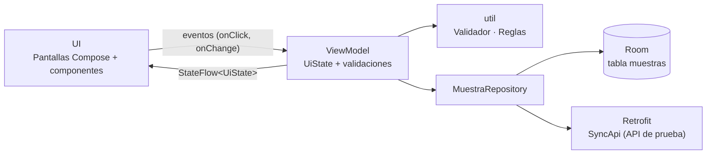
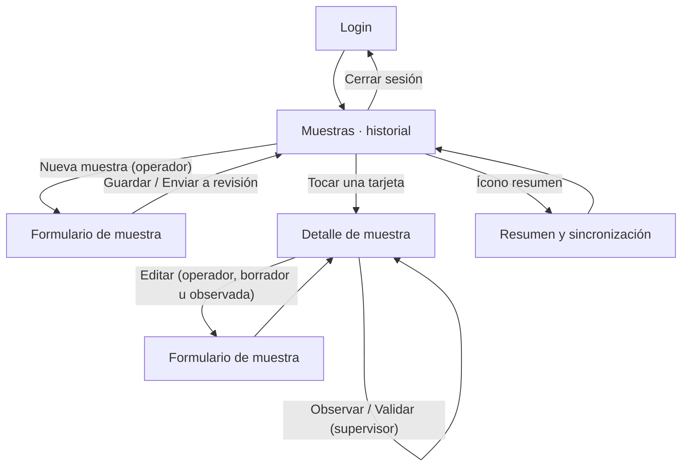

# AquaSample — Registro y trazabilidad de muestras de choritos

Guía paso a paso para reconstruir el MVP académico **AquaSample** (caso ALDEMAR SpA, asignatura DSY1105).

> Esta guía está escrita para ti, estudiante. Cada etapa produce un avance visible y termina con un checkpoint que compila. Si te saltas una etapa, la siguiente no compilará.

---

## 1. Introducción

### La problemática

ALDEMAR SpA presta servicios a la industria acuícola. En el muestreo de líneas de cultivo de choritos, un operador corta un tramo de cuerda (por ejemplo 20 cm), lo pone sobre una mesa, cuenta los individuos, anota datos, saca fotos y luego consolida todo en planillas para que un supervisor lo revise.

Hoy ese trabajo es manual y disperso: la información queda repartida entre planillas, fotos y notas. Eso genera conteos distintos, registros incompletos y dificulta seguir el historial de una misma línea de cultivo.

### El objetivo

Construir una app Android que permita **registrar una muestra en terreno con su fotografía, validarla, guardarla localmente, revisarla como supervisor y consultar el historial**, todo con datos ficticios.

### La solución propuesta

Una app Jetpack Compose con arquitectura MVVM, persistencia local en Room (funciona sin internet), cámara/galería para la evidencia fotográfica, flujo de revisión por estados (borrador → pendiente → observado/corregido → validado) y una sincronización simulada con Retrofit hacia una API de prueba.

### Qué aprenderás

- Organizar una app real con MVVM: `model`, `data`, `viewmodel`, `ui`, `navigation`, `util`.
- Manejar estado con `StateFlow` y una `data class UiState` por pantalla.
- Validar formularios desde el ViewModel y mostrar errores en Material 3.
- Persistir con Room (Entity, DAO, Database, Repository) y observar cambios con `Flow`.
- Usar la cámara y la galería con `ActivityResultContracts` y `FileProvider`.
- Consumir una API REST con Retrofit manejando Loading / Success / Error.
- Escribir pruebas unitarias de validaciones y reglas de negocio.
- Generar un APK debug y un APK release firmado.

---

## 2. Resultado esperado

Al terminar, tu aplicación podrá:

1. Iniciar sesión con usuarios ficticios de tres roles: operador, supervisor y analista.
2. Mostrar el historial de muestras con búsqueda por texto y filtro por estado.
3. Crear una muestra: centro, tren, línea, tramo en cm, conteo con botones +1/+10, calibre opcional, observaciones y fotografía (cámara o galería).
4. Guardar como borrador o enviar a revisión; al enviar exige conteo mayor a 0 y foto.
5. Como supervisor, abrir una muestra pendiente y **validarla** u **observarla** con un comentario obligatorio.
6. Como operador, corregir una muestra observada y reenviarla (pasa a "Corregido").
7. Ver un resumen con indicadores (total de muestras, individuos, densidad promedio por metro) y sincronizar las validadas hacia una API de prueba, mostrando cargando / éxito / error.
8. Seguir funcionando sin internet: todo se guarda en Room; solo la sincronización requiere conexión.

Usuarios de prueba (clave `1234` para todos):

| Código | Rol |
|---|---|
| `OP-01`, `OP-02` | Operador de muestreo |
| `SUP-01` | Supervisor técnico |
| `AN-01` | Analista de reportes |

---

## 3. Arquitectura

MVVM simple. La UI solo dibuja el estado y envía eventos; el ViewModel valida, decide y conversa con el repositorio; el repositorio es el único que toca Room y Retrofit.



Decisiones clave:

- **Un UiState por pantalla** (`data class`) expuesto como `StateFlow`. La UI lo recoge con `collectAsStateWithLifecycle()`.
- **Sin librería de inyección de dependencias.** La clase `AquaSampleApp` crea una sola vez la base de datos y el repositorio; `Fabricas` entrega los ViewModels con sus parámetros.
- **Sesión en memoria.** `AuthViewModel` vive en la Activity y guarda el usuario logueado para todas las pantallas.
- **Reglas de negocio en `util/Reglas.kt`**, separadas de la UI, para poder probarlas con JUnit.

---

## 4. Flujo de navegación



Rutas de Navigation Compose:

| Ruta | Pantalla |
|---|---|
| `login` | `LoginScreen` |
| `muestras` | `MuestrasScreen` |
| `form/{id}` | `MuestraFormScreen` (`id = 0` crea, otro `id` edita) |
| `detalle/{id}` | `DetalleScreen` |
| `resumen` | `ResumenScreen` |

---

## 5. Tecnologías utilizadas

| Tecnología | Para qué se usa | Versión |
|---|---|---|
| Kotlin | Lenguaje | 2.0.21 |
| Android Gradle Plugin | Compilación | 8.7.3 |
| Jetpack Compose + Material 3 | Interfaz | BOM 2024.12.01 |
| Navigation Compose | Navegación entre pantallas | 2.8.5 |
| Lifecycle ViewModel / StateFlow | Estado y lógica | 2.8.7 |
| Room + KSP | Persistencia local SQLite | 2.6.1 |
| Retrofit + Gson | Sincronización REST simulada | 2.11.0 |
| Coil | Mostrar la fotografía guardada | 2.7.0 |
| ActivityResult (cámara / galería) | Recurso nativo de fotografía | activity 1.9.3 |
| JUnit 4 | Pruebas unitarias | 4.13.2 |

Requisitos de herramientas: Android Studio Ladybug o superior, JDK 17, Gradle 8.9 (lo descarga el wrapper), `compileSdk 35`, `minSdk 26`.

---

## 6. Estructura final del proyecto

```
AquaSample/
├── app/
│   ├── build.gradle.kts
│   └── src/
│       ├── main/
│       │   ├── AndroidManifest.xml
│       │   ├── res/
│       │   │   ├── drawable/ic_launcher.xml
│       │   │   ├── values/strings.xml
│       │   │   ├── values/themes.xml
│       │   │   └── xml/file_paths.xml
│       │   └── java/cl/duoc/aquasample/
│       │       ├── AquaSampleApp.kt
│       │       ├── MainActivity.kt
│       │       ├── data/
│       │       │   ├── local/AppDatabase.kt
│       │       │   ├── local/MuestraDao.kt
│       │       │   ├── remote/SyncApi.kt
│       │       │   └── repository/MuestraRepository.kt
│       │       ├── model/
│       │       │   ├── DatosDemo.kt
│       │       │   ├── EstadoMuestra.kt
│       │       │   ├── Muestra.kt
│       │       │   └── Usuario.kt
│       │       ├── navigation/AppNavigation.kt
│       │       ├── ui/
│       │       │   ├── components/CamposFormulario.kt
│       │       │   ├── components/Componentes.kt
│       │       │   ├── screens/LoginScreen.kt
│       │       │   ├── screens/MuestrasScreen.kt
│       │       │   ├── screens/MuestraFormScreen.kt
│       │       │   ├── screens/DetalleScreen.kt
│       │       │   ├── screens/ResumenScreen.kt
│       │       │   └── theme/Theme.kt
│       │       ├── util/
│       │       │   ├── Formato.kt
│       │       │   ├── Fotos.kt
│       │       │   ├── Reglas.kt
│       │       │   └── Validador.kt
│       │       └── viewmodel/
│       │           ├── AuthViewModel.kt
│       │           ├── DetalleViewModel.kt
│       │           ├── Fabricas.kt
│       │           ├── MuestraFormViewModel.kt
│       │           ├── MuestrasViewModel.kt
│       │           └── ResumenViewModel.kt
│       └── test/java/cl/duoc/aquasample/
│           ├── ReglasTest.kt
│           └── ValidadorTest.kt
├── gradle/libs.versions.toml
├── build.gradle.kts
├── settings.gradle.kts
└── GUIA_PROYECTO.md
```

Son 29 archivos Kotlin de código más 2 de pruebas. Ninguno supera las 200 líneas.

---

## 7. Desarrollo paso a paso

Checkpoints sugeridos (haz un commit al terminar cada etapa):

| Etapa | Checkpoint |
|---|---|
| 1 | `checkpoint-01-proyecto-base` |
| 2 | `checkpoint-02-modelos` |
| 3 | `checkpoint-03-reglas-validaciones` |
| 4 | `checkpoint-04-login-navigation` |
| 5 | `checkpoint-05-room` |
| 6 | `checkpoint-06-historial` |
| 7 | `checkpoint-07-formulario` |
| 8 | `checkpoint-08-foto` |
| 9 | `checkpoint-09-revision` |
| 10 | `checkpoint-10-resumen-sync` |
| 11 | `checkpoint-11-testing` |
| 12 | `checkpoint-12-apk` |

---

### Etapa 1 — Crear el proyecto base

#### Objetivo

Tener un proyecto Compose que compila, con todas las dependencias del semestre ya declaradas y la paleta de colores definida.

#### Archivos

- `settings.gradle.kts`
- `build.gradle.kts` (raíz)
- `gradle/libs.versions.toml`
- `app/build.gradle.kts`
- `app/src/main/AndroidManifest.xml`
- `app/src/main/res/values/themes.xml`, `strings.xml`, `drawable/ic_launcher.xml`
- `app/src/main/java/cl/duoc/aquasample/ui/theme/Theme.kt`
- `app/src/main/java/cl/duoc/aquasample/MainActivity.kt`

#### Paso 1 — Crea el proyecto en Android Studio

1. **File → New → New Project → Empty Activity** (la plantilla Compose).
2. Name: `AquaSample`. Package name: `cl.duoc.aquasample`. Minimum SDK: **API 26**. Build configuration language: **Kotlin DSL**.
3. Espera a que termine la sincronización de Gradle.

> 📷 CAPTURA 01 — Proyecto creado en Android Studio.

#### Paso 2 — Reemplaza el catálogo de versiones

Abre `gradle/libs.versions.toml` y deja exactamente este contenido:

```toml
[versions]
agp = "8.7.3"
kotlin = "2.0.21"
ksp = "2.0.21-1.0.28"
coreKtx = "1.15.0"
lifecycle = "2.8.7"
activityCompose = "1.9.3"
composeBom = "2024.12.01"
navigation = "2.8.5"
room = "2.6.1"
retrofit = "2.11.0"
coil = "2.7.0"
junit = "4.13.2"

[libraries]
androidx-core-ktx = { group = "androidx.core", name = "core-ktx", version.ref = "coreKtx" }
androidx-lifecycle-runtime-ktx = { group = "androidx.lifecycle", name = "lifecycle-runtime-ktx", version.ref = "lifecycle" }
androidx-lifecycle-viewmodel-compose = { group = "androidx.lifecycle", name = "lifecycle-viewmodel-compose", version.ref = "lifecycle" }
androidx-lifecycle-runtime-compose = { group = "androidx.lifecycle", name = "lifecycle-runtime-compose", version.ref = "lifecycle" }
androidx-activity-compose = { group = "androidx.activity", name = "activity-compose", version.ref = "activityCompose" }
androidx-compose-bom = { group = "androidx.compose", name = "compose-bom", version.ref = "composeBom" }
androidx-ui = { group = "androidx.compose.ui", name = "ui" }
androidx-ui-tooling = { group = "androidx.compose.ui", name = "ui-tooling" }
androidx-ui-tooling-preview = { group = "androidx.compose.ui", name = "ui-tooling-preview" }
androidx-material3 = { group = "androidx.compose.material3", name = "material3" }
androidx-material-icons-extended = { group = "androidx.compose.material", name = "material-icons-extended" }
androidx-navigation-compose = { group = "androidx.navigation", name = "navigation-compose", version.ref = "navigation" }
androidx-room-runtime = { group = "androidx.room", name = "room-runtime", version.ref = "room" }
androidx-room-ktx = { group = "androidx.room", name = "room-ktx", version.ref = "room" }
androidx-room-compiler = { group = "androidx.room", name = "room-compiler", version.ref = "room" }
retrofit = { group = "com.squareup.retrofit2", name = "retrofit", version.ref = "retrofit" }
retrofit-gson = { group = "com.squareup.retrofit2", name = "converter-gson", version.ref = "retrofit" }
coil-compose = { group = "io.coil-kt", name = "coil-compose", version.ref = "coil" }
junit = { group = "junit", name = "junit", version.ref = "junit" }

[plugins]
android-application = { id = "com.android.application", version.ref = "agp" }
kotlin-android = { id = "org.jetbrains.kotlin.android", version.ref = "kotlin" }
kotlin-compose = { id = "org.jetbrains.kotlin.plugin.compose", version.ref = "kotlin" }
ksp = { id = "com.google.devtools.ksp", version.ref = "ksp" }
```

#### Paso 3 — Archivos Gradle

`build.gradle.kts` (raíz):

```kotlin
plugins {
    alias(libs.plugins.android.application) apply false
    alias(libs.plugins.kotlin.android) apply false
    alias(libs.plugins.kotlin.compose) apply false
    alias(libs.plugins.ksp) apply false
}
```

`settings.gradle.kts` (la plantilla ya lo genera así; comprueba que incluya `google()` y `mavenCentral()` y `rootProject.name = "AquaSample"`).

`app/build.gradle.kts` completo:

```kotlin
import java.util.Properties

plugins {
    alias(libs.plugins.android.application)
    alias(libs.plugins.kotlin.android)
    alias(libs.plugins.kotlin.compose)
    alias(libs.plugins.ksp)
}

// Lee los datos de firma desde keystore.properties (NO se sube a Git). Se usa en la Etapa 12.
val keystoreFile = rootProject.file("keystore.properties")
val keystoreProps = Properties().apply {
    if (keystoreFile.exists()) load(keystoreFile.inputStream())
}

android {
    namespace = "cl.duoc.aquasample"
    compileSdk = 35

    defaultConfig {
        applicationId = "cl.duoc.aquasample"
        minSdk = 26
        targetSdk = 35
        versionCode = 1
        versionName = "1.0"
        testInstrumentationRunner = "androidx.test.runner.AndroidJUnitRunner"
    }

    signingConfigs {
        create("release") {
            if (keystoreFile.exists()) {
                storeFile = rootProject.file(keystoreProps["storeFile"] as String)
                storePassword = keystoreProps["storePassword"] as String
                keyAlias = keystoreProps["keyAlias"] as String
                keyPassword = keystoreProps["keyPassword"] as String
            }
        }
    }

    buildTypes {
        release {
            isMinifyEnabled = false
            if (keystoreFile.exists()) signingConfig = signingConfigs.getByName("release")
        }
    }
    compileOptions {
        sourceCompatibility = JavaVersion.VERSION_17
        targetCompatibility = JavaVersion.VERSION_17
    }
    kotlinOptions {
        jvmTarget = "17"
    }
    buildFeatures {
        compose = true
    }
}

dependencies {
    implementation(libs.androidx.core.ktx)
    implementation(libs.androidx.lifecycle.runtime.ktx)
    implementation(libs.androidx.lifecycle.viewmodel.compose)
    implementation(libs.androidx.lifecycle.runtime.compose)
    implementation(libs.androidx.activity.compose)

    implementation(platform(libs.androidx.compose.bom))
    implementation(libs.androidx.ui)
    implementation(libs.androidx.ui.tooling.preview)
    implementation(libs.androidx.material3)
    implementation(libs.androidx.material.icons.extended)
    debugImplementation(libs.androidx.ui.tooling)

    implementation(libs.androidx.navigation.compose)

    implementation(libs.androidx.room.runtime)
    implementation(libs.androidx.room.ktx)
    ksp(libs.androidx.room.compiler)

    implementation(libs.retrofit)
    implementation(libs.retrofit.gson)

    implementation(libs.coil.compose)

    testImplementation(libs.junit)
}
```

Presiona **Sync Now**.

#### Paso 4 — Recursos y manifiesto

Borra de la plantilla los archivos `ui/theme/Color.kt` y `ui/theme/Type.kt`, y las carpetas `res/mipmap-*` (usaremos un ícono vectorial simple). Deja `res/values/strings.xml` así:

```xml
<resources>
    <string name="app_name">AquaSample</string>
</resources>
```

`res/values/themes.xml`:

```xml
<resources>
    <style name="Theme.AquaSample" parent="android:Theme.Material.Light.NoActionBar" />
</resources>
```

Crea `res/drawable/ic_launcher.xml` (gota blanca sobre círculo azul):

```xml
<?xml version="1.0" encoding="utf-8"?>
<vector xmlns:android="http://schemas.android.com/apk/res/android"
    android:width="48dp"
    android:height="48dp"
    android:viewportWidth="48"
    android:viewportHeight="48">
    <path
        android:fillColor="#0B4F6C"
        android:pathData="M24,0a24,24 0,1 1,0 48a24,24 0,1 1,0 -48z" />
    <path
        android:fillColor="#FFFFFF"
        android:pathData="M24,9C24,9 14,21 14,28a10,10 0,0 0,20 0C34,21 24,9 24,9z" />
</vector>
```

`AndroidManifest.xml` (versión inicial; en las etapas 5 y 8 agregarás `android:name` y el `provider`):

```xml
<?xml version="1.0" encoding="utf-8"?>
<manifest xmlns:android="http://schemas.android.com/apk/res/android">

    <!-- Necesario para la sincronización con la API de prueba (Retrofit) -->
    <uses-permission android:name="android.permission.INTERNET" />

    <application
        android:allowBackup="true"
        android:icon="@drawable/ic_launcher"
        android:label="@string/app_name"
        android:supportsRtl="true"
        android:theme="@style/Theme.AquaSample">

        <activity
            android:name=".MainActivity"
            android:exported="true"
            android:windowSoftInputMode="adjustResize">
            <intent-filter>
                <action android:name="android.intent.action.MAIN" />
                <category android:name="android.intent.category.LAUNCHER" />
            </intent-filter>
        </activity>
    </application>
</manifest>
```

#### Paso 5 — Tema y paleta

Reemplaza `ui/theme/Theme.kt`:

```kotlin
package cl.duoc.aquasample.ui.theme

import androidx.compose.material3.MaterialTheme
import androidx.compose.material3.lightColorScheme
import androidx.compose.runtime.Composable
import androidx.compose.ui.graphics.Color

// Paleta pequeña inspirada en el mar
val AzulMar = Color(0xFF0B4F6C)     // primario
val Turquesa = Color(0xFF20A39E)    // secundario
val Fondo = Color(0xFFF4F7F9)
val Superficie = Color(0xFFFFFFFF)
val Exito = Color(0xFF2E7D32)
val Advertencia = Color(0xFFED8C00)
val ErrorRojo = Color(0xFFC62828)

private val Colores = lightColorScheme(
    primary = AzulMar,
    onPrimary = Color.White,
    secondary = Turquesa,
    onSecondary = Color.White,
    background = Fondo,
    surface = Superficie,
    error = ErrorRojo
)

@Composable
fun AquaSampleTheme(content: @Composable () -> Unit) {
    MaterialTheme(colorScheme = Colores, content = content)
}
```

#### Paso 6 — MainActivity provisional

```kotlin
package cl.duoc.aquasample

import android.os.Bundle
import androidx.activity.ComponentActivity
import androidx.activity.compose.setContent
import androidx.activity.enableEdgeToEdge
import androidx.compose.material3.Text
import cl.duoc.aquasample.ui.theme.AquaSampleTheme

class MainActivity : ComponentActivity() {
    override fun onCreate(savedInstanceState: Bundle?) {
        super.onCreate(savedInstanceState)
        enableEdgeToEdge()
        setContent {
            AquaSampleTheme { Text("AquaSample") }
        }
    }
}
```

#### Explicación

- El catálogo `libs.versions.toml` centraliza versiones: todo el equipo usa las mismas.
- `ksp` es el procesador de anotaciones que genera el código de Room.
- `material-icons-extended` nos da íconos como cámara, galería y gráfico sin dibujarlos.
- El bloque `signingConfigs` ya queda listo para la firma del APK release; mientras no exista `keystore.properties`, no hace nada.

#### Resultado esperado

La app se instala y muestra el texto "AquaSample" en pantalla.

> 📷 CAPTURA 02 — Estructura de paquetes vacía y app ejecutándose con el texto inicial.

#### Verificación

- [ ] Gradle sincroniza sin errores.
- [ ] La app compila y se ejecuta en el emulador.
- [ ] No quedan referencias a `@mipmap/ic_launcher` ni a `Color.kt` / `Type.kt`.

#### Error frecuente

`Unsupported class file major version` o `Incompatible Gradle JVM`: en **File → Settings → Build Tools → Gradle → Gradle JDK** selecciona un JDK 17. Con JDK 21 o superior AGP 8.7.3 puede fallar.

---

### Etapa 2 — Modelos y catálogos de prueba

#### Objetivo

Definir los datos del dominio: muestra, estado de revisión, usuario con rol y catálogos ficticios.

#### Archivos

- `model/EstadoMuestra.kt`
- `model/Usuario.kt`
- `model/Muestra.kt`
- `model/DatosDemo.kt`
- `util/Formato.kt`

#### Paso 1 — Estados de revisión

`model/EstadoMuestra.kt`:

```kotlin
package cl.duoc.aquasample.model

enum class EstadoMuestra(val etiqueta: String) {
    BORRADOR("Borrador"),
    PENDIENTE("Pendiente"),
    OBSERVADO("Observado"),
    CORREGIDO("Corregido"),
    VALIDADO("Validado")
}
```

#### Paso 2 — Usuario y rol

`model/Usuario.kt`:

```kotlin
package cl.duoc.aquasample.model

enum class Rol(val etiqueta: String) {
    OPERADOR("Operador de muestreo"),
    SUPERVISOR("Supervisor técnico"),
    ANALISTA("Analista de reportes")
}

data class Usuario(
    val codigo: String,
    val nombre: String,
    val clave: String,
    val rol: Rol
)
```

#### Paso 3 — La muestra (ya anotada para Room)

`model/Muestra.kt`:

```kotlin
package cl.duoc.aquasample.model

import androidx.room.Entity
import androidx.room.PrimaryKey

/** Una muestra de choritos tomada de un tramo de línea de cultivo. */
@Entity(tableName = "muestras")
data class Muestra(
    @PrimaryKey(autoGenerate = true) val id: Long = 0,
    val fechaHora: Long,              // milisegundos (System.currentTimeMillis)
    val centro: String,
    val tren: String,
    val linea: String,
    val tramoCm: Int,
    val operador: String,             // código ficticio del operador
    val conteo: Int,
    val calibreMm: Double? = null,    // opcional
    val fotoPath: String? = null,     // ruta del archivo en almacenamiento interno
    val observaciones: String = "",
    val estado: EstadoMuestra = EstadoMuestra.BORRADOR,
    val comentarioSupervisor: String = "",
    val sincronizada: Boolean = false
)
```

#### Paso 4 — Catálogos ficticios

`model/DatosDemo.kt`:

```kotlin
package cl.duoc.aquasample.model

/**
 * Datos FICTICIOS para el MVP académico.
 * No usar nombres, RUT ni datos reales de trabajadores o centros.
 */
object DatosDemo {

    val usuarios = listOf(
        Usuario("OP-01", "Operador Uno", "1234", Rol.OPERADOR),
        Usuario("OP-02", "Operador Dos", "1234", Rol.OPERADOR),
        Usuario("SUP-01", "Supervisor Uno", "1234", Rol.SUPERVISOR),
        Usuario("AN-01", "Analista Uno", "1234", Rol.ANALISTA)
    )

    val centros = listOf("Centro Bahía Norte", "Centro Isla Sur", "Centro Estero Azul")
    val trenes = listOf("Tren 1", "Tren 2", "Tren 3", "Tren 4")
    val lineas = (1..10).map { "Línea $it" }
}
```

#### Paso 5 — Formato de fecha y decimales

`util/Formato.kt`:

```kotlin
package cl.duoc.aquasample.util

import java.text.SimpleDateFormat
import java.util.Date
import java.util.Locale

fun formatearFecha(millis: Long): String =
    SimpleDateFormat("dd/MM/yyyy HH:mm", Locale.getDefault()).format(Date(millis))

fun formatearDecimal(valor: Double): String = String.format(Locale.US, "%.1f", valor)
```

#### Explicación

- La muestra guarda la fecha como `Long` (milisegundos). Room lo almacena sin conversores y es fácil de ordenar.
- `EstadoMuestra` es un `enum`; Room lo guarda como texto automáticamente.
- `fotoPath` es la ruta de un archivo en el almacenamiento interno de la app, no la imagen en sí. La base de datos queda liviana.
- Una sola tabla basta: centro, tren y línea son texto de un catálogo fijo. Crear tablas para ellos sería sobreingeniería para este MVP.

#### Resultado esperado

El proyecto compila igual que antes; aún no cambia nada en pantalla.

#### Verificación

- [ ] El proyecto compila.
- [ ] Existen los cuatro archivos en `model/` y `Formato.kt` en `util/`.

---

### Etapa 3 — Validaciones y reglas de negocio

#### Objetivo

Escribir toda la lógica "pura" (sin Android) que luego usarán los ViewModels: validar campos y decidir quién puede hacer qué.

#### Archivos

- `util/Validador.kt`
- `util/Reglas.kt`

#### Paso 1 — Validador

Cada función devuelve `null` si el valor es válido o el mensaje de error que verá el usuario.

`util/Validador.kt`:

```kotlin
package cl.duoc.aquasample.util

/**
 * Validaciones del formulario. Cada función devuelve null si el valor es válido,
 * o un mensaje de error para mostrar en la UI.
 */
object Validador {

    const val TRAMO_MIN = 1
    const val TRAMO_MAX = 200
    const val CONTEO_MAX = 5000
    const val OBS_MAX = 300

    /** Campo obligatorio: el mensaje se escribe completo para que suene natural ("Selecciona el centro"). */
    fun requerido(valor: String, mensaje: String): String? =
        if (valor.isBlank()) mensaje else null

    fun tramo(texto: String): String? {
        val n = texto.trim().toIntOrNull() ?: return "Ingresa el largo del tramo en cm"
        return if (n !in TRAMO_MIN..TRAMO_MAX) "El tramo debe estar entre $TRAMO_MIN y $TRAMO_MAX cm" else null
    }

    /** Al enviar a revisión el conteo es obligatorio y mayor a 0; en borrador puede quedar vacío. */
    fun conteo(texto: String, obligatorio: Boolean): String? {
        if (texto.isBlank()) return if (obligatorio) "Ingresa el conteo de individuos" else null
        val n = texto.trim().toIntOrNull() ?: return "El conteo debe ser un número entero"
        return when {
            n < 0 || n > CONTEO_MAX -> "El conteo debe estar entre 0 y $CONTEO_MAX"
            obligatorio && n == 0 -> "El conteo debe ser mayor a 0 para enviar"
            else -> null
        }
    }

    /** Calibre opcional en milímetros. Acepta coma o punto decimal. */
    fun calibre(texto: String): String? {
        if (texto.isBlank()) return null
        val n = texto.trim().replace(',', '.').toDoubleOrNull() ?: return "Calibre inválido"
        return if (n <= 0 || n > 150) "El calibre debe estar entre 0 y 150 mm" else null
    }

    fun observaciones(texto: String): String? =
        if (texto.length > OBS_MAX) "Máximo $OBS_MAX caracteres" else null

    fun foto(path: String?, obligatoria: Boolean): String? =
        if (obligatoria && path.isNullOrBlank()) "Debes adjuntar una fotografía de la muestra" else null

    fun comentarioRevision(texto: String): String? =
        if (texto.trim().length < 5) "Explica la observación (mínimo 5 caracteres)" else null
}
```

#### Paso 2 — Reglas de negocio

`util/Reglas.kt`:

```kotlin
package cl.duoc.aquasample.util

import cl.duoc.aquasample.model.EstadoMuestra
import cl.duoc.aquasample.model.Muestra
import cl.duoc.aquasample.model.Rol
import cl.duoc.aquasample.model.Usuario

/** Reglas de negocio: quién puede hacer qué y cálculos simples. */
object Reglas {

    fun puedeCrear(usuario: Usuario) = usuario.rol == Rol.OPERADOR

    /** El operador edita sus propias muestras mientras estén en borrador u observadas. */
    fun puedeEditar(usuario: Usuario, m: Muestra) =
        usuario.rol == Rol.OPERADOR && m.operador == usuario.codigo &&
            m.estado in listOf(EstadoMuestra.BORRADOR, EstadoMuestra.OBSERVADO)

    fun puedeEliminar(usuario: Usuario, m: Muestra) =
        usuario.rol == Rol.OPERADOR && m.operador == usuario.codigo &&
            m.estado == EstadoMuestra.BORRADOR

    fun puedeRevisar(usuario: Usuario, m: Muestra) =
        usuario.rol == Rol.SUPERVISOR &&
            m.estado in listOf(EstadoMuestra.PENDIENTE, EstadoMuestra.CORREGIDO)

    /** Una muestra observada que se reenvía pasa a CORREGIDO; si no, a PENDIENTE. */
    fun estadoAlEnviar(actual: EstadoMuestra) =
        if (actual == EstadoMuestra.OBSERVADO) EstadoMuestra.CORREGIDO else EstadoMuestra.PENDIENTE

    /** Qué registros ve cada rol. */
    fun esVisible(usuario: Usuario, m: Muestra) = when (usuario.rol) {
        Rol.OPERADOR -> m.operador == usuario.codigo
        Rol.SUPERVISOR -> m.estado != EstadoMuestra.BORRADOR
        Rol.ANALISTA -> m.estado == EstadoMuestra.VALIDADO
    }

    /** Individuos por metro lineal de cuerda. */
    fun densidadPorMetro(conteo: Int, tramoCm: Int): Double =
        if (tramoCm <= 0) 0.0 else conteo * 100.0 / tramoCm

    /** Filtra por texto (centro, tren, línea u operador) y por estado (null = todos). */
    fun filtrar(lista: List<Muestra>, texto: String, estado: EstadoMuestra?): List<Muestra> {
        val t = texto.trim().lowercase()
        return lista.filter { m ->
            (estado == null || m.estado == estado) &&
                (t.isEmpty() || listOf(m.centro, m.tren, m.linea, m.operador)
                    .any { it.lowercase().contains(t) })
        }
    }
}
```

#### Explicación

- Las validaciones **no están en la pantalla**. El ViewModel las llama y la UI solo muestra el mensaje. Así puedes probarlas con JUnit sin emulador (Etapa 11).
- El flujo de estados es: `BORRADOR → PENDIENTE → (OBSERVADO → CORREGIDO) → VALIDADO`. `estadoAlEnviar` lo encapsula.
- `esVisible` resuelve el requisito de seguridad por roles: el operador ve solo lo suyo, el supervisor no ve borradores y el analista solo ve validadas.
- La densidad por metro (`conteo * 100 / tramoCm`) es el único cálculo técnico del MVP.

#### Resultado esperado

Compila. Sigue sin cambios visibles: esta etapa es la base de todo lo que viene.

#### Verificación

- [ ] El proyecto compila.
- [ ] `Validador.tramo("20")` devuelve `null` y `Validador.tramo("0")` devuelve un mensaje (puedes probarlo mentalmente o adelantar la Etapa 11).

---

### Etapa 4 — Login, sesión y navegación

#### Objetivo

Que el usuario inicie sesión con un código ficticio y la app navegue a una pantalla principal. Aquí aparece por primera vez el patrón UiState + StateFlow.

#### Archivos

- `viewmodel/AuthViewModel.kt`
- `ui/screens/LoginScreen.kt`
- `navigation/AppNavigation.kt`
- `MainActivity.kt` (modificar)

#### Paso 1 — AuthViewModel

```kotlin
package cl.duoc.aquasample.viewmodel

import androidx.lifecycle.ViewModel
import cl.duoc.aquasample.model.DatosDemo
import cl.duoc.aquasample.model.Usuario
import cl.duoc.aquasample.util.Validador
import kotlinx.coroutines.flow.MutableStateFlow
import kotlinx.coroutines.flow.asStateFlow
import kotlinx.coroutines.flow.update

data class LoginUiState(
    val codigo: String = "",
    val clave: String = "",
    val errorCodigo: String? = null,
    val errorClave: String? = null,
    val error: String? = null,
    val usuario: Usuario? = null      // != null significa sesión iniciada
)

/** Maneja el login y guarda el usuario de la sesión para toda la app. */
class AuthViewModel : ViewModel() {

    private val _uiState = MutableStateFlow(LoginUiState())
    val uiState = _uiState.asStateFlow()

    fun onCodigoChange(valor: String) =
        _uiState.update { it.copy(codigo = valor.uppercase().trim(), errorCodigo = null, error = null) }

    fun onClaveChange(valor: String) =
        _uiState.update { it.copy(clave = valor, errorClave = null, error = null) }

    fun ingresar() {
        val s = _uiState.value
        val errorCodigo = Validador.requerido(s.codigo, "Ingresa tu código de usuario")
        val errorClave = Validador.requerido(s.clave, "Ingresa tu clave")
        if (errorCodigo != null || errorClave != null) {
            _uiState.update { it.copy(errorCodigo = errorCodigo, errorClave = errorClave) }
            return
        }
        val usuario = DatosDemo.usuarios.find { it.codigo == s.codigo && it.clave == s.clave }
        _uiState.update {
            if (usuario == null) it.copy(error = "Código o clave incorrectos")
            else it.copy(usuario = usuario, clave = "")
        }
    }

    fun cerrarSesion() = _uiState.update { LoginUiState() }
}
```

#### Paso 2 — LoginScreen

```kotlin
package cl.duoc.aquasample.ui.screens

import androidx.compose.foundation.layout.Arrangement
import androidx.compose.foundation.layout.Column
import androidx.compose.foundation.layout.fillMaxSize
import androidx.compose.foundation.layout.fillMaxWidth
import androidx.compose.foundation.layout.height
import androidx.compose.foundation.layout.padding
import androidx.compose.foundation.rememberScrollState
import androidx.compose.foundation.text.KeyboardOptions
import androidx.compose.foundation.verticalScroll
import androidx.compose.material3.Button
import androidx.compose.material3.Card
import androidx.compose.material3.MaterialTheme
import androidx.compose.material3.OutlinedTextField
import androidx.compose.material3.Scaffold
import androidx.compose.material3.Text
import androidx.compose.runtime.Composable
import androidx.compose.runtime.getValue
import androidx.compose.ui.Alignment
import androidx.compose.ui.Modifier
import androidx.compose.ui.text.font.FontWeight
import androidx.compose.ui.text.input.KeyboardType
import androidx.compose.ui.text.input.PasswordVisualTransformation
import androidx.compose.ui.unit.dp
import androidx.lifecycle.compose.collectAsStateWithLifecycle
import cl.duoc.aquasample.model.DatosDemo
import cl.duoc.aquasample.viewmodel.AuthViewModel

@Composable
fun LoginScreen(viewModel: AuthViewModel) {
    val state by viewModel.uiState.collectAsStateWithLifecycle()

    Scaffold { padding ->
        Column(
            modifier = Modifier
                .fillMaxSize()
                .padding(padding)
                .padding(24.dp)
                .verticalScroll(rememberScrollState()),
            horizontalAlignment = Alignment.CenterHorizontally,
            verticalArrangement = Arrangement.spacedBy(12.dp)
        ) {
            Text(
                "AquaSample",
                style = MaterialTheme.typography.headlineLarge,
                color = MaterialTheme.colorScheme.primary,
                fontWeight = FontWeight.Bold
            )
            Text("Registro y trazabilidad de muestras de choritos")

            OutlinedTextField(
                value = state.codigo,
                onValueChange = viewModel::onCodigoChange,
                label = { Text("Código de usuario") },
                isError = state.errorCodigo != null,
                supportingText = state.errorCodigo?.let { { Text(it) } },
                singleLine = true,
                modifier = Modifier.fillMaxWidth()
            )
            OutlinedTextField(
                value = state.clave,
                onValueChange = viewModel::onClaveChange,
                label = { Text("Clave") },
                isError = state.errorClave != null,
                supportingText = state.errorClave?.let { { Text(it) } },
                visualTransformation = PasswordVisualTransformation(),
                keyboardOptions = KeyboardOptions(keyboardType = KeyboardType.Password),
                singleLine = true,
                modifier = Modifier.fillMaxWidth()
            )
            state.error?.let { Text(it, color = MaterialTheme.colorScheme.error) }

            Button(onClick = viewModel::ingresar, modifier = Modifier.fillMaxWidth().height(52.dp)) {
                Text("Ingresar")
            }

            // Ayuda para la demo: usuarios ficticios disponibles
            Card(Modifier.fillMaxWidth()) {
                Column(Modifier.padding(16.dp)) {
                    Text("Usuarios de prueba (clave 1234)", fontWeight = FontWeight.SemiBold)
                    DatosDemo.usuarios.forEach { Text("• ${it.codigo} — ${it.rol.etiqueta}") }
                }
            }
        }
    }
}
```

#### Paso 3 — Navegación (versión inicial)

`navigation/AppNavigation.kt`. La pantalla `muestras` es provisional; la reemplazarás en la Etapa 6.

```kotlin
package cl.duoc.aquasample.navigation

import androidx.compose.material3.Button
import androidx.compose.material3.Text
import androidx.compose.runtime.Composable
import androidx.compose.runtime.LaunchedEffect
import androidx.compose.runtime.getValue
import androidx.lifecycle.compose.collectAsStateWithLifecycle
import androidx.lifecycle.viewmodel.compose.viewModel
import androidx.navigation.NavHostController
import androidx.navigation.compose.NavHost
import androidx.navigation.compose.composable
import androidx.navigation.compose.rememberNavController
import cl.duoc.aquasample.model.Usuario
import cl.duoc.aquasample.ui.screens.LoginScreen
import cl.duoc.aquasample.viewmodel.AuthViewModel

/** Rutas de la app. */
object Rutas {
    const val LOGIN = "login"
    const val MUESTRAS = "muestras"
}

@Composable
fun AppNavigation() {
    val nav = rememberNavController()
    // AuthViewModel vive a nivel de Activity: guarda la sesión para todas las pantallas.
    val authViewModel: AuthViewModel = viewModel()
    val login by authViewModel.uiState.collectAsStateWithLifecycle()
    val usuario = login.usuario

    // Cuando el login es exitoso, vamos al listado y sacamos el login de la pila.
    LaunchedEffect(usuario) {
        if (usuario != null && nav.currentDestination?.route == Rutas.LOGIN) {
            nav.navigate(Rutas.MUESTRAS) { popUpTo(Rutas.LOGIN) { inclusive = true } }
        }
    }

    NavHost(navController = nav, startDestination = Rutas.LOGIN) {
        composable(Rutas.LOGIN) { LoginScreen(authViewModel) }

        composable(Rutas.MUESTRAS) {
            ConSesion(usuario, nav) { u ->
                // PROVISIONAL: se reemplaza en la Etapa 6
                Button(onClick = {
                    authViewModel.cerrarSesion()
                    nav.navigate(Rutas.LOGIN) { popUpTo(nav.graph.id) { inclusive = true } }
                }) { Text("Hola ${u.nombre} (${u.rol.etiqueta}) — cerrar sesión") }
            }
        }
    }
}

/** Muestra el contenido solo si hay sesión; si no, vuelve al login. */
@Composable
private fun ConSesion(usuario: Usuario?, nav: NavHostController, contenido: @Composable (Usuario) -> Unit) {
    if (usuario != null) {
        contenido(usuario)
    } else {
        LaunchedEffect(Unit) { nav.navigate(Rutas.LOGIN) { popUpTo(nav.graph.id) { inclusive = true } } }
    }
}
```

#### Paso 4 — MainActivity definitiva

```kotlin
package cl.duoc.aquasample

import android.os.Bundle
import androidx.activity.ComponentActivity
import androidx.activity.compose.setContent
import androidx.activity.enableEdgeToEdge
import cl.duoc.aquasample.navigation.AppNavigation
import cl.duoc.aquasample.ui.theme.AquaSampleTheme

class MainActivity : ComponentActivity() {
    override fun onCreate(savedInstanceState: Bundle?) {
        super.onCreate(savedInstanceState)
        enableEdgeToEdge()
        setContent {
            AquaSampleTheme { AppNavigation() }
        }
    }
}
```

#### Explicación — por qué `MutableStateFlow` privado y `StateFlow` público

```kotlin
private val _uiState = MutableStateFlow(LoginUiState())
val uiState = _uiState.asStateFlow()
```

Solo el ViewModel puede **modificar** el estado (`_uiState.update { ... }`). La pantalla solo puede **leerlo**. Esto evita que un `onClick` cambie datos directamente y garantiza una única fuente de verdad. `update { it.copy(...) }` crea una nueva copia inmutable, y Compose redibuja únicamente lo que cambió.

Otros puntos:

- Cada campo tiene su propio error (`errorCodigo`, `errorClave`) y hay un error general (`error`) para "credenciales incorrectas".
- `ConSesion` es una pequeña guardia: si por alguna razón no hay usuario (por ejemplo, el proceso se recreó), vuelve al login en vez de fallar.
- `popUpTo(LOGIN) { inclusive = true }` evita que el botón "atrás" vuelva al login después de ingresar.

#### Resultado esperado

Pantalla de login con la lista de usuarios de prueba. Si dejas un campo vacío ves el error bajo el campo. Con `OP-01` / `1234` pasas a la pantalla provisional "Hola Operador Uno".

> 📷 CAPTURA 03 — Pantalla de login con error de validación.

#### Verificación

- [ ] La app compila.
- [ ] Campos vacíos muestran "Ingresa tu código de usuario" / "Ingresa tu clave".
- [ ] Credenciales incorrectas muestran mensaje en rojo.
- [ ] Con `OP-01` / `1234` se navega y el botón atrás **no** vuelve al login.
- [ ] Cerrar sesión regresa al login.

---

### Etapa 5 — Persistencia con Room

#### Objetivo

Guardar muestras en SQLite mediante Room y exponer un repositorio para los ViewModels.

#### Archivos

- `data/local/MuestraDao.kt`
- `data/local/AppDatabase.kt`
- `data/repository/MuestraRepository.kt`
- `AquaSampleApp.kt`
- `AndroidManifest.xml` (modificar)

#### Paso 1 — DAO

```kotlin
package cl.duoc.aquasample.data.local

import androidx.room.Dao
import androidx.room.Delete
import androidx.room.Insert
import androidx.room.Query
import androidx.room.Update
import cl.duoc.aquasample.model.Muestra
import kotlinx.coroutines.flow.Flow

@Dao
interface MuestraDao {

    @Query("SELECT * FROM muestras ORDER BY fechaHora DESC")
    fun observarTodas(): Flow<List<Muestra>>

    @Query("SELECT * FROM muestras WHERE id = :id")
    fun observarPorId(id: Long): Flow<Muestra?>

    @Query("SELECT * FROM muestras WHERE id = :id")
    suspend fun obtenerPorId(id: Long): Muestra?

    @Query("SELECT * FROM muestras WHERE estado = 'VALIDADO' AND sincronizada = 0")
    suspend fun validadasSinSincronizar(): List<Muestra>

    @Insert
    suspend fun insertar(muestra: Muestra): Long

    @Update
    suspend fun actualizar(muestra: Muestra)

    @Delete
    suspend fun eliminar(muestra: Muestra)
}
```

#### Paso 2 — Base de datos

```kotlin
package cl.duoc.aquasample.data.local

import android.content.Context
import androidx.room.Database
import androidx.room.Room
import androidx.room.RoomDatabase
import cl.duoc.aquasample.model.Muestra

@Database(entities = [Muestra::class], version = 1, exportSchema = false)
abstract class AppDatabase : RoomDatabase() {

    abstract fun muestraDao(): MuestraDao

    companion object {
        fun crear(context: Context): AppDatabase =
            Room.databaseBuilder(context, AppDatabase::class.java, "aquasample.db").build()
    }
}
```

#### Paso 3 — Repositorio (versión 1, solo local)

En la Etapa 10 le agregarás la API remota.

```kotlin
package cl.duoc.aquasample.data.repository

import cl.duoc.aquasample.data.local.MuestraDao
import cl.duoc.aquasample.model.EstadoMuestra
import cl.duoc.aquasample.model.Muestra
import java.io.File

/** Punto único de acceso a los datos. */
class MuestraRepository(
    private val dao: MuestraDao
) {
    fun observarTodas() = dao.observarTodas()
    fun observar(id: Long) = dao.observarPorId(id)
    suspend fun obtener(id: Long) = dao.obtenerPorId(id)

    suspend fun guardar(muestra: Muestra): Long =
        if (muestra.id == 0L) dao.insertar(muestra) else {
            dao.actualizar(muestra); muestra.id
        }

    suspend fun eliminar(muestra: Muestra) {
        muestra.fotoPath?.let { File(it).delete() }
        dao.eliminar(muestra)
    }

    suspend fun cambiarEstado(muestra: Muestra, estado: EstadoMuestra, comentario: String) =
        dao.actualizar(muestra.copy(estado = estado, comentarioSupervisor = comentario))
}
```

#### Paso 4 — Clase Application

`AquaSampleApp.kt` (junto a `MainActivity.kt`):

```kotlin
package cl.duoc.aquasample

import android.app.Application
import cl.duoc.aquasample.data.local.AppDatabase
import cl.duoc.aquasample.data.repository.MuestraRepository

/** Crea una sola vez la base de datos y el repositorio para toda la app. */
class AquaSampleApp : Application() {
    val repository: MuestraRepository by lazy {
        MuestraRepository(AppDatabase.crear(this).muestraDao())
    }
}
```

Regístrala en el manifiesto agregando `android:name=".AquaSampleApp"` dentro de `<application ...>`:

```xml
    <application
        android:name=".AquaSampleApp"
        android:allowBackup="true"
        ...
```

#### Explicación

- `observarTodas()` devuelve un `Flow`: cada vez que la tabla cambia, Room emite la nueva lista y la pantalla se actualiza sola. No hace falta "recargar".
- `guardar` decide entre insertar o actualizar mirando el `id` (0 = nuevo). Así el formulario usa una sola función para crear y editar.
- `eliminar` borra también el archivo de la foto para no dejar basura en el dispositivo.
- La `Application` es el lugar más simple para tener **una** instancia de la base de datos sin librerías de inyección.

#### Resultado esperado

Compila. Todavía no hay pantalla que use la base de datos; en la siguiente etapa la verás funcionando.

#### Verificación

- [ ] El proyecto compila (si Room falla, revisa que `ksp` esté aplicado en `app/build.gradle.kts`).
- [ ] El manifiesto tiene `android:name=".AquaSampleApp"`.

#### Error frecuente

`Cannot find implementation for AppDatabase`: falta `ksp(libs.androidx.room.compiler)` o el plugin `ksp` en el módulo app.

---

### Etapa 6 — Historial de muestras

#### Objetivo

Mostrar la lista de muestras desde Room, con búsqueda por texto y filtro por estado, según lo que cada rol puede ver.

#### Archivos

- `viewmodel/Fabricas.kt`
- `viewmodel/MuestrasViewModel.kt`
- `ui/components/Componentes.kt`
- `ui/screens/MuestrasScreen.kt`
- `navigation/AppNavigation.kt` (modificar)

#### Paso 1 — Fábricas de ViewModel (versión 1)

Los ViewModels necesitan el repositorio y el usuario. `viewModelFactory` nos permite pasárselos sin inyección de dependencias.

```kotlin
package cl.duoc.aquasample.viewmodel

import androidx.lifecycle.ViewModelProvider
import androidx.lifecycle.ViewModelProvider.AndroidViewModelFactory.Companion.APPLICATION_KEY
import androidx.lifecycle.viewmodel.CreationExtras
import androidx.lifecycle.viewmodel.initializer
import androidx.lifecycle.viewmodel.viewModelFactory
import cl.duoc.aquasample.AquaSampleApp
import cl.duoc.aquasample.data.repository.MuestraRepository
import cl.duoc.aquasample.model.Usuario

/**
 * Fábricas para crear ViewModels que reciben parámetros (repositorio, usuario, id).
 * Así evitamos usar una librería de inyección de dependencias.
 */
object Fabricas {

    private fun CreationExtras.repo(): MuestraRepository =
        (this[APPLICATION_KEY] as AquaSampleApp).repository

    fun muestras(usuario: Usuario): ViewModelProvider.Factory = viewModelFactory {
        initializer { MuestrasViewModel(repo(), usuario) }
    }
}
```

#### Paso 2 — MuestrasViewModel

```kotlin
package cl.duoc.aquasample.viewmodel

import androidx.lifecycle.ViewModel
import androidx.lifecycle.viewModelScope
import cl.duoc.aquasample.data.repository.MuestraRepository
import cl.duoc.aquasample.model.EstadoMuestra
import cl.duoc.aquasample.model.Muestra
import cl.duoc.aquasample.model.Usuario
import cl.duoc.aquasample.util.Reglas
import kotlinx.coroutines.flow.MutableStateFlow
import kotlinx.coroutines.flow.asStateFlow
import kotlinx.coroutines.flow.update
import kotlinx.coroutines.launch

data class MuestrasUiState(
    val cargando: Boolean = true,
    val muestras: List<Muestra> = emptyList(),
    val texto: String = "",
    val estado: EstadoMuestra? = null      // null = todos los estados
)

/** Historial de muestras con búsqueda y filtro por estado. */
class MuestrasViewModel(
    repository: MuestraRepository,
    private val usuario: Usuario
) : ViewModel() {

    private val _uiState = MutableStateFlow(MuestrasUiState())
    val uiState = _uiState.asStateFlow()

    private var visibles: List<Muestra> = emptyList()

    init {
        // Room emite una nueva lista cada vez que cambia la tabla.
        viewModelScope.launch {
            repository.observarTodas().collect { todas ->
                visibles = todas.filter { Reglas.esVisible(usuario, it) }
                aplicarFiltros()
            }
        }
    }

    fun onTextoChange(texto: String) {
        _uiState.update { it.copy(texto = texto) }
        aplicarFiltros()
    }

    fun onEstadoChange(estado: EstadoMuestra?) {
        _uiState.update { it.copy(estado = estado) }
        aplicarFiltros()
    }

    private fun aplicarFiltros() = _uiState.update {
        it.copy(cargando = false, muestras = Reglas.filtrar(visibles, it.texto, it.estado))
    }
}
```

#### Paso 3 — Componentes reutilizables

`ui/components/Componentes.kt` (en la Etapa 8 agregarás `FotoMuestra` a este mismo archivo):

```kotlin
package cl.duoc.aquasample.ui.components

import androidx.compose.foundation.layout.Row
import androidx.compose.foundation.layout.fillMaxWidth
import androidx.compose.foundation.layout.padding
import androidx.compose.foundation.shape.RoundedCornerShape
import androidx.compose.material3.MaterialTheme
import androidx.compose.material3.Surface
import androidx.compose.material3.Text
import androidx.compose.runtime.Composable
import androidx.compose.ui.Modifier
import androidx.compose.ui.graphics.Color
import androidx.compose.ui.text.font.FontWeight
import androidx.compose.ui.unit.dp
import cl.duoc.aquasample.model.EstadoMuestra
import cl.duoc.aquasample.ui.theme.Advertencia
import cl.duoc.aquasample.ui.theme.AzulMar
import cl.duoc.aquasample.ui.theme.ErrorRojo
import cl.duoc.aquasample.ui.theme.Exito

fun colorEstado(estado: EstadoMuestra): Color = when (estado) {
    EstadoMuestra.BORRADOR -> Color.Gray
    EstadoMuestra.PENDIENTE -> AzulMar
    EstadoMuestra.OBSERVADO -> ErrorRojo
    EstadoMuestra.CORREGIDO -> Advertencia
    EstadoMuestra.VALIDADO -> Exito
}

/** Etiqueta de color con el estado de revisión. */
@Composable
fun EstadoChip(estado: EstadoMuestra) {
    Surface(color = colorEstado(estado), shape = RoundedCornerShape(50)) {
        Text(
            estado.etiqueta,
            color = Color.White,
            style = MaterialTheme.typography.labelMedium,
            modifier = Modifier.padding(horizontal = 10.dp, vertical = 4.dp)
        )
    }
}

/** Fila "etiqueta: valor" para pantallas de detalle. */
@Composable
fun DatoFila(etiqueta: String, valor: String) {
    Row(Modifier.fillMaxWidth().padding(vertical = 4.dp)) {
        Text(etiqueta, Modifier.weight(1f), color = MaterialTheme.colorScheme.onSurfaceVariant)
        Text(valor, Modifier.weight(1.4f), fontWeight = FontWeight.SemiBold)
    }
}
```

#### Paso 4 — MuestrasScreen

Parte A: imports y estructura con barra superior, botón flotante, buscador y chips.

```kotlin
package cl.duoc.aquasample.ui.screens

import androidx.compose.foundation.clickable
import androidx.compose.foundation.layout.Arrangement
import androidx.compose.foundation.layout.Box
import androidx.compose.foundation.layout.Column
import androidx.compose.foundation.layout.PaddingValues
import androidx.compose.foundation.layout.Row
import androidx.compose.foundation.layout.fillMaxSize
import androidx.compose.foundation.layout.fillMaxWidth
import androidx.compose.foundation.layout.padding
import androidx.compose.foundation.lazy.LazyColumn
import androidx.compose.foundation.lazy.LazyRow
import androidx.compose.foundation.lazy.items
import androidx.compose.material.icons.Icons
import androidx.compose.material.icons.automirrored.filled.Logout
import androidx.compose.material.icons.filled.Add
import androidx.compose.material.icons.filled.BarChart
import androidx.compose.material.icons.filled.CloudDone
import androidx.compose.material.icons.filled.Search
import androidx.compose.material3.Card
import androidx.compose.material3.CircularProgressIndicator
import androidx.compose.material3.ExperimentalMaterial3Api
import androidx.compose.material3.ExtendedFloatingActionButton
import androidx.compose.material3.FilterChip
import androidx.compose.material3.Icon
import androidx.compose.material3.IconButton
import androidx.compose.material3.MaterialTheme
import androidx.compose.material3.OutlinedTextField
import androidx.compose.material3.Scaffold
import androidx.compose.material3.Text
import androidx.compose.material3.TopAppBar
import androidx.compose.material3.TopAppBarDefaults
import androidx.compose.runtime.Composable
import androidx.compose.runtime.getValue
import androidx.compose.ui.Alignment
import androidx.compose.ui.Modifier
import androidx.compose.ui.graphics.Color
import androidx.compose.ui.text.font.FontWeight
import androidx.compose.ui.unit.dp
import androidx.lifecycle.compose.collectAsStateWithLifecycle
import androidx.lifecycle.viewmodel.compose.viewModel
import cl.duoc.aquasample.model.EstadoMuestra
import cl.duoc.aquasample.model.Muestra
import cl.duoc.aquasample.model.Usuario
import cl.duoc.aquasample.ui.components.EstadoChip
import cl.duoc.aquasample.ui.theme.Exito
import cl.duoc.aquasample.util.Reglas
import cl.duoc.aquasample.util.formatearDecimal
import cl.duoc.aquasample.util.formatearFecha
import cl.duoc.aquasample.viewmodel.Fabricas
import cl.duoc.aquasample.viewmodel.MuestrasViewModel

@OptIn(ExperimentalMaterial3Api::class)
@Composable
fun MuestrasScreen(
    usuario: Usuario,
    onNueva: () -> Unit,
    onAbrir: (Long) -> Unit,
    onResumen: () -> Unit,
    onSalir: () -> Unit,
    viewModel: MuestrasViewModel = viewModel(factory = Fabricas.muestras(usuario))
) {
    val state by viewModel.uiState.collectAsStateWithLifecycle()

    Scaffold(
        topBar = {
            TopAppBar(
                title = {
                    Column {
                        Text("Muestras")
                        Text("${usuario.codigo} · ${usuario.rol.etiqueta}", style = MaterialTheme.typography.bodySmall)
                    }
                },
                colors = TopAppBarDefaults.topAppBarColors(
                    containerColor = MaterialTheme.colorScheme.primary,
                    titleContentColor = Color.White,
                    actionIconContentColor = Color.White
                ),
                actions = {
                    IconButton(onClick = onResumen) { Icon(Icons.Default.BarChart, "Resumen") }
                    IconButton(onClick = onSalir) { Icon(Icons.AutoMirrored.Filled.Logout, "Cerrar sesión") }
                }
            )
        },
        floatingActionButton = {
            if (Reglas.puedeCrear(usuario)) {
                ExtendedFloatingActionButton(
                    onClick = onNueva,
                    icon = { Icon(Icons.Default.Add, null) },
                    text = { Text("Nueva muestra") }
                )
            }
        }
    ) { padding ->
        Column(Modifier.padding(padding).fillMaxSize()) {
            OutlinedTextField(
                value = state.texto,
                onValueChange = viewModel::onTextoChange,
                placeholder = { Text("Buscar centro, tren, línea u operador") },
                leadingIcon = { Icon(Icons.Default.Search, null) },
                singleLine = true,
                modifier = Modifier.fillMaxWidth().padding(horizontal = 16.dp, vertical = 8.dp)
            )
            LazyRow(
                contentPadding = PaddingValues(horizontal = 16.dp),
                horizontalArrangement = Arrangement.spacedBy(8.dp)
            ) {
                item {
                    FilterChip(state.estado == null, { viewModel.onEstadoChange(null) }, { Text("Todos") })
                }
                items(EstadoMuestra.entries) { e ->
                    FilterChip(state.estado == e, { viewModel.onEstadoChange(e) }, { Text(e.etiqueta) })
                }
            }
            // --- Parte B va aquí ---
        }
    }
}
```

Parte B: reemplaza el comentario `// --- Parte B va aquí ---` por la lista, y agrega la tarjeta al final del archivo.

```kotlin
            when {
                state.cargando -> Box(Modifier.fillMaxSize(), Alignment.Center) { CircularProgressIndicator() }
                state.muestras.isEmpty() -> Box(Modifier.fillMaxSize().padding(32.dp), Alignment.Center) {
                    Text("No hay muestras para mostrar.")
                }
                else -> LazyColumn(
                    contentPadding = PaddingValues(16.dp),
                    verticalArrangement = Arrangement.spacedBy(10.dp)
                ) {
                    items(state.muestras, key = { it.id }) { m ->
                        MuestraCard(m, onClick = { onAbrir(m.id) })
                    }
                }
            }
```

```kotlin
@Composable
private fun MuestraCard(m: Muestra, onClick: () -> Unit) {
    Card(Modifier.fillMaxWidth().clickable(onClick = onClick)) {
        Column(Modifier.padding(16.dp)) {
            Row(verticalAlignment = Alignment.CenterVertically) {
                Text(m.centro, Modifier.weight(1f), fontWeight = FontWeight.Bold)
                EstadoChip(m.estado)
            }
            Text("${m.tren} · ${m.linea} · tramo ${m.tramoCm} cm")
            Text(formatearFecha(m.fechaHora) + " · " + m.operador, style = MaterialTheme.typography.bodySmall)
            Row(verticalAlignment = Alignment.CenterVertically) {
                Text(
                    "${m.conteo} individuos · ${formatearDecimal(Reglas.densidadPorMetro(m.conteo, m.tramoCm))} ind/m",
                    Modifier.weight(1f),
                    color = MaterialTheme.colorScheme.primary
                )
                if (m.sincronizada) Icon(Icons.Default.CloudDone, "Sincronizada", tint = Exito)
            }
        }
    }
}
```

#### Paso 5 — Conecta la pantalla en la navegación

En `AppNavigation.kt`, importa `cl.duoc.aquasample.ui.screens.MuestrasScreen`, elimina los imports de `Button` y `Text`, y reemplaza el bloque provisional de `Rutas.MUESTRAS` por:

```kotlin
        composable(Rutas.MUESTRAS) {
            ConSesion(usuario, nav) { u ->
                MuestrasScreen(
                    usuario = u,
                    onNueva = { },      // Etapa 7
                    onAbrir = { },      // Etapa 9
                    onResumen = { },    // Etapa 10
                    onSalir = {
                        authViewModel.cerrarSesion()
                        nav.navigate(Rutas.LOGIN) { popUpTo(nav.graph.id) { inclusive = true } }
                    }
                )
            }
        }
```

#### Explicación

- El ViewModel guarda la lista completa visible (`visibles`) y aplica los filtros en memoria. Para un MVP con decenas de muestras es más simple que hacer consultas SQL distintas por cada combinación.
- `MuestrasScreen` recibe **callbacks** (`onNueva`, `onAbrir`...) en vez del `NavController`. Así la pantalla no sabe nada de navegación y es más fácil de previsualizar y probar.
- El botón "Nueva muestra" solo aparece si `Reglas.puedeCrear(usuario)`: la seguridad por rol empieza en la UI y se refuerza en las reglas.

#### Resultado esperado

Al ingresar ves la barra azul con tu código y rol, el buscador, los chips de estado y el mensaje "No hay muestras para mostrar". Como operador aparece el botón flotante "Nueva muestra" (todavía no hace nada).

> 📷 CAPTURA 04 — Historial vacío con chips de filtro y botón "Nueva muestra".

#### Verificación

- [ ] La app compila.
- [ ] Como `OP-01` aparece el botón flotante; como `SUP-01` o `AN-01` no aparece.
- [ ] Los chips cambian de color al seleccionarlos.

---

### Etapa 7 — Formulario de muestra con validaciones

#### Objetivo

Crear y editar muestras con validaciones desde el ViewModel. Es la funcionalidad central del MVP.

#### Archivos

- `ui/components/CamposFormulario.kt`
- `viewmodel/MuestraFormViewModel.kt`
- `ui/screens/MuestraFormScreen.kt`
- `viewmodel/Fabricas.kt` (modificar)
- `navigation/AppNavigation.kt` (modificar)

#### Paso 1 — Campos reutilizables

`ui/components/CamposFormulario.kt`:

```kotlin
package cl.duoc.aquasample.ui.components

import androidx.compose.foundation.layout.Arrangement
import androidx.compose.foundation.layout.Column
import androidx.compose.foundation.layout.Row
import androidx.compose.foundation.layout.fillMaxWidth
import androidx.compose.foundation.layout.height
import androidx.compose.foundation.layout.size
import androidx.compose.foundation.layout.width
import androidx.compose.foundation.text.KeyboardOptions
import androidx.compose.material.icons.Icons
import androidx.compose.material.icons.filled.Remove
import androidx.compose.material3.Button
import androidx.compose.material3.DropdownMenuItem
import androidx.compose.material3.ExperimentalMaterial3Api
import androidx.compose.material3.ExposedDropdownMenuBox
import androidx.compose.material3.ExposedDropdownMenuDefaults
import androidx.compose.material3.FilledTonalIconButton
import androidx.compose.material3.Icon
import androidx.compose.material3.MaterialTheme
import androidx.compose.material3.MenuAnchorType
import androidx.compose.material3.OutlinedTextField
import androidx.compose.material3.Text
import androidx.compose.runtime.Composable
import androidx.compose.runtime.getValue
import androidx.compose.runtime.mutableStateOf
import androidx.compose.runtime.remember
import androidx.compose.runtime.setValue
import androidx.compose.ui.Alignment
import androidx.compose.ui.Modifier
import androidx.compose.ui.text.input.KeyboardType
import androidx.compose.ui.unit.dp
import androidx.compose.ui.unit.sp

/** Texto de error bajo un campo (solo si existe error). */
private fun textoError(error: String?): (@Composable () -> Unit)? =
    error?.let { { Text(it) } }

/** Campo de texto con mensaje de error. */
@Composable
fun CampoTexto(
    valor: String,
    onCambio: (String) -> Unit,
    etiqueta: String,
    error: String?,
    modifier: Modifier = Modifier,
    numerico: Boolean = false,
    lineas: Int = 1
) {
    OutlinedTextField(
        value = valor,
        onValueChange = onCambio,
        label = { Text(etiqueta) },
        isError = error != null,
        supportingText = textoError(error),
        singleLine = lineas == 1,
        minLines = lineas,
        keyboardOptions = if (numerico) KeyboardOptions(keyboardType = KeyboardType.Decimal) else KeyboardOptions.Default,
        modifier = modifier.fillMaxWidth()
    )
}

/** Lista desplegable para elegir un valor de un catálogo. */
@OptIn(ExperimentalMaterial3Api::class)
@Composable
fun CampoDesplegable(
    valor: String,
    opciones: List<String>,
    onSeleccion: (String) -> Unit,
    etiqueta: String,
    error: String?
) {
    var expandido by remember { mutableStateOf(false) }
    ExposedDropdownMenuBox(expanded = expandido, onExpandedChange = { expandido = it }) {
        OutlinedTextField(
            value = valor,
            onValueChange = {},
            readOnly = true,
            label = { Text(etiqueta) },
            isError = error != null,
            supportingText = textoError(error),
            trailingIcon = { ExposedDropdownMenuDefaults.TrailingIcon(expandido) },
            modifier = Modifier
                .menuAnchor(MenuAnchorType.PrimaryNotEditable)
                .fillMaxWidth()
        )
        ExposedDropdownMenu(expanded = expandido, onDismissRequest = { expandido = false }) {
            opciones.forEach { opcion ->
                DropdownMenuItem(
                    text = { Text(opcion) },
                    onClick = { onSeleccion(opcion); expandido = false }
                )
            }
        }
    }
}

/**
 * Contador táctil para el conteo en mesa: el operador presiona "+1" por cada chorito.
 * También puede escribir el número directamente.
 */
@Composable
fun Contador(
    valor: String,
    onCambio: (String) -> Unit,
    onSumar: (Int) -> Unit,
    error: String?
) {
    Column {
        Text("Conteo de individuos", style = MaterialTheme.typography.titleSmall)
        Row(
            verticalAlignment = Alignment.CenterVertically,
            horizontalArrangement = Arrangement.spacedBy(8.dp)
        ) {
            FilledTonalIconButton(onClick = { onSumar(-1) }, modifier = Modifier.size(56.dp)) {
                Icon(Icons.Default.Remove, contentDescription = "Restar uno")
            }
            OutlinedTextField(
                value = valor,
                onValueChange = onCambio,
                isError = error != null,
                singleLine = true,
                textStyle = MaterialTheme.typography.headlineSmall,
                keyboardOptions = KeyboardOptions(keyboardType = KeyboardType.Number),
                modifier = Modifier.width(120.dp)
            )
            Button(onClick = { onSumar(1) }, modifier = Modifier.weight(1f).height(56.dp)) {
                Text("+1", fontSize = 22.sp)
            }
            Button(onClick = { onSumar(10) }, modifier = Modifier.height(56.dp)) {
                Text("+10")
            }
        }
        if (error != null) {
            Text(error, color = MaterialTheme.colorScheme.error, style = MaterialTheme.typography.bodySmall)
        }
    }
}
```

#### Paso 2 — MuestraFormViewModel

Parte A: estado y errores.

```kotlin
package cl.duoc.aquasample.viewmodel

import androidx.lifecycle.ViewModel
import androidx.lifecycle.viewModelScope
import cl.duoc.aquasample.data.repository.MuestraRepository
import cl.duoc.aquasample.model.EstadoMuestra
import cl.duoc.aquasample.model.Muestra
import cl.duoc.aquasample.model.Usuario
import cl.duoc.aquasample.util.Reglas
import cl.duoc.aquasample.util.Validador
import kotlinx.coroutines.flow.MutableStateFlow
import kotlinx.coroutines.flow.asStateFlow
import kotlinx.coroutines.flow.update
import kotlinx.coroutines.launch

data class FormErrores(
    val centro: String? = null,
    val tren: String? = null,
    val linea: String? = null,
    val tramo: String? = null,
    val conteo: String? = null,
    val calibre: String? = null,
    val observaciones: String? = null,
    val foto: String? = null
) {
    fun hayErrores() =
        listOf(centro, tren, linea, tramo, conteo, calibre, observaciones, foto).any { it != null }
}

/** Los campos numéricos se guardan como texto para poder validar lo que escribe el usuario. */
data class FormUiState(
    val id: Long = 0,
    val fechaHora: Long = System.currentTimeMillis(),
    val operador: String = "",
    val centro: String = "",
    val tren: String = "",
    val linea: String = "",
    val tramo: String = "20",
    val conteo: String = "0",
    val calibre: String = "",
    val observaciones: String = "",
    val fotoPath: String? = null,
    val estado: EstadoMuestra = EstadoMuestra.BORRADOR,
    val comentarioSupervisor: String = "",
    val errores: FormErrores = FormErrores(),
    val guardado: Boolean = false,
    val mensaje: String? = null
)
```

Parte B: el ViewModel (continúa en el mismo archivo).

```kotlin
class MuestraFormViewModel(
    private val repository: MuestraRepository,
    usuario: Usuario,
    idMuestra: Long          // 0 = nueva muestra
) : ViewModel() {

    private val _uiState = MutableStateFlow(FormUiState(operador = usuario.codigo))
    val uiState = _uiState.asStateFlow()

    init {
        if (idMuestra != 0L) viewModelScope.launch {
            repository.obtener(idMuestra)?.let { m ->
                _uiState.value = FormUiState(
                    id = m.id, fechaHora = m.fechaHora, operador = m.operador,
                    centro = m.centro, tren = m.tren, linea = m.linea,
                    tramo = m.tramoCm.toString(), conteo = m.conteo.toString(),
                    calibre = m.calibreMm?.toString() ?: "", observaciones = m.observaciones,
                    fotoPath = m.fotoPath, estado = m.estado,
                    comentarioSupervisor = m.comentarioSupervisor
                )
            }
        }
    }

    /** Actualiza cualquier campo: viewModel.actualizar { copy(centro = "X") } */
    fun actualizar(cambio: FormUiState.() -> FormUiState) = _uiState.update { it.cambio() }

    fun sumarConteo(delta: Int) = _uiState.update {
        val actual = it.conteo.toIntOrNull() ?: 0
        it.copy(conteo = (actual + delta).coerceIn(0, Validador.CONTEO_MAX).toString())
    }

    fun fotoCapturada(path: String) = _uiState.update {
        it.copy(fotoPath = path, errores = it.errores.copy(foto = null))
    }

    fun mensajeMostrado() = _uiState.update { it.copy(mensaje = null) }

    /** enviar = false guarda como borrador; enviar = true exige todos los datos y la foto. */
    fun guardar(enviar: Boolean) {
        val s = _uiState.value
        val errores = FormErrores(
            centro = Validador.requerido(s.centro, "Selecciona el centro"),
            tren = Validador.requerido(s.tren, "Selecciona el tren"),
            linea = Validador.requerido(s.linea, "Selecciona la línea"),
            tramo = Validador.tramo(s.tramo),
            conteo = Validador.conteo(s.conteo, obligatorio = enviar),
            calibre = Validador.calibre(s.calibre),
            observaciones = Validador.observaciones(s.observaciones),
            foto = Validador.foto(s.fotoPath, obligatoria = enviar)
        )
        if (errores.hayErrores()) {
            _uiState.update { it.copy(errores = errores, mensaje = "Revisa los campos marcados") }
            return
        }
        val muestra = Muestra(
            id = s.id, fechaHora = s.fechaHora, centro = s.centro, tren = s.tren,
            linea = s.linea, tramoCm = s.tramo.trim().toInt(), operador = s.operador,
            conteo = s.conteo.toIntOrNull() ?: 0,
            calibreMm = s.calibre.trim().replace(',', '.').toDoubleOrNull(),
            fotoPath = s.fotoPath, observaciones = s.observaciones.trim(),
            estado = if (enviar) Reglas.estadoAlEnviar(s.estado) else s.estado,
            comentarioSupervisor = s.comentarioSupervisor
        )
        viewModelScope.launch {
            repository.guardar(muestra)
            _uiState.update { it.copy(errores = FormErrores(), guardado = true) }
        }
    }
}
```

#### Paso 3 — Agrega la fábrica

En `Fabricas.kt`, dentro del `object`, agrega:

```kotlin
    fun formulario(usuario: Usuario, id: Long): ViewModelProvider.Factory = viewModelFactory {
        initializer { MuestraFormViewModel(repo(), usuario, id) }
    }
```

#### Paso 4 — MuestraFormScreen (versión sin fotografía)

En la Etapa 8 agregarás la cámara. Por ahora crea el archivo así:

```kotlin
package cl.duoc.aquasample.ui.screens

import androidx.compose.foundation.layout.Arrangement
import androidx.compose.foundation.layout.Column
import androidx.compose.foundation.layout.Row
import androidx.compose.foundation.layout.fillMaxSize
import androidx.compose.foundation.layout.fillMaxWidth
import androidx.compose.foundation.layout.height
import androidx.compose.foundation.layout.padding
import androidx.compose.foundation.rememberScrollState
import androidx.compose.foundation.verticalScroll
import androidx.compose.material.icons.Icons
import androidx.compose.material.icons.automirrored.filled.ArrowBack
import androidx.compose.material3.Button
import androidx.compose.material3.Card
import androidx.compose.material3.CardDefaults
import androidx.compose.material3.ExperimentalMaterial3Api
import androidx.compose.material3.Icon
import androidx.compose.material3.IconButton
import androidx.compose.material3.MaterialTheme
import androidx.compose.material3.OutlinedButton
import androidx.compose.material3.Scaffold
import androidx.compose.material3.SnackbarHost
import androidx.compose.material3.SnackbarHostState
import androidx.compose.material3.Text
import androidx.compose.material3.TopAppBar
import androidx.compose.runtime.Composable
import androidx.compose.runtime.LaunchedEffect
import androidx.compose.runtime.getValue
import androidx.compose.runtime.remember
import androidx.compose.ui.Modifier
import androidx.compose.ui.unit.dp
import androidx.lifecycle.compose.collectAsStateWithLifecycle
import androidx.lifecycle.viewmodel.compose.viewModel
import cl.duoc.aquasample.model.DatosDemo
import cl.duoc.aquasample.model.Usuario
import cl.duoc.aquasample.ui.components.CampoDesplegable
import cl.duoc.aquasample.ui.components.CampoTexto
import cl.duoc.aquasample.ui.components.Contador
import cl.duoc.aquasample.util.formatearFecha
import cl.duoc.aquasample.viewmodel.Fabricas
import cl.duoc.aquasample.viewmodel.MuestraFormViewModel

@OptIn(ExperimentalMaterial3Api::class)
@Composable
fun MuestraFormScreen(
    usuario: Usuario,
    idMuestra: Long,
    onVolver: () -> Unit,
    viewModel: MuestraFormViewModel = viewModel(factory = Fabricas.formulario(usuario, idMuestra))
) {
    val state by viewModel.uiState.collectAsStateWithLifecycle()
    val snackbar = remember { SnackbarHostState() }

    // --- Etapa 8: launchers de cámara y galería van aquí ---

    // Efectos: volver al guardar y mostrar mensajes.
    LaunchedEffect(state.guardado) { if (state.guardado) onVolver() }
    LaunchedEffect(state.mensaje) {
        state.mensaje?.let { snackbar.showSnackbar(it); viewModel.mensajeMostrado() }
    }

    Scaffold(
        topBar = {
            TopAppBar(
                title = { Text(if (idMuestra == 0L) "Nueva muestra" else "Editar muestra") },
                navigationIcon = {
                    IconButton(onClick = onVolver) { Icon(Icons.AutoMirrored.Filled.ArrowBack, "Volver") }
                }
            )
        },
        snackbarHost = { SnackbarHost(snackbar) }
    ) { padding ->
        val e = state.errores
        Column(
            Modifier
                .padding(padding)
                .fillMaxSize()
                .verticalScroll(rememberScrollState())
                .padding(16.dp),
            verticalArrangement = Arrangement.spacedBy(8.dp)
        ) {
            // Comentario del supervisor si la muestra fue observada
            if (state.comentarioSupervisor.isNotBlank()) {
                Card(colors = CardDefaults.cardColors(containerColor = MaterialTheme.colorScheme.errorContainer)) {
                    Text("Observación del supervisor: ${state.comentarioSupervisor}", Modifier.padding(12.dp))
                }
            }
            Text("Fecha: ${formatearFecha(state.fechaHora)} · Operador: ${state.operador}")

            CampoDesplegable(state.centro, DatosDemo.centros, { viewModel.actualizar { copy(centro = it) } }, "Centro", e.centro)
            Row(horizontalArrangement = Arrangement.spacedBy(8.dp)) {
                Column(Modifier.weight(1f)) {
                    CampoDesplegable(state.tren, DatosDemo.trenes, { viewModel.actualizar { copy(tren = it) } }, "Tren", e.tren)
                }
                Column(Modifier.weight(1f)) {
                    CampoDesplegable(state.linea, DatosDemo.lineas, { viewModel.actualizar { copy(linea = it) } }, "Línea", e.linea)
                }
            }
            CampoTexto(state.tramo, { viewModel.actualizar { copy(tramo = it) } }, "Tramo muestreado (cm)", e.tramo, numerico = true)

            Contador(
                valor = state.conteo,
                onCambio = { viewModel.actualizar { copy(conteo = it) } },
                onSumar = viewModel::sumarConteo,
                error = e.conteo
            )

            CampoTexto(state.calibre, { viewModel.actualizar { copy(calibre = it) } }, "Calibre promedio mm (opcional)", e.calibre, numerico = true)
            CampoTexto(state.observaciones, { viewModel.actualizar { copy(observaciones = it) } }, "Observaciones", e.observaciones, lineas = 3)

            // --- Etapa 8: bloque de fotografía va aquí ---

            // Acciones
            Row(horizontalArrangement = Arrangement.spacedBy(8.dp), modifier = Modifier.padding(top = 8.dp)) {
                OutlinedButton(onClick = { viewModel.guardar(enviar = false) }, modifier = Modifier.weight(1f).height(52.dp)) {
                    Text("Guardar")
                }
                Button(onClick = { viewModel.guardar(enviar = true) }, modifier = Modifier.weight(1f).height(52.dp)) {
                    Text("Enviar a revisión")
                }
            }
        }
    }
}
```

#### Paso 5 — Ruta `form/{id}`

En `AppNavigation.kt`:

1. Agrega los imports `androidx.navigation.NavType`, `androidx.navigation.navArgument` y `cl.duoc.aquasample.ui.screens.MuestraFormScreen`.
2. En `Rutas` agrega:

```kotlin
    const val FORM = "form/{id}"
    fun form(id: Long) = "form/$id"      // form/0 significa "nueva muestra"
```

3. Antes del `NavHost` declara el argumento y agrega el destino:

```kotlin
    val idArg = listOf(navArgument("id") { type = NavType.LongType })

    NavHost(navController = nav, startDestination = Rutas.LOGIN) {
        // ... login y muestras ...

        composable(Rutas.FORM, arguments = idArg) { entry ->
            val id = entry.arguments?.getLong("id") ?: 0L
            ConSesion(usuario, nav) { u -> MuestraFormScreen(u, id, onVolver = { nav.popBackStack() }) }
        }
    }
```

4. En `MuestrasScreen` cambia `onNueva = { }` por `onNueva = { nav.navigate(Rutas.form(0)) }`.

#### Explicación

- **Validación en el ViewModel**: `guardar()` arma un `FormErrores` con el resultado de cada validador. Si hay alguno, actualiza el estado y la UI pinta cada campo en rojo con su mensaje. Si no, construye la `Muestra` y la guarda.
- **Borrador vs envío**: el mismo formulario sirve para "Guardar" (borrador, exige solo los datos de identificación) y "Enviar a revisión" (exige conteo > 0 y foto). Esto refleja el trabajo en terreno: a veces se registra la muestra y la foto se toma después.
- `actualizar { copy(centro = it) }` es un atajo: una sola función para todos los campos en vez de ocho `onXChange`.
- `guardado = true` es un evento de "una sola vez": la pantalla lo observa en un `LaunchedEffect` y vuelve atrás.
- La fecha se toma automáticamente al abrir el formulario. Elegir fecha manualmente queda como mejora opcional.

#### Resultado esperado

Como operador, "Nueva muestra" abre el formulario. Al tocar "Guardar" sin centro ves los errores en rojo y el Snackbar "Revisa los campos marcados". Si completas centro, tren y línea y guardas, vuelves al historial y aparece tu muestra como **Borrador**. "Enviar a revisión" todavía fallará con "Debes adjuntar una fotografía": es correcto, lo resolverás en la Etapa 8.

> 📷 CAPTURA 05 — Formulario con errores de validación visibles.

> 📷 CAPTURA 06 — Historial con la primera muestra en estado Borrador.

#### Verificación

- [ ] La app compila.
- [ ] Guardar sin datos marca centro, tren y línea.
- [ ] Tramo `0` o `300` muestra el error de rango.
- [ ] Los botones +1 / +10 modifican el conteo y nunca baja de 0.
- [ ] Un borrador guardado aparece en el historial y sobrevive si cierras y abres la app.

#### Error frecuente

`menuAnchor` sin parámetros está obsoleto en Material 3 1.3. Usa `menuAnchor(MenuAnchorType.PrimaryNotEditable)` como en el código.

---

### Etapa 8 — Fotografía con cámara y galería

#### Objetivo

Adjuntar evidencia fotográfica a la muestra usando la app de cámara del sistema o el selector de imágenes, guardando el archivo en el almacenamiento interno de la app.

#### Archivos

- `util/Fotos.kt`
- `res/xml/file_paths.xml`
- `AndroidManifest.xml` (modificar)
- `ui/components/Componentes.kt` (modificar)
- `ui/screens/MuestraFormScreen.kt` (modificar)

#### Paso 1 — Utilidad de archivos

`util/Fotos.kt`:

```kotlin
package cl.duoc.aquasample.util

import android.content.Context
import android.net.Uri
import androidx.core.content.FileProvider
import java.io.File

/** Manejo de archivos de fotografía en el almacenamiento interno de la app. */
object Fotos {

    private fun carpeta(context: Context) = File(context.filesDir, "fotos").apply { mkdirs() }

    fun nuevoArchivo(context: Context): File =
        File(carpeta(context), "muestra_${System.currentTimeMillis()}.jpg")

    /** Uri "content://" que la app de cámara puede usar para escribir la foto. */
    fun uriPara(context: Context, archivo: File): Uri =
        FileProvider.getUriForFile(context, "${context.packageName}.fileprovider", archivo)

    /** Copia una imagen elegida en la galería a nuestra carpeta (así no perdemos el acceso). */
    fun copiarDesdeGaleria(context: Context, uri: Uri): File {
        val destino = nuevoArchivo(context)
        context.contentResolver.openInputStream(uri).use { entrada ->
            requireNotNull(entrada) { "No se pudo abrir la imagen" }
            destino.outputStream().use { salida -> entrada.copyTo(salida) }
        }
        return destino
    }
}
```

#### Paso 2 — FileProvider

Crea `res/xml/file_paths.xml`:

```xml
<?xml version="1.0" encoding="utf-8"?>
<paths>
    <files-path name="fotos" path="fotos/" />
</paths>
```

En `AndroidManifest.xml` agrega, antes de `<application>`, la declaración de la cámara como opcional, y dentro de `<application>` el provider:

```xml
    <!-- La cámara se usa mediante la app de cámara del sistema (intent),
         por eso NO es obligatorio declarar el permiso CAMERA. -->
    <uses-feature android:name="android.hardware.camera" android:required="false" />
```

```xml
        <!-- Permite entregar a la cámara un archivo donde guardar la foto -->
        <provider
            android:name="androidx.core.content.FileProvider"
            android:authorities="${applicationId}.fileprovider"
            android:exported="false"
            android:grantUriPermissions="true">
            <meta-data
                android:name="android.support.FILE_PROVIDER_PATHS"
                android:resource="@xml/file_paths" />
        </provider>
```

#### Paso 3 — Componente para mostrar la foto

Agrega a `ui/components/Componentes.kt` estos imports:

```kotlin
import androidx.compose.foundation.background
import androidx.compose.foundation.layout.Box
import androidx.compose.foundation.layout.Column
import androidx.compose.foundation.layout.height
import androidx.compose.material.icons.Icons
import androidx.compose.material.icons.filled.PhotoCamera
import androidx.compose.material3.Icon
import androidx.compose.ui.Alignment
import androidx.compose.ui.draw.clip
import androidx.compose.ui.layout.ContentScale
import androidx.compose.ui.unit.Dp
import cl.duoc.aquasample.ui.theme.Turquesa
import coil.compose.AsyncImage
import java.io.File
```

y esta función:

```kotlin
/** Muestra la foto guardada o un marcador si aún no hay foto. */
@Composable
fun FotoMuestra(path: String?, alto: Dp = 200.dp) {
    val modifier = Modifier
        .fillMaxWidth()
        .height(alto)
        .clip(RoundedCornerShape(12.dp))
    if (path == null) {
        Box(modifier.background(Turquesa.copy(alpha = 0.12f)), contentAlignment = Alignment.Center) {
            Column(horizontalAlignment = Alignment.CenterHorizontally) {
                Icon(Icons.Default.PhotoCamera, contentDescription = null, tint = AzulMar)
                Text("Sin fotografía", color = AzulMar)
            }
        }
    } else {
        AsyncImage(
            model = File(path),
            contentDescription = "Fotografía de la muestra",
            contentScale = ContentScale.Crop,
            modifier = modifier
        )
    }
}
```

#### Paso 4 — Cámara y galería en el formulario

En `MuestraFormScreen.kt` agrega estos imports:

```kotlin
import android.content.ActivityNotFoundException
import androidx.activity.compose.rememberLauncherForActivityResult
import androidx.activity.result.PickVisualMediaRequest
import androidx.activity.result.contract.ActivityResultContracts
import androidx.compose.material.icons.filled.PhotoCamera
import androidx.compose.material.icons.filled.PhotoLibrary
import androidx.compose.runtime.mutableStateOf
import androidx.compose.runtime.rememberCoroutineScope
import androidx.compose.runtime.saveable.rememberSaveable
import androidx.compose.runtime.setValue
import androidx.compose.ui.platform.LocalContext
import cl.duoc.aquasample.ui.components.FotoMuestra
import cl.duoc.aquasample.util.Fotos
import kotlinx.coroutines.Dispatchers
import kotlinx.coroutines.launch
import kotlinx.coroutines.withContext
import java.io.File
```

Reemplaza el comentario `// --- Etapa 8: launchers de cámara y galería van aquí ---` por:

```kotlin
    val context = LocalContext.current
    val scope = rememberCoroutineScope()
    // Ruta del archivo que estamos esperando de la cámara (sobrevive a la rotación).
    var fotoPendiente by rememberSaveable { mutableStateOf<String?>(null) }

    val camara = rememberLauncherForActivityResult(ActivityResultContracts.TakePicture()) { ok ->
        val path = fotoPendiente
        if (ok && path != null) viewModel.fotoCapturada(path) else path?.let { File(it).delete() }
        fotoPendiente = null
    }
    val galeria = rememberLauncherForActivityResult(ActivityResultContracts.PickVisualMedia()) { uri ->
        if (uri != null) scope.launch {
            try {
                val archivo = withContext(Dispatchers.IO) { Fotos.copiarDesdeGaleria(context, uri) }
                viewModel.fotoCapturada(archivo.path)
            } catch (e: Exception) {
                snackbar.showSnackbar("No se pudo cargar la imagen")
            }
        }
    }
```

Reemplaza `// --- Etapa 8: bloque de fotografía va aquí ---` por:

```kotlin
            // Fotografía
            Text("Fotografía de la muestra", style = MaterialTheme.typography.titleSmall)
            FotoMuestra(state.fotoPath)
            e.foto?.let { Text(it, color = MaterialTheme.colorScheme.error) }
            Row(horizontalArrangement = Arrangement.spacedBy(8.dp)) {
                OutlinedButton(onClick = {
                    try {
                        val archivo = Fotos.nuevoArchivo(context)
                        fotoPendiente = archivo.path
                        camara.launch(Fotos.uriPara(context, archivo))
                    } catch (ex: ActivityNotFoundException) {
                        scope.launch { snackbar.showSnackbar("No hay una app de cámara disponible") }
                    }
                }, modifier = Modifier.weight(1f)) {
                    Icon(Icons.Default.PhotoCamera, null); Text(" Cámara")
                }
                OutlinedButton(onClick = {
                    galeria.launch(PickVisualMediaRequest(ActivityResultContracts.PickVisualMedia.ImageOnly))
                }, modifier = Modifier.weight(1f)) {
                    Icon(Icons.Default.PhotoLibrary, null); Text(" Galería")
                }
            }
```

#### Explicación

- **No pedimos el permiso CAMERA.** `TakePicture()` abre la app de cámara del sistema, que ya tiene permiso, y escribe la imagen en el archivo que le pasamos. Es la forma más simple y suficiente para el MVP. CameraX quedaría para un equipo que quiera una cámara embebida.
- **`FileProvider`** convierte la ruta interna (`/data/.../files/fotos/x.jpg`) en un `content://` que otra app puede escribir sin exponer el sistema de archivos.
- **Galería**: `PickVisualMedia` no necesita permiso de almacenamiento. Copiamos la imagen a nuestra carpeta porque el acceso al `Uri` original es temporal.
- `fotoPendiente` se guarda con `rememberSaveable` porque al abrir la cámara nuestra Activity puede ser destruida; al volver necesitamos saber qué archivo se estaba esperando.
- Si el usuario cancela la cámara, borramos el archivo vacío.

#### Resultado esperado

El formulario muestra el recuadro "Sin fotografía" y dos botones. Al tomar o elegir una foto, aparece en el recuadro. Ahora "Enviar a revisión" funciona y la muestra pasa a **Pendiente**.

> 📷 CAPTURA 07 — Formulario con fotografía adjunta.

#### Verificación

- [ ] La app compila.
- [ ] "Cámara" abre la cámara del emulador y la foto aparece en el formulario.
- [ ] "Galería" permite elegir una imagen de prueba (sin personas).
- [ ] "Enviar a revisión" sin foto muestra el error; con foto guarda y la muestra queda **Pendiente**.
- [ ] Al reabrir la app, la foto sigue visible en el detalle o al editar.

#### Error frecuente

`Couldn't find meta-data for provider with authority`: revisa que `android:authorities` sea exactamente `${applicationId}.fileprovider` y que `Fotos.uriPara` use el mismo sufijo.

---

### Etapa 9 — Detalle y revisión del supervisor

#### Objetivo

Ver una muestra completa y permitir que el supervisor la valide u observe (con comentario obligatorio), y que el operador edite o elimine sus borradores.

#### Archivos

- `viewmodel/DetalleViewModel.kt`
- `ui/screens/DetalleScreen.kt`
- `viewmodel/Fabricas.kt` (modificar)
- `navigation/AppNavigation.kt` (modificar)

#### Paso 1 — DetalleViewModel

```kotlin
package cl.duoc.aquasample.viewmodel

import androidx.lifecycle.ViewModel
import androidx.lifecycle.viewModelScope
import cl.duoc.aquasample.data.repository.MuestraRepository
import cl.duoc.aquasample.model.EstadoMuestra
import cl.duoc.aquasample.model.Muestra
import cl.duoc.aquasample.util.Validador
import kotlinx.coroutines.flow.MutableStateFlow
import kotlinx.coroutines.flow.asStateFlow
import kotlinx.coroutines.flow.update
import kotlinx.coroutines.launch

data class DetalleUiState(
    val cargando: Boolean = true,
    val muestra: Muestra? = null,
    val errorComentario: String? = null,
    val mensaje: String? = null,
    val eliminada: Boolean = false
)

/** Detalle de una muestra + acciones de revisión del supervisor. */
class DetalleViewModel(
    private val repository: MuestraRepository,
    idMuestra: Long
) : ViewModel() {

    private val _uiState = MutableStateFlow(DetalleUiState())
    val uiState = _uiState.asStateFlow()

    init {
        viewModelScope.launch {
            repository.observar(idMuestra).collect { m ->
                _uiState.update { it.copy(cargando = false, muestra = m) }
            }
        }
    }

    fun validar() = revisar(EstadoMuestra.VALIDADO, "", "Muestra validada")

    /** Devuelve true si el comentario es válido y la muestra quedó observada. */
    fun observar(comentario: String): Boolean {
        val error = Validador.comentarioRevision(comentario)
        _uiState.update { it.copy(errorComentario = error) }
        if (error != null) return false
        revisar(EstadoMuestra.OBSERVADO, comentario.trim(), "Muestra observada: el operador debe corregirla")
        return true
    }

    private fun revisar(estado: EstadoMuestra, comentario: String, mensaje: String) {
        val m = _uiState.value.muestra ?: return
        viewModelScope.launch {
            repository.cambiarEstado(m, estado, comentario)
            _uiState.update { it.copy(mensaje = mensaje) }
        }
    }

    fun eliminar() {
        val m = _uiState.value.muestra ?: return
        viewModelScope.launch {
            repository.eliminar(m)
            _uiState.update { it.copy(eliminada = true) }
        }
    }

    fun limpiarErrorComentario() = _uiState.update { it.copy(errorComentario = null) }
    fun mensajeMostrado() = _uiState.update { it.copy(mensaje = null) }
}
```

Agrega en `Fabricas.kt`:

```kotlin
    fun detalle(id: Long): ViewModelProvider.Factory = viewModelFactory {
        initializer { DetalleViewModel(repo(), id) }
    }
```

#### Paso 2 — DetalleScreen

Parte A: imports, barra superior y datos.

```kotlin
package cl.duoc.aquasample.ui.screens

import androidx.compose.foundation.layout.Arrangement
import androidx.compose.foundation.layout.Box
import androidx.compose.foundation.layout.Column
import androidx.compose.foundation.layout.Row
import androidx.compose.foundation.layout.fillMaxSize
import androidx.compose.foundation.layout.fillMaxWidth
import androidx.compose.foundation.layout.height
import androidx.compose.foundation.layout.padding
import androidx.compose.foundation.rememberScrollState
import androidx.compose.foundation.verticalScroll
import androidx.compose.material.icons.Icons
import androidx.compose.material.icons.automirrored.filled.ArrowBack
import androidx.compose.material.icons.filled.Delete
import androidx.compose.material.icons.filled.Edit
import androidx.compose.material3.AlertDialog
import androidx.compose.material3.Button
import androidx.compose.material3.ButtonDefaults
import androidx.compose.material3.Card
import androidx.compose.material3.CircularProgressIndicator
import androidx.compose.material3.ExperimentalMaterial3Api
import androidx.compose.material3.Icon
import androidx.compose.material3.IconButton
import androidx.compose.material3.MaterialTheme
import androidx.compose.material3.OutlinedButton
import androidx.compose.material3.OutlinedTextField
import androidx.compose.material3.Scaffold
import androidx.compose.material3.SnackbarHost
import androidx.compose.material3.SnackbarHostState
import androidx.compose.material3.Text
import androidx.compose.material3.TextButton
import androidx.compose.material3.TopAppBar
import androidx.compose.runtime.Composable
import androidx.compose.runtime.LaunchedEffect
import androidx.compose.runtime.getValue
import androidx.compose.runtime.mutableStateOf
import androidx.compose.runtime.remember
import androidx.compose.runtime.setValue
import androidx.compose.ui.Alignment
import androidx.compose.ui.Modifier
import androidx.compose.ui.text.font.FontWeight
import androidx.compose.ui.unit.dp
import androidx.lifecycle.compose.collectAsStateWithLifecycle
import androidx.lifecycle.viewmodel.compose.viewModel
import cl.duoc.aquasample.model.Usuario
import cl.duoc.aquasample.ui.components.DatoFila
import cl.duoc.aquasample.ui.components.EstadoChip
import cl.duoc.aquasample.ui.components.FotoMuestra
import cl.duoc.aquasample.ui.theme.Exito
import cl.duoc.aquasample.util.Reglas
import cl.duoc.aquasample.util.formatearDecimal
import cl.duoc.aquasample.util.formatearFecha
import cl.duoc.aquasample.viewmodel.DetalleViewModel
import cl.duoc.aquasample.viewmodel.Fabricas

@OptIn(ExperimentalMaterial3Api::class)
@Composable
fun DetalleScreen(
    usuario: Usuario,
    idMuestra: Long,
    onEditar: (Long) -> Unit,
    onVolver: () -> Unit,
    viewModel: DetalleViewModel = viewModel(factory = Fabricas.detalle(idMuestra))
) {
    val state by viewModel.uiState.collectAsStateWithLifecycle()
    val snackbar = remember { SnackbarHostState() }
    var dialogoObservar by remember { mutableStateOf(false) }
    var dialogoEliminar by remember { mutableStateOf(false) }

    LaunchedEffect(state.eliminada) { if (state.eliminada) onVolver() }
    LaunchedEffect(state.mensaje) {
        state.mensaje?.let { snackbar.showSnackbar(it); viewModel.mensajeMostrado() }
    }

    val m = state.muestra
    Scaffold(
        topBar = {
            TopAppBar(
                title = { Text("Detalle de muestra") },
                navigationIcon = {
                    IconButton(onClick = onVolver) { Icon(Icons.AutoMirrored.Filled.ArrowBack, "Volver") }
                },
                actions = {
                    if (m != null && Reglas.puedeEditar(usuario, m)) {
                        IconButton(onClick = { onEditar(m.id) }) { Icon(Icons.Default.Edit, "Editar") }
                    }
                    if (m != null && Reglas.puedeEliminar(usuario, m)) {
                        IconButton(onClick = { dialogoEliminar = true }) { Icon(Icons.Default.Delete, "Eliminar") }
                    }
                }
            )
        },
        snackbarHost = { SnackbarHost(snackbar) }
    ) { padding ->
        if (m == null) {
            Box(Modifier.fillMaxSize().padding(padding), Alignment.Center) {
                if (state.cargando) CircularProgressIndicator() else Text("La muestra no existe")
            }
            return@Scaffold
        }
        Column(
            Modifier
                .padding(padding)
                .fillMaxSize()
                .verticalScroll(rememberScrollState())
                .padding(16.dp),
            verticalArrangement = Arrangement.spacedBy(8.dp)
        ) {
            FotoMuestra(m.fotoPath, alto = 240.dp)
            Row(verticalAlignment = Alignment.CenterVertically) {
                Text(m.centro, Modifier.weight(1f), style = MaterialTheme.typography.titleLarge)
                EstadoChip(m.estado)
            }
            Card(Modifier.fillMaxWidth()) {
                Column(Modifier.padding(16.dp)) {
                    DatoFila("Fecha y hora", formatearFecha(m.fechaHora))
                    DatoFila("Tren / Línea", "${m.tren} / ${m.linea}")
                    DatoFila("Tramo", "${m.tramoCm} cm")
                    DatoFila("Operador", m.operador)
                    DatoFila("Conteo", "${m.conteo} individuos")
                    DatoFila("Densidad", "${formatearDecimal(Reglas.densidadPorMetro(m.conteo, m.tramoCm))} ind/m")
                    DatoFila("Calibre prom.", m.calibreMm?.let { "${formatearDecimal(it)} mm" } ?: "—")
                    DatoFila("Sincronizada", if (m.sincronizada) "Sí" else "No")
                }
            }
            if (m.observaciones.isNotBlank()) {
                Text("Observaciones", fontWeight = FontWeight.SemiBold)
                Text(m.observaciones)
            }
            if (m.comentarioSupervisor.isNotBlank()) {
                Text("Comentario del supervisor", fontWeight = FontWeight.SemiBold)
                Text(m.comentarioSupervisor, color = MaterialTheme.colorScheme.error)
            }

            // Acciones de revisión (solo supervisor y estados revisables)
            if (Reglas.puedeRevisar(usuario, m)) {
                Row(horizontalArrangement = Arrangement.spacedBy(8.dp), modifier = Modifier.padding(top = 8.dp)) {
                    OutlinedButton(
                        onClick = { dialogoObservar = true },
                        modifier = Modifier.weight(1f).height(52.dp)
                    ) { Text("Observar") }
                    Button(
                        onClick = viewModel::validar,
                        colors = ButtonDefaults.buttonColors(containerColor = Exito),
                        modifier = Modifier.weight(1f).height(52.dp)
                    ) { Text("Validar") }
                }
            }
        }
    }
    // --- Parte B: diálogos ---
}
```

Parte B: reemplaza `// --- Parte B: diálogos ---` por los dos diálogos.

```kotlin
    if (dialogoObservar) {
        var comentario by remember { mutableStateOf("") }
        AlertDialog(
            onDismissRequest = { dialogoObservar = false; viewModel.limpiarErrorComentario() },
            title = { Text("Observar muestra") },
            text = {
                OutlinedTextField(
                    value = comentario,
                    onValueChange = { comentario = it },
                    label = { Text("¿Qué debe corregir el operador?") },
                    isError = state.errorComentario != null,
                    supportingText = state.errorComentario?.let { { Text(it) } }
                )
            },
            confirmButton = {
                TextButton(onClick = { if (viewModel.observar(comentario)) dialogoObservar = false }) {
                    Text("Enviar observación")
                }
            },
            dismissButton = {
                TextButton(onClick = { dialogoObservar = false; viewModel.limpiarErrorComentario() }) { Text("Cancelar") }
            }
        )
    }

    if (dialogoEliminar) {
        AlertDialog(
            onDismissRequest = { dialogoEliminar = false },
            title = { Text("Eliminar borrador") },
            text = { Text("Esta acción no se puede deshacer.") },
            confirmButton = {
                TextButton(onClick = { dialogoEliminar = false; viewModel.eliminar() }) { Text("Eliminar") }
            },
            dismissButton = { TextButton(onClick = { dialogoEliminar = false }) { Text("Cancelar") } }
        )
    }
```

#### Paso 3 — Ruta `detalle/{id}`

En `AppNavigation.kt`: importa `DetalleScreen`, agrega a `Rutas`:

```kotlin
    const val DETALLE = "detalle/{id}"
    fun detalle(id: Long) = "detalle/$id"
```

agrega el destino:

```kotlin
        composable(Rutas.DETALLE, arguments = idArg) { entry ->
            val id = entry.arguments?.getLong("id") ?: 0L
            ConSesion(usuario, nav) { u ->
                DetalleScreen(u, id, onEditar = { nav.navigate(Rutas.form(it)) }, onVolver = { nav.popBackStack() })
            }
        }
```

y en `MuestrasScreen` cambia `onAbrir = { }` por `onAbrir = { id -> nav.navigate(Rutas.detalle(id)) }`.

#### Explicación

- El detalle **observa** la muestra con `Flow`. Cuando el supervisor valida, Room emite el cambio y el chip de estado se actualiza sin recargar.
- Los botones Editar, Eliminar, Observar y Validar aparecen solo si `Reglas` lo permite para ese usuario y estado. La lógica está en un solo lugar y es la misma que prueban los tests.
- "Observar" exige un comentario de al menos 5 caracteres; el error se muestra dentro del diálogo.
- El ciclo completo de corrección: el operador abre una muestra **Observada**, ve el comentario en rojo dentro del formulario, corrige y "Enviar a revisión" la deja en **Corregido**, que el supervisor vuelve a revisar.

#### Resultado esperado

Ingresa como `OP-01`, crea y envía una muestra. Cierra sesión, entra como `SUP-01`: ves la muestra Pendiente, la abres y aparecen "Observar" y "Validar". Obsérvala con un comentario; vuelve como `OP-01` y verás el comentario y el botón Editar.

> 📷 CAPTURA 08 — Detalle de muestra visto por el supervisor con botones Observar / Validar.

> 📷 CAPTURA 09 — Formulario de edición mostrando la observación del supervisor.

#### Verificación

- [ ] La app compila.
- [ ] El operador ve Editar/Eliminar solo en borradores y observadas.
- [ ] El supervisor no ve borradores en el historial.
- [ ] Observar con un comentario de 2 letras muestra el error; con 5 o más cambia el estado.
- [ ] Validar cambia el chip a verde y el analista ahora ve la muestra.

---

### Etapa 10 — Resumen y sincronización con Retrofit

#### Objetivo

Mostrar indicadores y simular el envío de muestras validadas a una "planilla" remota (API de prueba), con estados Cargando / Éxito / Error.

#### Archivos

- `data/remote/SyncApi.kt`
- `data/repository/MuestraRepository.kt` (modificar)
- `AquaSampleApp.kt` (modificar)
- `viewmodel/ResumenViewModel.kt`
- `ui/screens/ResumenScreen.kt`
- `viewmodel/Fabricas.kt` y `navigation/AppNavigation.kt` (modificar)

#### Paso 1 — API con Retrofit

`data/remote/SyncApi.kt`:

```kotlin
package cl.duoc.aquasample.data.remote

import retrofit2.Retrofit
import retrofit2.converter.gson.GsonConverterFactory
import retrofit2.http.Body
import retrofit2.http.POST

/** Datos que se envían a la "planilla" remota. No incluye la foto, solo su referencia. */
data class MuestraDto(
    val idLocal: Long,
    val fechaHora: Long,
    val centro: String,
    val tren: String,
    val linea: String,
    val tramoCm: Int,
    val operador: String,
    val conteo: Int,
    val calibreMm: Double?,
    val foto: String?,
    val estado: String
)

/** Respuesta de la API: el servidor devuelve el id asignado. */
data class RespuestaSync(val id: Int)

interface SyncApi {
    // JSONPlaceholder acepta POST y responde con un id falso: ideal para simular.
    @POST("posts")
    suspend fun enviarMuestra(@Body muestra: MuestraDto): RespuestaSync
}

object RetrofitClient {
    // Reemplaza esta URL por tu propia API (por ejemplo Spring Boot) cuando la tengas.
    private const val BASE_URL = "https://jsonplaceholder.typicode.com/"

    val api: SyncApi by lazy {
        Retrofit.Builder()
            .baseUrl(BASE_URL)
            .addConverterFactory(GsonConverterFactory.create())
            .build()
            .create(SyncApi::class.java)
    }
}
```

#### Paso 2 — Repositorio (versión 2)

Modifica `MuestraRepository.kt`: agrega los imports de `MuestraDto` y `SyncApi`, el parámetro `api` y la función de sincronización.

```kotlin
import cl.duoc.aquasample.data.remote.MuestraDto
import cl.duoc.aquasample.data.remote.SyncApi
```

```kotlin
/** Punto único de acceso a los datos: Room (local) y Retrofit (remoto). */
class MuestraRepository(
    private val dao: MuestraDao,
    private val api: SyncApi
) {
    // ... funciones existentes ...

    /** Envía las muestras validadas pendientes. Devuelve cuántas se sincronizaron. */
    suspend fun sincronizarValidadas(): Int {
        val pendientes = dao.validadasSinSincronizar()
        pendientes.forEach { m ->
            api.enviarMuestra(
                MuestraDto(
                    m.id, m.fechaHora, m.centro, m.tren, m.linea, m.tramoCm,
                    m.operador, m.conteo, m.calibreMm, m.fotoPath?.let { File(it).name },
                    m.estado.name
                )
            )
            dao.actualizar(m.copy(sincronizada = true))
        }
        return pendientes.size
    }
}
```

En `AquaSampleApp.kt` importa `cl.duoc.aquasample.data.remote.RetrofitClient` y cambia la creación:

```kotlin
    val repository: MuestraRepository by lazy {
        MuestraRepository(AppDatabase.crear(this).muestraDao(), RetrofitClient.api)
    }
```

#### Paso 3 — ResumenViewModel

```kotlin
package cl.duoc.aquasample.viewmodel

import androidx.lifecycle.ViewModel
import androidx.lifecycle.viewModelScope
import cl.duoc.aquasample.data.repository.MuestraRepository
import cl.duoc.aquasample.model.EstadoMuestra
import cl.duoc.aquasample.model.Usuario
import cl.duoc.aquasample.util.Reglas
import kotlinx.coroutines.flow.MutableStateFlow
import kotlinx.coroutines.flow.asStateFlow
import kotlinx.coroutines.flow.update
import kotlinx.coroutines.launch

/** Estados posibles de la sincronización remota. */
sealed interface SyncEstado {
    data object Inactivo : SyncEstado
    data object Cargando : SyncEstado
    data class Exito(val enviadas: Int) : SyncEstado
    data class Error(val mensaje: String) : SyncEstado
}

data class ResumenUiState(
    val total: Int = 0,
    val porEstado: Map<EstadoMuestra, Int> = emptyMap(),
    val totalIndividuos: Int = 0,
    val densidadPromedio: Double = 0.0,
    val porSincronizar: Int = 0,
    val sync: SyncEstado = SyncEstado.Inactivo
)

class ResumenViewModel(
    private val repository: MuestraRepository,
    usuario: Usuario
) : ViewModel() {

    private val _uiState = MutableStateFlow(ResumenUiState())
    val uiState = _uiState.asStateFlow()

    init {
        viewModelScope.launch {
            repository.observarTodas().collect { todas ->
                val lista = todas.filter { Reglas.esVisible(usuario, it) }
                _uiState.update {
                    it.copy(
                        total = lista.size,
                        porEstado = lista.groupingBy { m -> m.estado }.eachCount(),
                        totalIndividuos = lista.sumOf { m -> m.conteo },
                        densidadPromedio = lista.map { m -> Reglas.densidadPorMetro(m.conteo, m.tramoCm) }
                            .average().takeIf { d -> !d.isNaN() } ?: 0.0,
                        porSincronizar = lista.count { m -> m.estado == EstadoMuestra.VALIDADO && !m.sincronizada }
                    )
                }
            }
        }
    }

    fun sincronizar() {
        _uiState.update { it.copy(sync = SyncEstado.Cargando) }
        viewModelScope.launch {
            val nuevo = try {
                SyncEstado.Exito(repository.sincronizarValidadas())
            } catch (e: Exception) {
                SyncEstado.Error("No se pudo sincronizar. Revisa tu conexión e intenta nuevamente.")
            }
            _uiState.update { it.copy(sync = nuevo) }
        }
    }
}
```

Agrega en `Fabricas.kt`:

```kotlin
    fun resumen(usuario: Usuario): ViewModelProvider.Factory = viewModelFactory {
        initializer { ResumenViewModel(repo(), usuario) }
    }
```

#### Paso 4 — ResumenScreen

```kotlin
package cl.duoc.aquasample.ui.screens

import androidx.compose.foundation.layout.Arrangement
import androidx.compose.foundation.layout.Column
import androidx.compose.foundation.layout.Row
import androidx.compose.foundation.layout.fillMaxSize
import androidx.compose.foundation.layout.fillMaxWidth
import androidx.compose.foundation.layout.height
import androidx.compose.foundation.layout.padding
import androidx.compose.foundation.layout.size
import androidx.compose.foundation.rememberScrollState
import androidx.compose.foundation.verticalScroll
import androidx.compose.material.icons.Icons
import androidx.compose.material.icons.automirrored.filled.ArrowBack
import androidx.compose.material3.Button
import androidx.compose.material3.Card
import androidx.compose.material3.CircularProgressIndicator
import androidx.compose.material3.ExperimentalMaterial3Api
import androidx.compose.material3.Icon
import androidx.compose.material3.IconButton
import androidx.compose.material3.MaterialTheme
import androidx.compose.material3.Scaffold
import androidx.compose.material3.Text
import androidx.compose.material3.TopAppBar
import androidx.compose.runtime.Composable
import androidx.compose.runtime.getValue
import androidx.compose.ui.Alignment
import androidx.compose.ui.Modifier
import androidx.compose.ui.graphics.Color
import androidx.compose.ui.text.font.FontWeight
import androidx.compose.ui.unit.dp
import androidx.lifecycle.compose.collectAsStateWithLifecycle
import androidx.lifecycle.viewmodel.compose.viewModel
import cl.duoc.aquasample.model.EstadoMuestra
import cl.duoc.aquasample.model.Rol
import cl.duoc.aquasample.model.Usuario
import cl.duoc.aquasample.ui.components.DatoFila
import cl.duoc.aquasample.ui.components.EstadoChip
import cl.duoc.aquasample.ui.theme.Exito
import cl.duoc.aquasample.util.formatearDecimal
import cl.duoc.aquasample.viewmodel.Fabricas
import cl.duoc.aquasample.viewmodel.ResumenViewModel
import cl.duoc.aquasample.viewmodel.SyncEstado

@OptIn(ExperimentalMaterial3Api::class)
@Composable
fun ResumenScreen(
    usuario: Usuario,
    onVolver: () -> Unit,
    viewModel: ResumenViewModel = viewModel(factory = Fabricas.resumen(usuario))
) {
    val state by viewModel.uiState.collectAsStateWithLifecycle()

    Scaffold(
        topBar = {
            TopAppBar(
                title = { Text("Resumen") },
                navigationIcon = {
                    IconButton(onClick = onVolver) { Icon(Icons.AutoMirrored.Filled.ArrowBack, "Volver") }
                }
            )
        }
    ) { padding ->
        Column(
            Modifier
                .padding(padding)
                .fillMaxSize()
                .verticalScroll(rememberScrollState())
                .padding(16.dp),
            verticalArrangement = Arrangement.spacedBy(12.dp)
        ) {
            Card(Modifier.fillMaxWidth()) {
                Column(Modifier.padding(16.dp)) {
                    Text("Indicadores", fontWeight = FontWeight.Bold)
                    DatoFila("Muestras", state.total.toString())
                    DatoFila("Individuos contados", state.totalIndividuos.toString())
                    DatoFila("Densidad promedio", "${formatearDecimal(state.densidadPromedio)} ind/m")
                }
            }
            Card(Modifier.fillMaxWidth()) {
                Column(Modifier.padding(16.dp), verticalArrangement = Arrangement.spacedBy(6.dp)) {
                    Text("Por estado de revisión", fontWeight = FontWeight.Bold)
                    EstadoMuestra.entries.forEach { e ->
                        Row(verticalAlignment = Alignment.CenterVertically) {
                            Column(Modifier.weight(1f)) { EstadoChip(e) }
                            Text((state.porEstado[e] ?: 0).toString(), fontWeight = FontWeight.Bold)
                        }
                    }
                }
            }

            // Sincronización simulada con la "planilla" remota (solo supervisor y analista)
            if (usuario.rol != Rol.OPERADOR) {
                Card(Modifier.fillMaxWidth()) {
                    Column(Modifier.padding(16.dp), verticalArrangement = Arrangement.spacedBy(8.dp)) {
                        Text("Sincronización", fontWeight = FontWeight.Bold)
                        Text("Muestras validadas por enviar: ${state.porSincronizar}")
                        Button(
                            onClick = viewModel::sincronizar,
                            enabled = state.porSincronizar > 0 && state.sync != SyncEstado.Cargando,
                            modifier = Modifier.fillMaxWidth().height(52.dp)
                        ) { Text("Sincronizar validadas") }

                        when (val s = state.sync) {
                            SyncEstado.Inactivo -> Unit
                            SyncEstado.Cargando -> Row(verticalAlignment = Alignment.CenterVertically) {
                                CircularProgressIndicator(Modifier.size(20.dp)); Text("  Enviando…")
                            }
                            is SyncEstado.Exito -> Text("✔ ${s.enviadas} muestra(s) sincronizada(s)", color = Exito)
                            is SyncEstado.Error -> Text(s.mensaje, color = MaterialTheme.colorScheme.error)
                        }
                    }
                }
            }
            Text(
                "MVP académico con datos ficticios. Los resultados no reemplazan el criterio técnico.",
                style = MaterialTheme.typography.bodySmall,
                color = Color.Gray
            )
        }
    }
}
```

#### Paso 5 — Ruta `resumen`

En `AppNavigation.kt`: importa `ResumenScreen`, agrega `const val RESUMEN = "resumen"` a `Rutas`, el destino:

```kotlin
        composable(Rutas.RESUMEN) {
            ConSesion(usuario, nav) { u -> ResumenScreen(u, onVolver = { nav.popBackStack() }) }
        }
```

y en `MuestrasScreen` cambia `onResumen = { }` por `onResumen = { nav.navigate(Rutas.RESUMEN) }`.

Con esto `AppNavigation.kt` queda completo. Compara con el archivo final del proyecto si algo no coincide.

#### Explicación

- `SyncEstado` es una `sealed interface` con los cuatro estados pedidos: inactivo, cargando, éxito y error. La pantalla hace un `when` exhaustivo, así no olvidas ninguno.
- Usamos **JSONPlaceholder**, una API pública que acepta `POST` y responde `{ "id": 101 }`. Simula la "planilla" sin montar un backend. Para reemplazarla por un microservicio propio basta cambiar `BASE_URL` y la ruta del `@POST`.
- Solo se envían muestras **validadas y no sincronizadas**; al enviarse se marcan con `sincronizada = true`, y el historial muestra un ícono de nube. Esto cubre el requisito de conectividad limitada: puedes trabajar sin internet y sincronizar después.
- El operador no ve la tarjeta de sincronización: es tarea del supervisor o analista.

#### Resultado esperado

Como supervisor, valida una muestra, entra al resumen y presiona "Sincronizar validadas". Verás "Enviando…" y luego "✔ 1 muestra(s) sincronizada(s)". Si activas el modo avión, verás el mensaje de error.

> 📷 CAPTURA 10 — Resumen con indicadores y sincronización exitosa.

> 📷 CAPTURA 11 — Mensaje de error de sincronización en modo avión.

#### Verificación

- [ ] La app compila.
- [ ] Los indicadores cambian al crear o validar muestras.
- [ ] Sincronizar con internet muestra éxito; sin internet muestra error y el botón se puede reintentar.
- [ ] Tras sincronizar, el historial muestra el ícono de nube en la tarjeta.

#### Error frecuente

`CLEARTEXT communication not permitted` ocurre solo si cambias la URL a `http://`. Usa `https://` o configura `network_security_config` para tu API local.

---

### Etapa 11 — Testing

#### Objetivo

Probar las validaciones y reglas de negocio con JUnit, sin emulador.

#### Archivos

- `app/src/test/java/cl/duoc/aquasample/ValidadorTest.kt`
- `app/src/test/java/cl/duoc/aquasample/ReglasTest.kt`

#### Paso 1 — Pruebas del validador

```kotlin
package cl.duoc.aquasample

import cl.duoc.aquasample.util.Validador
import org.junit.Assert.assertEquals
import org.junit.Assert.assertNotNull
import org.junit.Assert.assertNull
import org.junit.Test

class ValidadorTest {

    @Test
    fun `tramo fuera de rango entrega error`() {
        assertNotNull(Validador.tramo("0"))
        assertNotNull(Validador.tramo("500"))
        assertNotNull(Validador.tramo("abc"))
        assertNull(Validador.tramo("20"))
    }

    @Test
    fun `conteo vacio se permite en borrador pero no al enviar`() {
        assertNull(Validador.conteo("", obligatorio = false))
        assertEquals("Ingresa el conteo de individuos", Validador.conteo("", obligatorio = true))
        assertNotNull(Validador.conteo("0", obligatorio = true))
        assertNull(Validador.conteo("152", obligatorio = true))
    }

    @Test
    fun `calibre es opcional y acepta coma decimal`() {
        assertNull(Validador.calibre(""))
        assertNull(Validador.calibre("35,5"))
        assertNotNull(Validador.calibre("-3"))
    }

    @Test
    fun `foto es obligatoria solo al enviar a revision`() {
        assertNull(Validador.foto(null, obligatoria = false))
        assertNotNull(Validador.foto(null, obligatoria = true))
        assertNull(Validador.foto("/data/fotos/m.jpg", obligatoria = true))
    }
}
```

#### Paso 2 — Pruebas de reglas de negocio

```kotlin
package cl.duoc.aquasample

import cl.duoc.aquasample.model.EstadoMuestra
import cl.duoc.aquasample.model.Muestra
import cl.duoc.aquasample.model.Rol
import cl.duoc.aquasample.model.Usuario
import cl.duoc.aquasample.util.Reglas
import org.junit.Assert.assertEquals
import org.junit.Assert.assertFalse
import org.junit.Assert.assertTrue
import org.junit.Test

class ReglasTest {

    private val operador = Usuario("OP-01", "Op", "1234", Rol.OPERADOR)
    private val supervisor = Usuario("SUP-01", "Sup", "1234", Rol.SUPERVISOR)

    private fun muestra(estado: EstadoMuestra, linea: String = "Línea 1") = Muestra(
        fechaHora = 0, centro = "Centro Isla Sur", tren = "Tren 1", linea = linea,
        tramoCm = 20, operador = "OP-01", conteo = 150, estado = estado
    )

    @Test
    fun `densidad por metro se calcula desde el tramo`() {
        assertEquals(750.0, Reglas.densidadPorMetro(150, 20), 0.001)
        assertEquals(0.0, Reglas.densidadPorMetro(150, 0), 0.001)
    }

    @Test
    fun `muestra observada reenviada pasa a corregida`() {
        assertEquals(EstadoMuestra.CORREGIDO, Reglas.estadoAlEnviar(EstadoMuestra.OBSERVADO))
        assertEquals(EstadoMuestra.PENDIENTE, Reglas.estadoAlEnviar(EstadoMuestra.BORRADOR))
    }

    @Test
    fun `permisos por rol y estado`() {
        assertTrue(Reglas.puedeEditar(operador, muestra(EstadoMuestra.BORRADOR)))
        assertFalse(Reglas.puedeEditar(operador, muestra(EstadoMuestra.VALIDADO)))
        assertTrue(Reglas.puedeRevisar(supervisor, muestra(EstadoMuestra.PENDIENTE)))
        assertFalse(Reglas.puedeRevisar(operador, muestra(EstadoMuestra.PENDIENTE)))
        assertFalse(Reglas.esVisible(supervisor, muestra(EstadoMuestra.BORRADOR)))
    }

    @Test
    fun `filtrar por texto y estado`() {
        val lista = listOf(
            muestra(EstadoMuestra.PENDIENTE, "Línea 1"),
            muestra(EstadoMuestra.VALIDADO, "Línea 2")
        )
        assertEquals(1, Reglas.filtrar(lista, "línea 2", null).size)
        assertEquals(1, Reglas.filtrar(lista, "", EstadoMuestra.PENDIENTE).size)
        assertEquals(2, Reglas.filtrar(lista, "isla", null).size)
    }
}
```

#### Paso 3 — Ejecuta las pruebas

Clic derecho sobre la carpeta `test/java/cl/duoc/aquasample` → **Run 'Tests in aquasample'**, o en terminal:

```bash
./gradlew testDebugUnitTest
```

En Windows usa `gradlew.bat testDebugUnitTest`.

#### Explicación

- Las pruebas no tocan Android ni Room: por eso `Validador` y `Reglas` son `object` sin dependencias. Es la razón principal de haberlos separado de los ViewModels.
- Cada prueba documenta una regla: "conteo vacío se permite en borrador pero no al enviar" es a la vez un test y una especificación.
- Las 8 pruebas corren en menos de un segundo.

#### Resultado esperado

Las 8 pruebas en verde.

> 📷 CAPTURA 12 — Resultado de las pruebas unitarias en Android Studio.

#### Verificación

- [ ] `testDebugUnitTest` termina con `BUILD SUCCESSFUL`.
- [ ] Las 8 pruebas pasan.
- [ ] Si cambias `TRAMO_MAX` a 10, la primera prueba falla (y luego lo devuelves a 200).

---

### Etapa 12 — Generar el APK (debug y release firmado)

#### Objetivo

Producir el ejecutable de la app para demostrarla e instalarla en un teléfono.

#### Paso 1 — APK debug

Desde Android Studio: **Build → Build App Bundle(s) / APK(s) → Build APK(s)**. O por terminal:

```bash
./gradlew assembleDebug
```

El archivo queda en:

```
app/build/outputs/apk/debug/app-debug.apk
```

Instálalo en el emulador o en un teléfono con depuración USB:

```bash
adb install -r app/build/outputs/apk/debug/app-debug.apk
```

#### Paso 2 — Crear el keystore

Un keystore es el archivo con la clave privada que firma tu app. Guárdalo fuera del repositorio o en la raíz del proyecto (ya está en `.gitignore`).

Opción A, con el asistente: **Build → Generate Signed App Bundle / APK → APK → Create new...** y completa los campos.

Opción B, con `keytool` (viene con el JDK):

```bash
keytool -genkeypair -v -keystore aquasample-release.jks -alias aquasample -keyalg RSA -keysize 2048 -validity 10000
```

Responde las preguntas con datos de ejemplo (nombre del equipo, "Duoc UC", "Puerto Montt", "CL"). Anota la contraseña; no la compartas en el repositorio.

#### Paso 3 — Configurar la firma

Crea `keystore.properties` en la **raíz del proyecto** (junto a `settings.gradle.kts`). Valores de ejemplo:

```properties
storeFile=aquasample-release.jks
storePassword=CAMBIA_ESTA_CLAVE
keyAlias=aquasample
keyPassword=CAMBIA_ESTA_CLAVE
```

`app/build.gradle.kts` ya lee este archivo (lo configuraste en la Etapa 1). Si el archivo no existe, el build release simplemente queda sin firmar.

Verifica que `.gitignore` contenga:

```
keystore.properties
*.jks
*.keystore
```

#### Paso 4 — APK release firmado

```bash
./gradlew assembleRelease
```

Resultado:

```
app/build/outputs/apk/release/app-release.apk
```

Comprueba la firma (opcional):

```bash
apksigner verify --print-certs app/build/outputs/apk/release/app-release.apk
```

`apksigner` está en `<Android SDK>/build-tools/<versión>/`.

#### Explicación

- El APK **debug** se firma con una clave automática de Android Studio; sirve para desarrollar pero no para distribuir.
- El APK **release** se firma con tu keystore. Si pierdes el keystore no podrás actualizar la app con la misma firma, así que respáldalo.
- Leer la firma desde `keystore.properties` evita escribir contraseñas en `build.gradle.kts`, que sí se sube al repositorio.
- `isMinifyEnabled = false` mantiene el release simple; activar R8 queda como mejora opcional.

#### Resultado esperado

Dos APK instalables. El release se instala en un teléfono físico y muestra el ícono de la gota azul.

> 📷 CAPTURA 13 — Carpeta `outputs/apk/release` con el APK firmado.

#### Verificación

- [ ] `assembleDebug` y `assembleRelease` terminan con `BUILD SUCCESSFUL`.
- [ ] `app-release.apk` existe y se instala en un dispositivo.
- [ ] `keystore.properties` y el `.jks` **no** aparecen en `git status`.

#### Error frecuente

`INSTALL_FAILED_UPDATE_INCOMPATIBLE` al instalar el release sobre un debug: desinstala primero la versión debug (`adb uninstall cl.duoc.aquasample`), ya que tienen firmas distintas.

---

## 8. Escenarios de prueba manual

Recorre estos escenarios antes de la demostración:

| # | Escenario | Resultado esperado |
|---|---|---|
| 1 | Muestra completa | `OP-01` crea muestra con foto y envía → queda **Pendiente**. |
| 2 | Campos faltantes | Guardar sin centro → errores en rojo, no se guarda. |
| 3 | Fotografía pendiente | Enviar sin foto → "Debes adjuntar una fotografía". Guardar como borrador sí funciona. |
| 4 | Muestra observada | `SUP-01` observa con comentario → `OP-01` ve el comentario, edita y reenvía → **Corregido**. |
| 5 | Muestra validada | `SUP-01` valida → `AN-01` la ve en el historial y en el resumen. |
| 6 | Sin conexión | Modo avión + sincronizar → mensaje de error; con conexión → éxito. |
| 7 | Persistencia | Cerrar la app y volver → las muestras y fotos siguen ahí. |

---

## 9. Desafío del equipo (el 20% que completas tú)

Estas mejoras son realistas, están acotadas y ninguna es necesaria para que el MVP resuelva la problemática. Elige al menos tres y justifícalas en tu presentación.

1. **Selector de fecha y hora.** Hoy la fecha se toma al abrir el formulario. Agrega un `DatePickerDialog` de Material 3 para registrar muestras tomadas antes (útil cuando se digita en la oficina).
2. **Calibre mínimo y máximo y peso.** El caso los menciona como opcionales. Agrega los campos a `Muestra` (sube `version` de Room a 2 con `fallbackToDestructiveMigration()` o una migración), al formulario, al validador y al detalle.
3. **Filtro por rango de fechas y por centro** en el historial, con chips o un diálogo. Hoy el filtro por fecha solo existe como texto.
4. **Historial por línea.** En el detalle, muestra las muestras anteriores de la misma línea (centro + tren + línea) y su densidad, para comparar crecimiento entre fechas.
5. **Recordar sesión con DataStore.** Guarda el código del usuario para no pedir login cada vez que se abre la app, con botón de cerrar sesión.
6. **Exportación simulada a CSV.** Genera un archivo `.csv` con las muestras validadas en `filesDir` y compártelo con un `Intent.ACTION_SEND`. Complementa la sincronización.
7. **Más pruebas.** Agrega pruebas para `AuthViewModel` (login correcto e incorrecto) y para `MuestraFormViewModel.guardar()` usando un repositorio falso en memoria. Opcional: una prueba de UI con `createComposeRule()` que verifique que `LoginScreen` muestra el error con campos vacíos.
8. **Identidad visual del equipo.** Reemplaza la paleta de `Theme.kt`, el ícono y el nombre; agrega modo oscuro con `darkColorScheme`.

Mejoras avanzadas (solo si el equipo va sobrado): rol **Cliente** de solo lectura, API REST propia en Spring Boot que reemplace JSONPlaceholder, conteo experimental sobre la imagen (debe declararse como experimental, nunca como conteo automático real).

---

## 10. Límites del MVP (para la presentación)

- El conteo es **manual**; la app no cuenta choritos en la foto.
- Los usuarios y catálogos son ficticios y están en código (`DatosDemo`). No hay administración de usuarios.
- La sincronización envía a una API pública de prueba que no guarda nada; demuestra el flujo, no la integración real.
- La sesión vive en memoria: al cerrar la app hay que volver a ingresar.
- No reemplaza el criterio técnico de ALDEMAR ni entrega análisis productivos.
