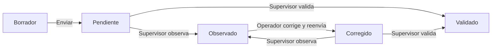
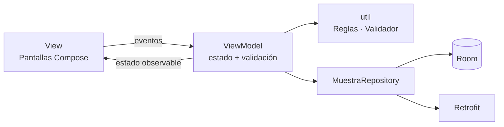

# AquaSample — Registro y trazabilidad de muestras de choritos

Guía paso a paso para construir un MVP Android con **Kotlin + Jetpack Compose + MVVM**, con la menor cantidad de código posible (caso ALDEMAR SpA, asignatura DSY1105).

> ⚠️ **Es un material de apoyo y puede contener errores.** Si lo usas como estudiante o equipo, adáptalo a tus necesidades y mejóralo.
>
> **Cómo usar esta guía:** escribe (no copies a ciegas) cada archivo en el orden indicado. Cada etapa termina con un punto de control que compila. Al final encontrarás una sección con ideas para llevar el proyecto al siguiente nivel.

---

## 1. El problema

ALDEMAR SpA presta servicios a la industria acuícola. En el muestreo de líneas de cultivo de choritos, un operador corta un tramo de cuerda (por ejemplo 20 cm), cuenta los individuos, anota datos, saca fotos y luego pasa todo a planillas para que un supervisor lo revise.

Hoy ese trabajo es manual y disperso: datos, fotos y notas quedan en lugares distintos. Resultado: conteos distintos, registros incompletos y un historial difícil de seguir.

**Objetivo:** una app que permita **registrar una muestra en terreno con su foto, validarla, guardarla sin internet, revisarla como supervisor y consultar el historial**. Todo con datos ficticios.

## 2. Qué hace la app (la solución completa)

1. **Login** con usuarios ficticios de 3 roles (clave `1234`): `OP-01`/`OP-02` (operador), `SUP-01` (supervisor), `AN-01` (analista).
2. **Historial** con búsqueda por texto y filtro por estado. Cada rol ve solo lo suyo: el operador sus muestras, el supervisor las enviadas a revisión, el analista las validadas.
3. **Nueva muestra** (operador): centro, tren, línea, tramo en cm, conteo con botones +1/+10, calibre opcional, observaciones y foto (cámara o galería). Se guarda como **borrador** o se **envía a revisión** (ahí exige conteo > 0 y foto).
4. **Revisión** (supervisor): abre una muestra pendiente y la **valida** u **observa** (comentario obligatorio).
5. **Corrección** (operador): edita una muestra observada y la reenvía; queda "Corregida".
6. **Resumen**: total de muestras, individuos, densidad promedio por metro y estados. Botón para **sincronizar** las validadas con una API de prueba (cargando / éxito / error).
7. **Funciona sin internet**: todo se guarda en el teléfono; solo sincronizar necesita conexión.

Ciclo de vida de una muestra:



## 3. Arquitectura MVVM

Cada capa tiene **una sola responsabilidad**:

| Capa | Carpeta | Qué hace | Qué NO hace |
|---|---|---|---|
| **View** | `ui/` | Dibuja el estado y avisa los eventos (clics, texto). | No decide ni valida nada. |
| **ViewModel** | `viewmodel/` | Guarda el estado de la pantalla, valida y decide. | No conoce Compose ni dibuja. |
| **Model + Repository** | `model/`, `data/` | Datos (Room, Retrofit) y un único punto de acceso: el repositorio. | No conoce la pantalla. |
| **Reglas** | `util/` | Funciones puras (permisos, validaciones) fáciles de probar. | No usan Android. |



Decisiones que mantienen el código corto:

- **El estado de cada ViewModel son propiedades `mutableStateOf`.** La UI las lee y Compose se redibuja solo cuando cambian. Sin `StateFlow`, sin `collectAsState`.
- **Sin inyección de dependencias ni fábricas.** `AquaSampleApp` crea el repositorio una vez; los ViewModel lo toman de ahí.
- **El `id` de la ruta llega solo** al ViewModel mediante `SavedStateHandle` (Navigation Compose lo entrega).
- **Sesión en memoria** (`object Sesion`).
- **Tema por defecto de Material 3** con un solo color propio.

## 4. Estructura del proyecto (25 archivos Kotlin)

```
AquaSample/
├── build.gradle.kts · settings.gradle.kts · gradle/libs.versions.toml
└── app/
    ├── build.gradle.kts
    └── src/
        ├── main/
        │   ├── AndroidManifest.xml
        │   ├── res/ (drawable/ic_launcher.xml · values/strings.xml · values/themes.xml · xml/file_paths.xml)
        │   └── java/cl/duoc/aquasample/
        │       ├── AquaSampleApp.kt          MainActivity.kt
        │       ├── model/      Muestra.kt  Formulario.kt  Usuario.kt
        │       ├── data/       MuestraDao.kt  AppDatabase.kt  SyncApi.kt  MuestraRepository.kt
        │       ├── util/       Reglas.kt  Validador.kt  Fotos.kt
        │       ├── viewmodel/  AuthViewModel.kt  MuestrasViewModel.kt  MuestraFormViewModel.kt
        │       │               DetalleViewModel.kt  ResumenViewModel.kt
        │       ├── ui/         Componentes.kt  LoginScreen.kt  MuestrasScreen.kt
        │       │               MuestraFormScreen.kt  DetalleScreen.kt  ResumenScreen.kt
        │       └── navigation/ AppNavigation.kt
        └── test/java/cl/duoc/aquasample/ReglasTest.kt
```

Herramientas: Android Studio Ladybug o superior, JDK 17, `compileSdk 35`, `minSdk 26`. Tecnologías: Kotlin 2.0.21, Compose (BOM 2024.12.01) + Material 3, Navigation Compose 2.8.5, ViewModel 2.8.7, Room 2.6.1, Retrofit 2.11.0, Coil 2.7.0, JUnit 4.

---

## 5. Desarrollo paso a paso

Haz un commit de Git al terminar cada etapa.

### Etapa 1 — Proyecto base

1. En Android Studio: **New Project → Empty Activity**. Nombre `AquaSample`, paquete `cl.duoc.aquasample`, Minimum SDK 26, lenguaje Kotlin, Build configuration **Kotlin DSL**.
2. Reemplaza el contenido de estos archivos (borra cualquier otro archivo `.kt`, `values/colors.xml` y `ui/theme` que haya generado el asistente).

**`gradle/libs.versions.toml`** — el catálogo de versiones:

```toml
[versions]
agp = "8.7.3"
kotlin = "2.0.21"
ksp = "2.0.21-1.0.28"
coreKtx = "1.15.0"
lifecycle = "2.8.7"
activityCompose = "1.9.3"
composeBom = "2024.12.01"
navigation = "2.8.5"
room = "2.6.1"
retrofit = "2.11.0"
coil = "2.7.0"
junit = "4.13.2"

[libraries]
androidx-core-ktx = { group = "androidx.core", name = "core-ktx", version.ref = "coreKtx" }
androidx-lifecycle-viewmodel-compose = { group = "androidx.lifecycle", name = "lifecycle-viewmodel-compose", version.ref = "lifecycle" }
androidx-activity-compose = { group = "androidx.activity", name = "activity-compose", version.ref = "activityCompose" }
androidx-compose-bom = { group = "androidx.compose", name = "compose-bom", version.ref = "composeBom" }
androidx-ui = { group = "androidx.compose.ui", name = "ui" }
androidx-material3 = { group = "androidx.compose.material3", name = "material3" }
androidx-navigation-compose = { group = "androidx.navigation", name = "navigation-compose", version.ref = "navigation" }
androidx-room-runtime = { group = "androidx.room", name = "room-runtime", version.ref = "room" }
androidx-room-ktx = { group = "androidx.room", name = "room-ktx", version.ref = "room" }
androidx-room-compiler = { group = "androidx.room", name = "room-compiler", version.ref = "room" }
retrofit = { group = "com.squareup.retrofit2", name = "retrofit", version.ref = "retrofit" }
retrofit-gson = { group = "com.squareup.retrofit2", name = "converter-gson", version.ref = "retrofit" }
coil-compose = { group = "io.coil-kt", name = "coil-compose", version.ref = "coil" }
junit = { group = "junit", name = "junit", version.ref = "junit" }

[plugins]
android-application = { id = "com.android.application", version.ref = "agp" }
kotlin-android = { id = "org.jetbrains.kotlin.android", version.ref = "kotlin" }
kotlin-compose = { id = "org.jetbrains.kotlin.plugin.compose", version.ref = "kotlin" }
ksp = { id = "com.google.devtools.ksp", version.ref = "ksp" }
```

**`build.gradle.kts`** (raíz):

```kotlin
plugins {
    alias(libs.plugins.android.application) apply false
    alias(libs.plugins.kotlin.android) apply false
    alias(libs.plugins.kotlin.compose) apply false
    alias(libs.plugins.ksp) apply false
}
```

**`app/build.gradle.kts`**:

```kotlin
plugins {
    alias(libs.plugins.android.application)
    alias(libs.plugins.kotlin.android)
    alias(libs.plugins.kotlin.compose)
    alias(libs.plugins.ksp)
}

android {
    namespace = "cl.duoc.aquasample"
    compileSdk = 35

    defaultConfig {
        applicationId = "cl.duoc.aquasample"
        minSdk = 26
        targetSdk = 35
        versionCode = 1
        versionName = "1.0"
    }

    compileOptions {
        sourceCompatibility = JavaVersion.VERSION_17
        targetCompatibility = JavaVersion.VERSION_17
    }
    kotlinOptions { jvmTarget = "17" }
    buildFeatures { compose = true }
}

dependencies {
    implementation(libs.androidx.core.ktx)
    implementation(libs.androidx.lifecycle.viewmodel.compose)
    implementation(libs.androidx.activity.compose)

    implementation(platform(libs.androidx.compose.bom))
    implementation(libs.androidx.ui)
    implementation(libs.androidx.material3)
    implementation(libs.androidx.navigation.compose)

    implementation(libs.androidx.room.runtime)
    implementation(libs.androidx.room.ktx)
    ksp(libs.androidx.room.compiler)

    implementation(libs.retrofit)
    implementation(libs.retrofit.gson)
    implementation(libs.coil.compose)

    testImplementation(libs.junit)
}
```

**`AndroidManifest.xml`** (`app/src/main/`). Contiene la clase `Application` y el `FileProvider` de la cámara, que activarás en las etapas 3 y 5:

```xml
<?xml version="1.0" encoding="utf-8"?>
<manifest xmlns:android="http://schemas.android.com/apk/res/android">

    <!-- Necesario para la sincronización con la API de prueba (Retrofit) -->
    <uses-permission android:name="android.permission.INTERNET" />

    <!-- La cámara se usa mediante la app de cámara del sistema (intent),
         por eso NO es obligatorio declarar el permiso CAMERA. -->
    <uses-feature android:name="android.hardware.camera" android:required="false" />

    <application
        android:name=".AquaSampleApp"
        android:allowBackup="true"
        android:icon="@drawable/ic_launcher"
        android:label="@string/app_name"
        android:supportsRtl="true"
        android:theme="@style/Theme.AquaSample">

        <activity
            android:name=".MainActivity"
            android:exported="true"
            android:windowSoftInputMode="adjustResize">
            <intent-filter>
                <action android:name="android.intent.action.MAIN" />
                <category android:name="android.intent.category.LAUNCHER" />
            </intent-filter>
        </activity>

        <!-- Permite entregar a la cámara un archivo donde guardar la foto -->
        <provider
            android:name="androidx.core.content.FileProvider"
            android:authorities="${applicationId}.fileprovider"
            android:exported="false"
            android:grantUriPermissions="true">
            <meta-data
                android:name="android.support.FILE_PROVIDER_PATHS"
                android:resource="@xml/file_paths" />
        </provider>
    </application>
</manifest>
```

**`res/values/strings.xml`** y **`res/values/themes.xml`**:

```xml
<resources>
    <string name="app_name">AquaSample</string>
</resources>
```

```xml
<resources>
    <style name="Theme.AquaSample" parent="android:Theme.Material.Light.NoActionBar" />
</resources>
```

**`res/drawable/ic_launcher.xml`** (ícono simple):

```xml
<?xml version="1.0" encoding="utf-8"?>
<!-- Ícono simple: gota de agua blanca sobre fondo azul mar -->
<vector xmlns:android="http://schemas.android.com/apk/res/android"
    android:width="48dp"
    android:height="48dp"
    android:viewportWidth="48"
    android:viewportHeight="48">
    <path
        android:fillColor="#0B4F6C"
        android:pathData="M24,0a24,24 0,1 1,0 48a24,24 0,1 1,0 -48z" />
    <path
        android:fillColor="#FFFFFF"
        android:pathData="M24,9C24,9 14,21 14,28a10,10 0,0 0,20 0C34,21 24,9 24,9z" />
</vector>
```

**`res/xml/file_paths.xml`** (crea la carpeta `xml`; la usará la cámara):

```xml
<?xml version="1.0" encoding="utf-8"?>
<paths>
    <files-path name="fotos" path="fotos/" />
</paths>
```

Reemplaza `MainActivity.kt` por una versión provisional:

```kotlin
class MainActivity : ComponentActivity() {
    override fun onCreate(savedInstanceState: Bundle?) {
        super.onCreate(savedInstanceState)
        setContent { Text("AquaSample") }
    }
}
```

> Para esta etapa, en el manifiesto **comenta** temporalmente `android:name=".AquaSampleApp"` y el bloque `<provider>`; los activarás en las etapas 3 y 5.

✅ **Punto de control:** *Sync Project* sin errores y la app muestra el texto "AquaSample" en el emulador.

### Etapa 2 — Modelo y reglas (sin Android, sin UI)

Aquí vive el "cerebro" del negocio. Son clases y funciones simples.

**`model/Muestra.kt`** — la tabla de Room y los estados:

`model/Muestra.kt`

```kotlin
package cl.duoc.aquasample.model

import androidx.room.Entity
import androidx.room.PrimaryKey

enum class Estado(val etiqueta: String) {
    BORRADOR("Borrador"), PENDIENTE("Pendiente"), OBSERVADO("Observado"),
    CORREGIDO("Corregido"), VALIDADO("Validado")
}

/** Una muestra de choritos: un tramo de cuerda contado por un operador. */
@Entity(tableName = "muestras")
data class Muestra(
    @PrimaryKey(autoGenerate = true) val id: Long = 0,
    val fechaHora: Long,
    val centro: String,
    val tren: String,
    val linea: String,
    val tramoCm: Int,
    val operador: String,
    val conteo: Int,
    val calibreMm: Double? = null,
    val fotoPath: String? = null,
    val observaciones: String = "",
    val estado: Estado = Estado.BORRADOR,
    val comentarioSupervisor: String = "",
    val sincronizada: Boolean = false
)
```

**`model/Formulario.kt`** — lo que escribe el usuario (todo texto, para poder validarlo):

`model/Formulario.kt`

```kotlin
package cl.duoc.aquasample.model

/** Lo que el usuario escribe en el formulario. Todo es texto para poder validarlo antes de convertirlo. */
data class Formulario(
    val id: Long = 0,
    val fechaHora: Long = System.currentTimeMillis(),
    val operador: String = "",
    val centro: String = "",
    val tren: String = "",
    val linea: String = "",
    val tramo: String = "20",
    val conteo: String = "0",
    val calibre: String = "",
    val observaciones: String = "",
    val fotoPath: String? = null,
    val estado: Estado = Estado.BORRADOR,
    val comentarioSupervisor: String = ""
) {
    fun aMuestra(estado: Estado) = Muestra(
        id, fechaHora, centro, tren, linea, tramo.toInt(), operador, conteo.toInt(),
        calibre.replace(',', '.').toDoubleOrNull(), fotoPath, observaciones.trim(),
        estado, comentarioSupervisor
    )

    companion object {
        fun desde(m: Muestra) = Formulario(
            m.id, m.fechaHora, m.operador, m.centro, m.tren, m.linea, m.tramoCm.toString(),
            m.conteo.toString(), m.calibreMm?.toString() ?: "", m.observaciones,
            m.fotoPath, m.estado, m.comentarioSupervisor
        )
    }
}
```

**`model/Usuario.kt`** — roles, usuarios de prueba y catálogos:

`model/Usuario.kt`

```kotlin
package cl.duoc.aquasample.model

enum class Rol(val etiqueta: String) { OPERADOR("Operador"), SUPERVISOR("Supervisor"), ANALISTA("Analista") }

data class Usuario(val codigo: String, val nombre: String, val clave: String, val rol: Rol)

/** Sesión en memoria: quién inició sesión. */
object Sesion { var usuario: Usuario? = null }

/** Datos FICTICIOS para el MVP. No usar datos reales. */
object DatosDemo {
    val usuarios = listOf(
        Usuario("OP-01", "Operador Uno", "1234", Rol.OPERADOR),
        Usuario("OP-02", "Operador Dos", "1234", Rol.OPERADOR),
        Usuario("SUP-01", "Supervisor Uno", "1234", Rol.SUPERVISOR),
        Usuario("AN-01", "Analista Uno", "1234", Rol.ANALISTA)
    )
    val centros = listOf("Centro Bahía Norte", "Centro Isla Sur", "Centro Estero Azul")
    val trenes = (1..4).map { "Tren $it" }
    val lineas = (1..10).map { "Línea $it" }
}
```

**`util/Reglas.kt`** — quién puede hacer qué:

`util/Reglas.kt`

```kotlin
package cl.duoc.aquasample.util

import cl.duoc.aquasample.model.Estado
import cl.duoc.aquasample.model.Muestra
import cl.duoc.aquasample.model.Rol
import cl.duoc.aquasample.model.Usuario

/** Reglas de negocio: quién puede hacer qué y cálculos simples. Sin Android, fácil de probar. */
object Reglas {

    fun puedeEditar(u: Usuario, m: Muestra) =
        u.rol == Rol.OPERADOR && m.operador == u.codigo &&
            m.estado in listOf(Estado.BORRADOR, Estado.OBSERVADO)

    fun puedeEliminar(u: Usuario, m: Muestra) =
        u.rol == Rol.OPERADOR && m.operador == u.codigo && m.estado == Estado.BORRADOR

    fun puedeRevisar(u: Usuario, m: Muestra) =
        u.rol == Rol.SUPERVISOR && m.estado in listOf(Estado.PENDIENTE, Estado.CORREGIDO)

    /** Una muestra observada que se reenvía pasa a CORREGIDO; cualquier otra, a PENDIENTE. */
    fun estadoAlEnviar(actual: Estado) =
        if (actual == Estado.OBSERVADO) Estado.CORREGIDO else Estado.PENDIENTE

    /** Qué registros ve cada rol. */
    fun esVisible(u: Usuario, m: Muestra) = when (u.rol) {
        Rol.OPERADOR -> m.operador == u.codigo
        Rol.SUPERVISOR -> m.estado != Estado.BORRADOR
        Rol.ANALISTA -> m.estado == Estado.VALIDADO
    }

    /** Individuos por metro de cuerda. */
    fun densidad(conteo: Int, tramoCm: Int) = if (tramoCm <= 0) 0.0 else conteo * 100.0 / tramoCm

    fun filtrar(lista: List<Muestra>, texto: String, estado: Estado?): List<Muestra> {
        val t = texto.trim().lowercase()
        return lista.filter { m ->
            (estado == null || m.estado == estado) &&
                (t.isEmpty() || listOf(m.centro, m.tren, m.linea, m.operador).any { it.lowercase().contains(t) })
        }
    }
}
```

**`util/Validador.kt`** — validaciones del formulario:

`util/Validador.kt`

```kotlin
package cl.duoc.aquasample.util

import cl.duoc.aquasample.model.Formulario

object Validador {

    /**
     * Devuelve un mapa campo -> mensaje de error. Mapa vacío = formulario válido.
     * Al enviar a revisión (enviar = true) se exige conteo > 0 y foto; en borrador no.
     */
    fun validar(f: Formulario, enviar: Boolean): Map<String, String> = buildMap {
        if (f.centro.isBlank()) put("centro", "Selecciona el centro")
        if (f.tren.isBlank()) put("tren", "Selecciona el tren")
        if (f.linea.isBlank()) put("linea", "Selecciona la línea")
        if (f.tramo.toIntOrNull() !in 1..200) put("tramo", "El tramo debe estar entre 1 y 200 cm")
        val conteo = f.conteo.toIntOrNull()
        if (conteo == null || conteo !in 0..5000) put("conteo", "El conteo debe estar entre 0 y 5000")
        else if (enviar && conteo == 0) put("conteo", "El conteo debe ser mayor a 0 para enviar")
        if (f.calibre.isNotBlank() && f.calibre.replace(',', '.').toDoubleOrNull().let { it == null || it <= 0 || it > 150 })
            put("calibre", "El calibre debe estar entre 0 y 150 mm")
        if (f.observaciones.length > 300) put("observaciones", "Máximo 300 caracteres")
        if (enviar && f.fotoPath == null) put("foto", "Debes adjuntar una fotografía")
    }

    fun comentarioValido(texto: String) = texto.trim().length >= 5
}
```

✅ **Punto de control:** compila. (Aún no hay nada visible; la prueba de esta etapa llega en la etapa 6.)

### Etapa 3 — Datos: Room, Retrofit y repositorio

**`data/MuestraDao.kt`** — las consultas SQL:

`data/MuestraDao.kt`

```kotlin
package cl.duoc.aquasample.data

import androidx.room.Dao
import androidx.room.Delete
import androidx.room.Query
import androidx.room.Upsert
import cl.duoc.aquasample.model.Muestra
import kotlinx.coroutines.flow.Flow

@Dao
interface MuestraDao {
    @Query("SELECT * FROM muestras ORDER BY fechaHora DESC")
    fun observarTodas(): Flow<List<Muestra>>

    @Query("SELECT * FROM muestras WHERE id = :id")
    fun observar(id: Long): Flow<Muestra?>

    @Query("SELECT * FROM muestras WHERE id = :id")
    suspend fun obtener(id: Long): Muestra?

    @Query("SELECT * FROM muestras WHERE estado = 'VALIDADO' AND sincronizada = 0")
    suspend fun porSincronizar(): List<Muestra>

    /** Inserta si id = 0, actualiza si ya existe. */
    @Upsert
    suspend fun guardar(muestra: Muestra)

    @Delete
    suspend fun eliminar(muestra: Muestra)
}
```

**`data/AppDatabase.kt`**:

`data/AppDatabase.kt`

```kotlin
package cl.duoc.aquasample.data

import androidx.room.Database
import androidx.room.RoomDatabase
import cl.duoc.aquasample.model.Muestra

@Database(entities = [Muestra::class], version = 1, exportSchema = false)
abstract class AppDatabase : RoomDatabase() {
    abstract fun muestraDao(): MuestraDao
}
```

**`data/SyncApi.kt`** — Retrofit hacia una API de prueba:

`data/SyncApi.kt`

```kotlin
package cl.duoc.aquasample.data

import cl.duoc.aquasample.model.Muestra
import retrofit2.Retrofit
import retrofit2.converter.gson.GsonConverterFactory
import retrofit2.http.Body
import retrofit2.http.POST

interface SyncApi {
    // JSONPlaceholder acepta cualquier POST y responde OK: sirve para simular el servidor.
    @POST("posts")
    suspend fun enviar(@Body muestra: Muestra): Any
}

fun crearSyncApi(): SyncApi = Retrofit.Builder()
    .baseUrl("https://jsonplaceholder.typicode.com/")
    .addConverterFactory(GsonConverterFactory.create())
    .build()
    .create(SyncApi::class.java)
```

**`data/MuestraRepository.kt`** — el único punto de acceso a los datos:

`data/MuestraRepository.kt`

```kotlin
package cl.duoc.aquasample.data

import cl.duoc.aquasample.model.Muestra
import java.io.File

/** Único punto de acceso a los datos: Room (local) y Retrofit (remoto). */
class MuestraRepository(private val dao: MuestraDao, private val api: SyncApi) {

    fun todas() = dao.observarTodas()
    fun observar(id: Long) = dao.observar(id)
    suspend fun obtener(id: Long) = dao.obtener(id)
    suspend fun guardar(m: Muestra) = dao.guardar(m)

    suspend fun eliminar(m: Muestra) {
        m.fotoPath?.let { File(it).delete() }
        dao.eliminar(m)
    }

    /** Envía las muestras validadas que faltan. Devuelve cuántas envió. */
    suspend fun sincronizar(): Int {
        val pendientes = dao.porSincronizar()
        pendientes.forEach { api.enviar(it); dao.guardar(it.copy(sincronizada = true)) }
        return pendientes.size
    }
}
```

**`AquaSampleApp.kt`** — crea el repositorio una sola vez:

`AquaSampleApp.kt`

```kotlin
package cl.duoc.aquasample

import android.app.Application
import androidx.room.Room
import cl.duoc.aquasample.data.AppDatabase
import cl.duoc.aquasample.data.MuestraRepository
import cl.duoc.aquasample.data.crearSyncApi

/** Crea una sola vez el repositorio; los ViewModel lo toman de aquí. */
class AquaSampleApp : Application() {
    val repo by lazy {
        val db = Room.databaseBuilder(this, AppDatabase::class.java, "aquasample.db").build()
        MuestraRepository(db.muestraDao(), crearSyncApi())
    }
}
```

Ahora **descomenta** `android:name=".AquaSampleApp"` en el manifiesto.

✅ **Punto de control:** compila y la app abre sin cerrarse.

### Etapa 4 — ViewModels

Cada ViewModel expone su estado con `mutableStateOf(...)` y `private set`: la pantalla puede **leer**, pero solo el ViewModel puede **cambiar**.

**`viewmodel/AuthViewModel.kt`** — login:

`viewmodel/AuthViewModel.kt`

```kotlin
package cl.duoc.aquasample.viewmodel

import androidx.compose.runtime.getValue
import androidx.compose.runtime.mutableStateOf
import androidx.compose.runtime.setValue
import androidx.lifecycle.ViewModel
import cl.duoc.aquasample.model.DatosDemo
import cl.duoc.aquasample.model.Sesion

class AuthViewModel : ViewModel() {
    var codigo by mutableStateOf("")
    var clave by mutableStateOf("")
    var error by mutableStateOf<String?>(null)
        private set

    /** Devuelve true si las credenciales son correctas y deja al usuario en la sesión. */
    fun ingresar(): Boolean {
        val usuario = DatosDemo.usuarios.find { it.codigo == codigo.trim().uppercase() && it.clave == clave }
        Sesion.usuario = usuario
        error = if (usuario == null) "Código o clave incorrectos" else null
        return usuario != null
    }
}
```

**`viewmodel/MuestrasViewModel.kt`** — historial con filtros:

`viewmodel/MuestrasViewModel.kt`

```kotlin
package cl.duoc.aquasample.viewmodel

import android.app.Application
import androidx.compose.runtime.getValue
import androidx.compose.runtime.mutableStateOf
import androidx.compose.runtime.setValue
import androidx.lifecycle.AndroidViewModel
import androidx.lifecycle.viewModelScope
import cl.duoc.aquasample.AquaSampleApp
import cl.duoc.aquasample.model.Estado
import cl.duoc.aquasample.model.Muestra
import cl.duoc.aquasample.model.Sesion
import cl.duoc.aquasample.util.Reglas
import kotlinx.coroutines.launch

/** Historial: las muestras que el usuario puede ver, con búsqueda y filtro por estado. */
class MuestrasViewModel(app: Application) : AndroidViewModel(app) {
    private val usuario = Sesion.usuario!!
    private var visibles by mutableStateOf(emptyList<Muestra>())

    var texto by mutableStateOf("")
    var estado by mutableStateOf<Estado?>(null)

    val muestras get() = Reglas.filtrar(visibles, texto, estado)

    init {
        // Room emite una lista nueva cada vez que cambia la tabla.
        viewModelScope.launch {
            (app as AquaSampleApp).repo.todas().collect { todas ->
                visibles = todas.filter { Reglas.esVisible(usuario, it) }
            }
        }
    }
}
```

**`viewmodel/MuestraFormViewModel.kt`** — crear / editar con validación:

`viewmodel/MuestraFormViewModel.kt`

```kotlin
package cl.duoc.aquasample.viewmodel

import android.app.Application
import androidx.compose.runtime.getValue
import androidx.compose.runtime.mutableStateOf
import androidx.compose.runtime.setValue
import androidx.lifecycle.AndroidViewModel
import androidx.lifecycle.SavedStateHandle
import androidx.lifecycle.viewModelScope
import cl.duoc.aquasample.AquaSampleApp
import cl.duoc.aquasample.model.Formulario
import cl.duoc.aquasample.model.Sesion
import cl.duoc.aquasample.util.Reglas
import cl.duoc.aquasample.util.Validador
import kotlinx.coroutines.launch

/** Formulario de muestra. El argumento "id" de la ruta llega en el SavedStateHandle (0 = nueva). */
class MuestraFormViewModel(app: Application, handle: SavedStateHandle) : AndroidViewModel(app) {
    private val repo = (app as AquaSampleApp).repo

    var f by mutableStateOf(Formulario(operador = Sesion.usuario!!.codigo))
        private set
    var errores by mutableStateOf<Map<String, String>>(emptyMap())
        private set
    var guardado by mutableStateOf(false)
        private set

    init {
        val id = handle.get<Long>("id") ?: 0L
        if (id != 0L) viewModelScope.launch { repo.obtener(id)?.let { f = Formulario.desde(it) } }
    }

    fun editar(nuevo: Formulario) { f = nuevo }

    fun sumarConteo(delta: Int) {
        f = f.copy(conteo = ((f.conteo.toIntOrNull() ?: 0) + delta).coerceIn(0, 5000).toString())
    }

    /** enviar = false guarda borrador; enviar = true exige todos los datos y la foto. */
    fun guardar(enviar: Boolean) {
        errores = Validador.validar(f, enviar)
        if (errores.isNotEmpty()) return
        val estado = if (enviar) Reglas.estadoAlEnviar(f.estado) else f.estado
        viewModelScope.launch {
            repo.guardar(f.aMuestra(estado))
            guardado = true
        }
    }
}
```

**`viewmodel/DetalleViewModel.kt`** — detalle y revisión del supervisor:

`viewmodel/DetalleViewModel.kt`

```kotlin
package cl.duoc.aquasample.viewmodel

import android.app.Application
import androidx.compose.runtime.getValue
import androidx.compose.runtime.mutableStateOf
import androidx.compose.runtime.setValue
import androidx.lifecycle.AndroidViewModel
import androidx.lifecycle.SavedStateHandle
import androidx.lifecycle.viewModelScope
import cl.duoc.aquasample.AquaSampleApp
import cl.duoc.aquasample.model.Estado
import cl.duoc.aquasample.model.Muestra
import cl.duoc.aquasample.util.Validador
import kotlinx.coroutines.launch

/** Detalle de una muestra y acciones de revisión del supervisor. */
class DetalleViewModel(app: Application, handle: SavedStateHandle) : AndroidViewModel(app) {
    private val repo = (app as AquaSampleApp).repo

    var muestra by mutableStateOf<Muestra?>(null)
        private set
    var errorComentario by mutableStateOf(false)
        private set

    init {
        viewModelScope.launch { repo.observar(handle.get<Long>("id")!!).collect { muestra = it } }
    }

    fun validar() = cambiarEstado(Estado.VALIDADO, "")

    /** Devuelve false si el comentario es muy corto. */
    fun observar(comentario: String): Boolean {
        errorComentario = !Validador.comentarioValido(comentario)
        if (!errorComentario) cambiarEstado(Estado.OBSERVADO, comentario.trim())
        return !errorComentario
    }

    private fun cambiarEstado(estado: Estado, comentario: String) {
        val m = muestra ?: return
        viewModelScope.launch { repo.guardar(m.copy(estado = estado, comentarioSupervisor = comentario)) }
    }

    fun eliminar(alTerminar: () -> Unit) {
        val m = muestra ?: return
        viewModelScope.launch { repo.eliminar(m); alTerminar() }
    }
}
```

**`viewmodel/ResumenViewModel.kt`** — indicadores y sincronización:

`viewmodel/ResumenViewModel.kt`

```kotlin
package cl.duoc.aquasample.viewmodel

import android.app.Application
import androidx.compose.runtime.getValue
import androidx.compose.runtime.mutableStateOf
import androidx.compose.runtime.setValue
import androidx.lifecycle.AndroidViewModel
import androidx.lifecycle.viewModelScope
import cl.duoc.aquasample.AquaSampleApp
import cl.duoc.aquasample.model.Muestra
import cl.duoc.aquasample.model.Sesion
import cl.duoc.aquasample.util.Reglas
import kotlinx.coroutines.launch

/** Indicadores y sincronización con la API. */
class ResumenViewModel(app: Application) : AndroidViewModel(app) {
    private val repo = (app as AquaSampleApp).repo
    private val usuario = Sesion.usuario!!

    var lista by mutableStateOf(emptyList<Muestra>())
        private set
    var cargando by mutableStateOf(false)
        private set
    var mensaje by mutableStateOf("")
        private set

    val densidadPromedio get() = lista.map { Reglas.densidad(it.conteo, it.tramoCm) }.average().takeIf { !it.isNaN() } ?: 0.0

    init {
        viewModelScope.launch {
            repo.todas().collect { todas -> lista = todas.filter { Reglas.esVisible(usuario, it) } }
        }
    }

    /** Tres estados para la UI: cargando, éxito o error (mensaje). */
    fun sincronizar() {
        viewModelScope.launch {
            cargando = true
            mensaje = try {
                "Sincronizadas: ${repo.sincronizar()}"
            } catch (e: Exception) {
                "No se pudo sincronizar. Revisa tu conexión."
            }
            cargando = false
        }
    }
}
```

✅ **Punto de control:** compila. Toda la lógica de la app ya existe; solo falta dibujarla.

### Etapa 5 — Interfaz y navegación

Las pantallas solo **leen** el ViewModel y **llaman** sus funciones.

**`util/Fotos.kt`** — archivos de la cámara/galería:

`util/Fotos.kt`

```kotlin
package cl.duoc.aquasample.util

import android.content.Context
import android.net.Uri
import androidx.core.content.FileProvider
import java.io.File

/** Archivos de fotografía en el almacenamiento interno de la app. */
object Fotos {

    fun nuevoArchivo(context: Context): File =
        File(File(context.filesDir, "fotos").apply { mkdirs() }, "muestra_${System.currentTimeMillis()}.jpg")

    /** Uri que la app de cámara usa para escribir la foto en nuestro archivo. */
    fun uriPara(context: Context, archivo: File): Uri =
        FileProvider.getUriForFile(context, "${context.packageName}.fileprovider", archivo)

    /** Copia la imagen elegida en la galería a nuestra carpeta, para no perder el acceso. */
    fun copiarDesdeGaleria(context: Context, uri: Uri): File {
        val destino = nuevoArchivo(context)
        context.contentResolver.openInputStream(uri)!!.use { entrada ->
            destino.outputStream().use { entrada.copyTo(it) }
        }
        return destino
    }
}
```

En el manifiesto **descomenta** el bloque `<provider>` (FileProvider).

**`ui/Componentes.kt`** — piezas reutilizables:

`ui/Componentes.kt`

```kotlin
package cl.duoc.aquasample.ui

import androidx.compose.foundation.clickable
import androidx.compose.foundation.layout.Column
import androidx.compose.foundation.layout.fillMaxWidth
import androidx.compose.foundation.layout.padding
import androidx.compose.material3.Card
import androidx.compose.material3.DropdownMenu
import androidx.compose.material3.DropdownMenuItem
import androidx.compose.material3.MaterialTheme
import androidx.compose.material3.OutlinedButton
import androidx.compose.material3.OutlinedTextField
import androidx.compose.material3.Text
import androidx.compose.runtime.Composable
import androidx.compose.runtime.getValue
import androidx.compose.runtime.mutableStateOf
import androidx.compose.runtime.remember
import androidx.compose.runtime.setValue
import androidx.compose.ui.Modifier
import androidx.compose.ui.text.input.KeyboardType
import androidx.compose.foundation.text.KeyboardOptions
import androidx.compose.ui.unit.dp
import cl.duoc.aquasample.model.Muestra
import cl.duoc.aquasample.util.Reglas
import java.text.SimpleDateFormat
import java.util.Date
import java.util.Locale

fun Long.fecha(): String = SimpleDateFormat("dd/MM/yyyy HH:mm", Locale.getDefault()).format(Date(this))

/** Campo de texto con mensaje de error debajo. */
@Composable
fun Campo(
    etiqueta: String, valor: String, error: String?, modifier: Modifier = Modifier.fillMaxWidth(),
    teclado: KeyboardType = KeyboardType.Text, onChange: (String) -> Unit
) = OutlinedTextField(
    value = valor, onValueChange = onChange, label = { Text(etiqueta) }, isError = error != null,
    supportingText = error?.let { { Text(it) } },
    keyboardOptions = KeyboardOptions(keyboardType = teclado), modifier = modifier
)

/** Lista desplegable para elegir una opción (centro, tren, línea). */
@Composable
fun Selector(etiqueta: String, valor: String, opciones: List<String>, error: String?, onElegir: (String) -> Unit) {
    var abierto by remember { mutableStateOf(false) }
    Column {
        OutlinedButton(onClick = { abierto = true }, modifier = Modifier.fillMaxWidth()) {
            Text(valor.ifEmpty { etiqueta })
        }
        DropdownMenu(expanded = abierto, onDismissRequest = { abierto = false }) {
            opciones.forEach { DropdownMenuItem(text = { Text(it) }, onClick = { onElegir(it); abierto = false }) }
        }
        error?.let { Text(it, color = MaterialTheme.colorScheme.error, style = MaterialTheme.typography.bodySmall) }
    }
}

/** Tarjeta de una muestra en el historial. */
@Composable
fun TarjetaMuestra(m: Muestra, onClick: () -> Unit) {
    Card(Modifier.fillMaxWidth().clickable(onClick = onClick)) {
        Column(Modifier.padding(12.dp)) {
            Text("${m.centro} · ${m.tren} · ${m.linea}", style = MaterialTheme.typography.titleSmall)
            Text("${m.fechaHora.fecha()} · ${m.operador}")
            Text("Conteo ${m.conteo} (${"%.1f".format(Locale.US, Reglas.densidad(m.conteo, m.tramoCm))} ind/m) · ${m.estado.etiqueta}")
        }
    }
}
```

**`ui/LoginScreen.kt`**:

`ui/LoginScreen.kt`

```kotlin
package cl.duoc.aquasample.ui

import androidx.compose.foundation.layout.Arrangement
import androidx.compose.foundation.layout.Column
import androidx.compose.foundation.layout.fillMaxSize
import androidx.compose.foundation.layout.fillMaxWidth
import androidx.compose.foundation.layout.padding
import androidx.compose.material3.Button
import androidx.compose.material3.MaterialTheme
import androidx.compose.material3.OutlinedTextField
import androidx.compose.material3.Text
import androidx.compose.runtime.Composable
import androidx.compose.ui.Modifier
import androidx.compose.ui.unit.dp
import androidx.compose.ui.text.input.PasswordVisualTransformation
import androidx.compose.ui.text.input.KeyboardType
import androidx.compose.foundation.text.KeyboardOptions
import androidx.compose.foundation.layout.systemBarsPadding
import androidx.lifecycle.viewmodel.compose.viewModel
import cl.duoc.aquasample.viewmodel.AuthViewModel

@Composable
fun LoginScreen(onIngreso: () -> Unit, vm: AuthViewModel = viewModel()) {
    Column(
        Modifier.fillMaxSize().systemBarsPadding().padding(24.dp),
        verticalArrangement = Arrangement.spacedBy(12.dp, androidx.compose.ui.Alignment.CenterVertically)
    ) {
        Text("AquaSample", style = MaterialTheme.typography.headlineMedium)
        Campo("Código (ej. OP-01)", vm.codigo, null) { vm.codigo = it }
        OutlinedTextField(
            value = vm.clave, onValueChange = { vm.clave = it }, label = { Text("Clave") },
            visualTransformation = PasswordVisualTransformation(),
            keyboardOptions = KeyboardOptions(keyboardType = KeyboardType.Password),
            modifier = Modifier.fillMaxWidth()
        )
        vm.error?.let { Text(it, color = MaterialTheme.colorScheme.error) }
        Button(onClick = { if (vm.ingresar()) onIngreso() }, modifier = Modifier.fillMaxWidth()) { Text("Ingresar") }
        Text("Prueba: OP-01, OP-02, SUP-01 o AN-01 con clave 1234")
    }
}
```

**`ui/MuestrasScreen.kt`**:

`ui/MuestrasScreen.kt`

```kotlin
package cl.duoc.aquasample.ui

import androidx.compose.foundation.layout.Arrangement
import androidx.compose.foundation.layout.Column
import androidx.compose.foundation.layout.Row
import androidx.compose.foundation.layout.fillMaxWidth
import androidx.compose.foundation.layout.padding
import androidx.compose.foundation.lazy.LazyColumn
import androidx.compose.foundation.lazy.LazyRow
import androidx.compose.foundation.lazy.items
import androidx.compose.material3.ExtendedFloatingActionButton
import androidx.compose.material3.FilterChip
import androidx.compose.material3.MaterialTheme
import androidx.compose.material3.OutlinedTextField
import androidx.compose.material3.Scaffold
import androidx.compose.material3.Text
import androidx.compose.material3.TextButton
import androidx.compose.runtime.Composable
import androidx.compose.ui.Modifier
import androidx.compose.ui.unit.dp
import androidx.lifecycle.viewmodel.compose.viewModel
import cl.duoc.aquasample.model.Estado
import cl.duoc.aquasample.model.Rol
import cl.duoc.aquasample.model.Sesion
import cl.duoc.aquasample.viewmodel.MuestrasViewModel

@Composable
fun MuestrasScreen(
    onNueva: () -> Unit, onDetalle: (Long) -> Unit, onResumen: () -> Unit, onSalir: () -> Unit,
    vm: MuestrasViewModel = viewModel()
) {
    val usuario = Sesion.usuario!!
    Scaffold(floatingActionButton = {
        if (usuario.rol == Rol.OPERADOR) ExtendedFloatingActionButton(onClick = onNueva) { Text("Nueva muestra") }
    }) { padding ->
        Column(Modifier.padding(padding).padding(horizontal = 16.dp), verticalArrangement = Arrangement.spacedBy(8.dp)) {
            Row(Modifier.fillMaxWidth(), horizontalArrangement = Arrangement.SpaceBetween) {
                Text("${usuario.nombre} (${usuario.rol.etiqueta})", style = MaterialTheme.typography.titleMedium)
                Row {
                    TextButton(onClick = onResumen) { Text("Resumen") }
                    TextButton(onClick = onSalir) { Text("Salir") }
                }
            }
            OutlinedTextField(
                value = vm.texto, onValueChange = { vm.texto = it }, label = { Text("Buscar centro, tren, línea u operador") },
                modifier = Modifier.fillMaxWidth()
            )
            LazyRow(horizontalArrangement = Arrangement.spacedBy(8.dp)) {
                item { FilterChip(vm.estado == null, { vm.estado = null }, { Text("Todos") }) }
                items(Estado.entries) { e -> FilterChip(vm.estado == e, { vm.estado = e }, { Text(e.etiqueta) }) }
            }
            if (vm.muestras.isEmpty()) Text("No hay muestras para mostrar.")
            LazyColumn(verticalArrangement = Arrangement.spacedBy(8.dp)) {
                items(vm.muestras, key = { it.id }) { m -> TarjetaMuestra(m) { onDetalle(m.id) } }
            }
        }
    }
}
```

**`ui/MuestraFormScreen.kt`** — incluye cámara y galería:

`ui/MuestraFormScreen.kt`

```kotlin
package cl.duoc.aquasample.ui

import androidx.activity.compose.rememberLauncherForActivityResult
import androidx.activity.result.PickVisualMediaRequest
import androidx.activity.result.contract.ActivityResultContracts
import androidx.compose.foundation.layout.Arrangement
import androidx.compose.foundation.layout.Column
import androidx.compose.foundation.layout.Row
import androidx.compose.foundation.layout.fillMaxWidth
import androidx.compose.foundation.layout.height
import androidx.compose.foundation.layout.padding
import androidx.compose.foundation.layout.systemBarsPadding
import androidx.compose.foundation.rememberScrollState
import androidx.compose.foundation.verticalScroll
import androidx.compose.material3.Button
import androidx.compose.material3.MaterialTheme
import androidx.compose.material3.OutlinedButton
import androidx.compose.material3.Text
import androidx.compose.runtime.Composable
import androidx.compose.runtime.LaunchedEffect
import androidx.compose.runtime.getValue
import androidx.compose.runtime.mutableStateOf
import androidx.compose.runtime.saveable.rememberSaveable
import androidx.compose.runtime.setValue
import androidx.compose.ui.Modifier
import androidx.compose.ui.layout.ContentScale
import androidx.compose.ui.platform.LocalContext
import androidx.compose.ui.text.input.KeyboardType
import androidx.compose.ui.unit.dp
import androidx.lifecycle.viewmodel.compose.viewModel
import cl.duoc.aquasample.model.DatosDemo
import cl.duoc.aquasample.model.Estado
import cl.duoc.aquasample.util.Fotos
import cl.duoc.aquasample.viewmodel.MuestraFormViewModel
import coil.compose.AsyncImage
import java.io.File

@Composable
fun MuestraFormScreen(onVolver: () -> Unit, vm: MuestraFormViewModel = viewModel()) {
    val f = vm.f
    val e = vm.errores
    val context = LocalContext.current

    LaunchedEffect(vm.guardado) { if (vm.guardado) onVolver() }

    // Cámara: la app de cámara escribe en un archivo nuestro. Galería: copiamos la imagen elegida.
    var pendiente by rememberSaveable { mutableStateOf<String?>(null) }
    val camara = rememberLauncherForActivityResult(ActivityResultContracts.TakePicture()) { ok ->
        if (ok) vm.editar(f.copy(fotoPath = pendiente))
    }
    val galeria = rememberLauncherForActivityResult(ActivityResultContracts.PickVisualMedia()) { uri ->
        if (uri != null) vm.editar(f.copy(fotoPath = Fotos.copiarDesdeGaleria(context, uri).absolutePath))
    }

    Column(
        Modifier.systemBarsPadding().verticalScroll(rememberScrollState()).padding(16.dp),
        verticalArrangement = Arrangement.spacedBy(8.dp)
    ) {
        Text(if (f.id == 0L) "Nueva muestra" else "Editar muestra", style = MaterialTheme.typography.titleLarge)
        if (f.estado == Estado.OBSERVADO) Text("Observación del supervisor: ${f.comentarioSupervisor}", color = MaterialTheme.colorScheme.error)

        Selector("Centro", f.centro, DatosDemo.centros, e["centro"]) { vm.editar(f.copy(centro = it)) }
        Selector("Tren", f.tren, DatosDemo.trenes, e["tren"]) { vm.editar(f.copy(tren = it)) }
        Selector("Línea", f.linea, DatosDemo.lineas, e["linea"]) { vm.editar(f.copy(linea = it)) }
        Campo("Tramo (cm)", f.tramo, e["tramo"], teclado = KeyboardType.Number) { vm.editar(f.copy(tramo = it)) }
        Campo("Conteo de individuos", f.conteo, e["conteo"], teclado = KeyboardType.Number) { vm.editar(f.copy(conteo = it)) }
        Row(horizontalArrangement = Arrangement.spacedBy(8.dp)) {
            OutlinedButton(onClick = { vm.sumarConteo(1) }) { Text("+1") }
            OutlinedButton(onClick = { vm.sumarConteo(10) }) { Text("+10") }
        }
        Campo("Calibre mm (opcional)", f.calibre, e["calibre"], teclado = KeyboardType.Decimal) { vm.editar(f.copy(calibre = it)) }
        Campo("Observaciones", f.observaciones, e["observaciones"]) { vm.editar(f.copy(observaciones = it)) }

        Row(horizontalArrangement = Arrangement.spacedBy(8.dp)) {
            OutlinedButton(onClick = {
                val archivo = Fotos.nuevoArchivo(context)
                pendiente = archivo.absolutePath
                camara.launch(Fotos.uriPara(context, archivo))
            }) { Text("Cámara") }
            OutlinedButton(onClick = {
                galeria.launch(PickVisualMediaRequest(ActivityResultContracts.PickVisualMedia.ImageOnly))
            }) { Text("Galería") }
        }
        f.fotoPath?.let { AsyncImage(File(it), "Foto de la muestra", Modifier.fillMaxWidth().height(200.dp), contentScale = ContentScale.Crop) }
        e["foto"]?.let { Text(it, color = MaterialTheme.colorScheme.error) }

        Button(onClick = { vm.guardar(enviar = true) }, modifier = Modifier.fillMaxWidth()) { Text("Enviar a revisión") }
        OutlinedButton(onClick = { vm.guardar(enviar = false) }, modifier = Modifier.fillMaxWidth()) { Text("Guardar borrador") }
        OutlinedButton(onClick = onVolver, modifier = Modifier.fillMaxWidth()) { Text("Cancelar") }
    }
}
```

**`ui/DetalleScreen.kt`**:

`ui/DetalleScreen.kt`

```kotlin
package cl.duoc.aquasample.ui

import androidx.compose.foundation.layout.Arrangement
import androidx.compose.foundation.layout.Column
import androidx.compose.foundation.layout.Row
import androidx.compose.foundation.layout.fillMaxWidth
import androidx.compose.foundation.layout.height
import androidx.compose.foundation.layout.padding
import androidx.compose.foundation.layout.systemBarsPadding
import androidx.compose.foundation.rememberScrollState
import androidx.compose.foundation.verticalScroll
import androidx.compose.material3.Button
import androidx.compose.material3.MaterialTheme
import androidx.compose.material3.OutlinedButton
import androidx.compose.material3.Text
import androidx.compose.runtime.Composable
import androidx.compose.runtime.getValue
import androidx.compose.runtime.mutableStateOf
import androidx.compose.runtime.remember
import androidx.compose.runtime.setValue
import androidx.compose.ui.Modifier
import androidx.compose.ui.layout.ContentScale
import androidx.compose.ui.unit.dp
import androidx.lifecycle.viewmodel.compose.viewModel
import cl.duoc.aquasample.model.Sesion
import cl.duoc.aquasample.util.Reglas
import cl.duoc.aquasample.viewmodel.DetalleViewModel
import coil.compose.AsyncImage
import java.io.File
import java.util.Locale

@Composable
fun DetalleScreen(onVolver: () -> Unit, onEditar: (Long) -> Unit, vm: DetalleViewModel = viewModel()) {
    val m = vm.muestra
    val usuario = Sesion.usuario!!
    var comentario by remember { mutableStateOf("") }

    Column(
        Modifier.systemBarsPadding().verticalScroll(rememberScrollState()).padding(16.dp),
        verticalArrangement = Arrangement.spacedBy(8.dp)
    ) {
        OutlinedButton(onClick = onVolver) { Text("Volver") }
        if (m == null) { Text("Cargando..."); return }

        Text("Muestra #${m.id} · ${m.estado.etiqueta}", style = MaterialTheme.typography.titleLarge)
        Text("${m.centro} · ${m.tren} · ${m.linea}")
        Text("${m.fechaHora.fecha()} · operador ${m.operador}")
        Text("Tramo ${m.tramoCm} cm · Conteo ${m.conteo} · Densidad ${"%.1f".format(Locale.US, Reglas.densidad(m.conteo, m.tramoCm))} ind/m")
        m.calibreMm?.let { Text("Calibre $it mm") }
        if (m.observaciones.isNotBlank()) Text("Observaciones: ${m.observaciones}")
        if (m.comentarioSupervisor.isNotBlank()) Text("Supervisor: ${m.comentarioSupervisor}", color = MaterialTheme.colorScheme.error)
        m.fotoPath?.let { AsyncImage(File(it), "Foto de la muestra", Modifier.fillMaxWidth().height(220.dp), contentScale = ContentScale.Crop) }

        Row(horizontalArrangement = Arrangement.spacedBy(8.dp)) {
            if (Reglas.puedeEditar(usuario, m)) Button(onClick = { onEditar(m.id) }) { Text("Editar") }
            if (Reglas.puedeEliminar(usuario, m)) OutlinedButton(onClick = { vm.eliminar(onVolver) }) { Text("Eliminar") }
        }

        if (Reglas.puedeRevisar(usuario, m)) {
            Campo("Comentario (obligatorio para observar)", comentario, if (vm.errorComentario) "Explica la observación (mínimo 5 caracteres)" else null) { comentario = it }
            Row(horizontalArrangement = Arrangement.spacedBy(8.dp)) {
                Button(onClick = { vm.validar() }) { Text("Validar") }
                OutlinedButton(onClick = { vm.observar(comentario) }) { Text("Observar") }
            }
        }
    }
}
```

**`ui/ResumenScreen.kt`**:

`ui/ResumenScreen.kt`

```kotlin
package cl.duoc.aquasample.ui

import androidx.compose.foundation.layout.Arrangement
import androidx.compose.foundation.layout.Column
import androidx.compose.foundation.layout.padding
import androidx.compose.foundation.layout.systemBarsPadding
import androidx.compose.material3.Button
import androidx.compose.material3.CircularProgressIndicator
import androidx.compose.material3.MaterialTheme
import androidx.compose.material3.OutlinedButton
import androidx.compose.material3.Text
import androidx.compose.runtime.Composable
import androidx.compose.ui.Modifier
import androidx.compose.ui.unit.dp
import androidx.lifecycle.viewmodel.compose.viewModel
import cl.duoc.aquasample.model.Estado
import cl.duoc.aquasample.viewmodel.ResumenViewModel
import java.util.Locale

@Composable
fun ResumenScreen(onVolver: () -> Unit, vm: ResumenViewModel = viewModel()) {
    val lista = vm.lista
    Column(Modifier.systemBarsPadding().padding(16.dp), verticalArrangement = Arrangement.spacedBy(8.dp)) {
        OutlinedButton(onClick = onVolver) { Text("Volver") }
        Text("Resumen", style = MaterialTheme.typography.titleLarge)
        Text("Muestras: ${lista.size}")
        Text("Individuos contados: ${lista.sumOf { it.conteo }}")
        Text("Densidad promedio: ${"%.1f".format(Locale.US, vm.densidadPromedio)} ind/m")
        Estado.entries.forEach { e -> Text("${e.etiqueta}: ${lista.count { it.estado == e }}") }

        val porSincronizar = lista.count { it.estado == Estado.VALIDADO && !it.sincronizada }
        Text("Validadas por sincronizar: $porSincronizar")
        Button(onClick = { vm.sincronizar() }, enabled = !vm.cargando && porSincronizar > 0) { Text("Sincronizar") }
        if (vm.cargando) CircularProgressIndicator()
        if (vm.mensaje.isNotEmpty()) Text(vm.mensaje)
    }
}
```

**`navigation/AppNavigation.kt`** — las 5 rutas:

`navigation/AppNavigation.kt`

```kotlin
package cl.duoc.aquasample.navigation

import androidx.compose.runtime.Composable
import androidx.navigation.NavType
import androidx.navigation.compose.NavHost
import androidx.navigation.compose.composable
import androidx.navigation.compose.rememberNavController
import androidx.navigation.navArgument
import cl.duoc.aquasample.model.Sesion
import cl.duoc.aquasample.ui.DetalleScreen
import cl.duoc.aquasample.ui.LoginScreen
import cl.duoc.aquasample.ui.MuestraFormScreen
import cl.duoc.aquasample.ui.MuestrasScreen
import cl.duoc.aquasample.ui.ResumenScreen

/** Rutas: form/0 = nueva muestra; form/5 = editar la muestra 5. */
@Composable
fun AppNavigation() {
    val nav = rememberNavController()
    val argId = listOf(navArgument("id") { type = NavType.LongType })

    NavHost(nav, startDestination = "login") {
        composable("login") {
            LoginScreen(onIngreso = { nav.navigate("muestras") { popUpTo("login") { inclusive = true } } })
        }
        composable("muestras") {
            MuestrasScreen(
                onNueva = { nav.navigate("form/0") },
                onDetalle = { nav.navigate("detalle/$it") },
                onResumen = { nav.navigate("resumen") },
                onSalir = { Sesion.usuario = null; nav.navigate("login") { popUpTo(0) } }
            )
        }
        composable("form/{id}", argId) { MuestraFormScreen(onVolver = { nav.popBackStack() }) }
        composable("detalle/{id}", argId) {
            DetalleScreen(onVolver = { nav.popBackStack() }, onEditar = { nav.navigate("form/$it") })
        }
        composable("resumen") { ResumenScreen(onVolver = { nav.popBackStack() }) }
    }
}
```

**`MainActivity.kt`** — versión definitiva:

`MainActivity.kt`

```kotlin
package cl.duoc.aquasample

import android.os.Bundle
import androidx.activity.ComponentActivity
import androidx.activity.compose.setContent
import androidx.activity.enableEdgeToEdge
import androidx.compose.material3.MaterialTheme
import androidx.compose.material3.lightColorScheme
import androidx.compose.ui.graphics.Color
import cl.duoc.aquasample.navigation.AppNavigation

class MainActivity : ComponentActivity() {
    override fun onCreate(savedInstanceState: Bundle?) {
        super.onCreate(savedInstanceState)
        enableEdgeToEdge()
        setContent {
            MaterialTheme(colorScheme = lightColorScheme(primary = Color(0xFF0B4F6C))) {
                AppNavigation()
            }
        }
    }
}
```

✅ **Punto de control (la app completa):** inicia sesión como `OP-01` / `1234`, crea una muestra con foto, envíala. Sal, entra como `SUP-01`, observa la muestra con un comentario. Vuelve como `OP-01`, corrígela y reenvía. Entra como `SUP-01` y valídala. Entra como `AN-01` (la ve) y en **Resumen** sincroniza.

### Etapa 6 — Pruebas y APK

**`test/.../ReglasTest.kt`** — como `Reglas` y `Validador` no usan Android, se prueban en milisegundos:

```kotlin
package cl.duoc.aquasample

import cl.duoc.aquasample.model.Estado
import cl.duoc.aquasample.model.Formulario
import cl.duoc.aquasample.model.Muestra
import cl.duoc.aquasample.model.Rol
import cl.duoc.aquasample.model.Usuario
import cl.duoc.aquasample.util.Reglas
import cl.duoc.aquasample.util.Validador
import org.junit.Assert.assertEquals
import org.junit.Assert.assertFalse
import org.junit.Assert.assertTrue
import org.junit.Test

class ReglasTest {
    private val op = Usuario("OP-01", "Op", "1234", Rol.OPERADOR)
    private val sup = Usuario("SUP-01", "Sup", "1234", Rol.SUPERVISOR)
    private fun muestra(estado: Estado) =
        Muestra(fechaHora = 0, centro = "C", tren = "T", linea = "L", tramoCm = 20, operador = "OP-01", conteo = 10, estado = estado)

    @Test fun densidad() = assertEquals(50.0, Reglas.densidad(10, 20), 0.001)

    @Test fun observadaSeReenviaComoCorregida() {
        assertEquals(Estado.CORREGIDO, Reglas.estadoAlEnviar(Estado.OBSERVADO))
        assertEquals(Estado.PENDIENTE, Reglas.estadoAlEnviar(Estado.BORRADOR))
    }

    @Test fun permisosPorRolYEstado() {
        assertTrue(Reglas.puedeEditar(op, muestra(Estado.BORRADOR)))
        assertFalse(Reglas.puedeEditar(op, muestra(Estado.VALIDADO)))
        assertTrue(Reglas.puedeRevisar(sup, muestra(Estado.PENDIENTE)))
        assertFalse(Reglas.puedeRevisar(op, muestra(Estado.PENDIENTE)))
    }

    @Test fun formularioVacioNoSeEnvia() {
        val errores = Validador.validar(Formulario(), enviar = true)
        assertTrue(errores.keys.containsAll(listOf("centro", "tren", "linea", "conteo", "foto")))
    }

    @Test fun borradorNoExigeConteoNiFoto() {
        val f = Formulario(centro = "C", tren = "T", linea = "L")
        assertTrue(Validador.validar(f, enviar = false).isEmpty())
    }
}
```

Ejecuta: clic derecho sobre el archivo → **Run 'ReglasTest'** (o `./gradlew test`). Deben pasar las 5 pruebas.

**APK:**
- *Debug:* `./gradlew assembleDebug` → `app/build/outputs/apk/debug/app-debug.apk`.
- *Release firmado:* menú **Build → Generate Signed App Bundle / APK → APK**, crea un keystore nuevo y elige `release`. **Nunca subas el keystore ni sus claves a Git.**

---

## 6. Escenarios de prueba manual

| # | Acción | Resultado esperado |
|---|---|---|
| 1 | Login con clave incorrecta | Mensaje "Código o clave incorrectos" |
| 2 | Operador: enviar con conteo 0 | Error en el conteo |
| 3 | Operador: enviar sin foto | Error "Debes adjuntar una fotografía" |
| 4 | Operador: guardar borrador sin conteo ni foto | Se guarda como Borrador |
| 5 | Supervisor: observar sin comentario | Error de comentario (mínimo 5 caracteres) |
| 6 | Operador corrige una observada y reenvía | Estado "Corregido" |
| 7 | Analista | Solo ve muestras validadas |
| 8 | Modo avión + crear muestra | Funciona (Room) |
| 9 | Modo avión + sincronizar | Mensaje de error de conexión |

## 7. Qué hace cada archivo

### Capa de arranque

**`AquaSampleApp.kt`** — Es la clase `Application`, el primer código que Android ejecuta al abrir la app. Crea una sola vez la base de datos Room y la API de Retrofit, y con ellas arma el `MuestraRepository`, que expone como `repo`. Gracias a `by lazy` se construye solo cuando alguien lo necesita por primera vez, y todos los ViewModel lo comparten. Reemplaza a una librería de inyección de dependencias con tres líneas.

**`MainActivity.kt`** — Es la única `Activity` de la app y el punto donde Compose toma el control de la pantalla. Activa el modo de borde a borde, define el tema Material 3 con el azul de la marca como color primario y muestra `AppNavigation`, que decide qué pantalla se ve. No contiene lógica ni diseño propio.

### model — los datos

**`model/Muestra.kt`** — Define el dato central del negocio: una muestra de choritos con su fecha, ubicación (centro, tren, línea), tramo de cuerda, conteo, calibre opcional, foto, observaciones, estado y comentario del supervisor. Está anotada con `@Entity`, por lo que Room la convierte directamente en la tabla `muestras`. En el mismo archivo está el enum `Estado` (borrador, pendiente, observado, corregido, validado), que modela el flujo de revisión.

**`model/Formulario.kt`** — Representa lo que el usuario está escribiendo en el formulario. Todos sus campos numéricos son texto, porque mientras se escribe puede haber valores vacíos o inválidos que primero hay que validar. Sabe convertirse en una `Muestra` (`aMuestra`) cuando todo está correcto y crearse a partir de una existente (`desde`) para editarla. Así el ViewModel del formulario no repite conversiones.

**`model/Usuario.kt`** — Agrupa todo lo relativo a quién usa la app y a los datos de prueba. Contiene los tres roles (operador, supervisor, analista), la clase `Usuario`, el objeto `Sesion` que recuerda en memoria quién inició sesión, y `DatosDemo` con los usuarios ficticios y los catálogos de centros, trenes y líneas. Es el lugar a reemplazar cuando se conecte un login y catálogos reales.

### data — acceso a datos

**`data/MuestraDao.kt`** — Es la interfaz que describe las consultas a la base de datos. Permite observar todas las muestras o una sola como `Flow` (la pantalla se actualiza sola cuando cambian los datos), obtener una por id, listar las validadas que faltan por sincronizar, guardar y eliminar. `@Upsert` inserta si la muestra es nueva y actualiza si ya existe, lo que evita escribir dos funciones. Room genera el código SQL a partir de estas anotaciones.

**`data/AppDatabase.kt`** — Declara la base de datos Room: indica qué tablas tiene (solo `Muestra`), su versión y expone el DAO. Es una clase abstracta de cuatro líneas porque Room escribe la implementación. Si más adelante se agregan tablas o campos, aquí se sube la versión y se registran las migraciones.

**`data/SyncApi.kt`** — Define con Retrofit cómo se habla con el servidor: un único `POST` que envía una muestra. Apunta a JSONPlaceholder, un servicio público de pruebas que acepta cualquier envío, así se simula la sincronización sin montar un backend. La función `crearSyncApi` arma el cliente con el conversor Gson, que transforma la muestra a JSON. Para usar un servidor propio basta cambiar la URL base.

**`data/MuestraRepository.kt`** — Es el único punto por donde los ViewModel obtienen y guardan datos, y esconde si vienen de Room o de la API. Reenvía las lecturas y escrituras al DAO, borra el archivo de la foto cuando se elimina una muestra y ofrece `sincronizar`, que envía cada muestra validada pendiente y la marca como sincronizada. Si el envío falla lanza una excepción que el ViewModel convierte en mensaje de error.

### util — reglas puras

**`util/Reglas.kt`** — Concentra las reglas de negocio como funciones puras, sin Android: quién puede editar, eliminar o revisar una muestra según su rol y estado, qué muestras ve cada rol, a qué estado pasa una muestra al enviarse, la densidad de individuos por metro y el filtro por texto y estado. Al estar separado de la interfaz, cada regla se prueba con JUnit y se cambia en un solo lugar.

**`util/Validador.kt`** — Valida el formulario completo y devuelve un mapa de campo a mensaje de error; si el mapa está vacío, el formulario es válido. Distingue borrador de envío: el borrador solo exige centro, tren, línea y números razonables, mientras que enviar a revisión exige además conteo mayor a 0 y foto. También valida que el comentario del supervisor tenga al menos cinco caracteres.

**`util/Fotos.kt`** — Administra los archivos de las fotografías en el almacenamiento interno de la app. Crea archivos nuevos con nombre único, entrega a la cámara una `Uri` segura mediante el `FileProvider` para que escriba la foto, y copia a la carpeta propia la imagen elegida en la galería para no perder acceso a ella. Es el único archivo que toca la API de archivos de Android.

### viewmodel — estado y lógica de cada pantalla

**`viewmodel/AuthViewModel.kt`** — Controla la pantalla de login. Guarda el código y la clave que se escriben y el mensaje de error, y `ingresar()` busca al usuario entre los de demostración. Si lo encuentra lo deja en `Sesion` y devuelve `true` para que la pantalla navegue; si no, muestra "Código o clave incorrectos". El código se normaliza a mayúsculas para que `op-01` también funcione.

**`viewmodel/MuestrasViewModel.kt`** — Prepara el historial. Escucha a Room y conserva solo las muestras que el rol del usuario puede ver; luego expone `muestras` como el resultado de aplicar el texto de búsqueda y el filtro de estado. Como esas propiedades son estado de Compose, la lista se recalcula y redibuja sola al escribir o cambiar de filtro, sin código adicional.

**`viewmodel/MuestraFormViewModel.kt`** — Maneja el formulario de crear y editar. Lee el `id` de la ruta (0 significa nueva) y, si corresponde, carga la muestra. Expone el formulario actual, los errores por campo y la señal `guardado`. `guardar(enviar)` valida con `Validador`; si hay errores los publica, y si no calcula el estado (borrador o el que corresponda al enviar) y guarda mediante el repositorio. También suma +1 o +10 al conteo.

**`viewmodel/DetalleViewModel.kt`** — Maneja el detalle de una muestra y las acciones del supervisor. Observa la muestra en Room, de modo que la pantalla refleja al instante cualquier cambio de estado. `validar()` la marca como validada, `observar()` la devuelve al operador con un comentario obligatorio y `eliminar()` la borra y avisa cuando terminó para que la pantalla vuelva atrás.

**`viewmodel/ResumenViewModel.kt`** — Alimenta la pantalla de indicadores y la sincronización. Mantiene la lista de muestras visibles para el usuario, calcula la densidad promedio y expone `cargando` y `mensaje`, los tres estados que muestra la pantalla (cargando, éxito o error). `sincronizar()` llama al repositorio dentro de una corrutina y captura cualquier excepción para mostrar un mensaje amigable en lugar de cerrar la app.

### ui — pantallas (View)

**`ui/Componentes.kt`** — Reúne las piezas visuales que se repiten en varias pantallas: `Campo` (texto con mensaje de error), `Selector` (lista desplegable para centro, tren y línea), `TarjetaMuestra` (cada ítem del historial) y la función `fecha()` que formatea una fecha. Centralizarlas evita copiar el mismo código en cada pantalla y da un aspecto uniforme.

**`ui/LoginScreen.kt`** — Dibuja la pantalla de inicio de sesión: título, campos de código y clave (oculta), mensaje de error y botón Ingresar, más una pista con los usuarios de prueba. No valida nada por sí misma: le pide todo a `AuthViewModel` y, si el ingreso es correcto, avisa con `onIngreso` para que la navegación avance.

**`ui/MuestrasScreen.kt`** — Es la pantalla principal tras el login. Muestra quién inició sesión, atajos a Resumen y Salir, un buscador, chips para filtrar por estado y la lista de tarjetas. Solo el operador ve el botón flotante "Nueva muestra". Toda la lista viene del ViewModel; la pantalla se limita a dibujarla y a avisar qué tarjeta se tocó.

**`ui/MuestraFormScreen.kt`** — Dibuja el formulario de la muestra con selectores, campos numéricos, botones +1/+10, observaciones y la fotografía. Registra los dos lanzadores del sistema: la cámara, que escribe en un archivo propio, y la galería, cuya imagen se copia a la app. Muestra los errores que entrega el ViewModel junto a cada campo y ofrece enviar a revisión, guardar borrador o cancelar. Si la muestra está observada, muestra el comentario del supervisor.

**`ui/DetalleScreen.kt`** — Muestra todos los datos de una muestra, su foto y el comentario del supervisor. Según el rol y el estado, usando `Reglas`, muestra los botones adecuados: Editar y Eliminar para el operador dueño, y Validar u Observar (con un campo de comentario) para el supervisor. No contiene reglas propias; solo consulta si cada acción está permitida.

**`ui/ResumenScreen.kt`** — Presenta los indicadores del usuario: cantidad de muestras, individuos contados, densidad promedio, conteo por estado y validadas por sincronizar. El botón Sincronizar se desactiva mientras carga o si no hay nada pendiente, y la pantalla muestra un indicador de progreso y el mensaje de éxito o error que le entrega el ViewModel.

### navigation

**`navigation/AppNavigation.kt`** — Define el mapa de la app con Navigation Compose: cinco rutas (`login`, `muestras`, `form/{id}`, `detalle/{id}` y `resumen`) y conecta cada pantalla con las demás mediante funciones lambda, de modo que las pantallas no conocen la navegación. Al ingresar elimina el login de la pila para que "atrás" no vuelva a él, y al salir limpia la sesión y toda la pila. El `id` de las rutas viaja al ViewModel de forma automática.

### test

**`ReglasTest.kt`** — Contiene cinco pruebas unitarias de JUnit sobre `Reglas` y `Validador`: la densidad, el paso de observada a corregida, los permisos por rol y estado, que un formulario vacío no se pueda enviar y que un borrador no exija conteo ni foto. Corren en milisegundos y sin emulador porque la lógica no depende de Android.

## 8. Límites de este MVP

Es un prototipo académico, a propósito simple:

- Los usuarios y claves están en el código (datos ficticios). No es un login seguro.
- La sesión vive en memoria: si el sistema cierra la app en segundo plano, hay que iniciar sesión otra vez.
- La sincronización envía a una API de prueba que no guarda nada de verdad; la foto no se sube, solo se envía su ruta local.
- Los catálogos (centros, trenes, líneas) son listas fijas.

## 9. Llevarlo al siguiente nivel

Cada punto parte de algo que hoy está simplificado. Elige uno por vez y haz un commit por cada avance.

| Nivel | Qué hacer | Qué aprenderás |
|---|---|---|
| **Estado** | Cambia `mutableStateOf` por `StateFlow` + una `data class UiState` por pantalla; recoge con `collectAsStateWithLifecycle()`. | El patrón estándar de la industria; estado inmutable. |
| **Dependencias** | Reemplaza `AquaSampleApp.repo` por **Hilt** (`@HiltViewModel`, `@Inject`). Crea `interface MuestraRepository` para poder falsearla en pruebas. | Inyección de dependencias, código testeable. |
| **Seguridad** | Backend propio (Spring Boot) con login real y token **JWT**; guarda la sesión con **DataStore** y las claves con hash. | Autenticación, sesión persistente. |
| **Sincronización** | Usa **WorkManager** para sincronizar en segundo plano y reintentar si falla; sube la foto de verdad (`multipart`). Marca con estados `PENDIENTE_SYNC / ERROR`. | Offline-first, trabajo en segundo plano. |
| **Datos** | Lleva centros, trenes y líneas a tablas Room (con migraciones) o a la API; agrega fotos múltiples por muestra y ubicación GPS. | Relaciones en Room, migraciones, permisos. |
| **Reportes** | Pantalla del analista con gráficos y exportación a CSV/PDF. | Compose Canvas, archivos compartibles. |
| **Calidad** | Pruebas de ViewModel con `kotlinx-coroutines-test` y de UI con `compose-ui-test`; análisis con ktlint/detekt; CI con GitHub Actions. | Pruebas automáticas y calidad continua. |
| **Interfaz** | `TopAppBar`, `NavigationBar`, tema propio con modo oscuro, textos en `strings.xml`, accesibilidad. | Material 3 completo. |
| **Producción** | Activa R8 (`isMinifyEnabled = true`), publica un AAB firmado, agrega un `.gitignore` para el keystore. | Preparar una app para distribución. |

**Desafío del equipo:** elijan **dos** filas de la tabla, diseñen su cambio en un diagrama y expliquen en la presentación qué simplificación del MVP resolvieron y qué decisión de arquitectura tomaron.
