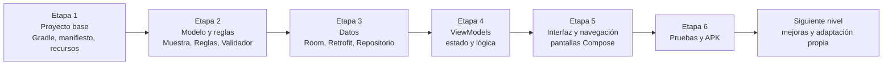

# AquaSample

Guía de apoyo para el desarrollo de una app Android de **registro y trazabilidad de muestras de choritos** (caso ALDEMAR SpA, asignatura DSY1105), con **Kotlin, Jetpack Compose y arquitectura MVVM**, usando la menor cantidad de código posible.

La app permite a un operador registrar una muestra con foto (sin internet), a un supervisor validarla u observarla, y a un analista consultar el historial y sincronizar con una API de prueba.

> ⚠️ **Aviso importante**
>
> Este material es **solo un apoyo** para el desarrollo de la aplicación, no una solución final ni oficial. **La guía puede contener errores** (de código, de versiones de librerías o de explicación).
>
> Si un estudiante o equipo la utiliza, debe **revisarla, adaptarla a sus propias necesidades y mejorarla**: entender cada parte, corregir lo que no funcione y ampliar la solución. La sección final de la guía propone ideas para hacerlo.

## Contenido

- **[GUIA_PROYECTO.md](GUIA_PROYECTO.md)**: la guía completa. Incluye el problema, la arquitectura, el código de los 25 archivos en 6 etapas con puntos de control, una explicación de cada archivo y una sección final de ideas para llevar el proyecto al siguiente nivel.

El proyecto de Android Studio no está en este repositorio: lo construyes tú siguiendo la guía.

## Etapas del proyecto

Cada etapa termina con un punto de control que compila; se recomienda hacer un commit al terminar cada una.

| Etapa | Qué construyes | Punto de control |
|---|---|---|
| 1 | Proyecto base y configuración | La app abre y muestra un texto |
| 2 | Modelos, reglas de negocio y validaciones | Compila |
| 3 | Room, Retrofit y repositorio | Compila y la app abre |
| 4 | Un ViewModel por pantalla | Compila; la lógica ya existe |
| 5 | Pantallas, componentes y navegación | La app completa funciona |
| 6 | Pruebas unitarias y APK | Pruebas en verde y APK generado |

## Cómo empezar

1. Instala Android Studio (Ladybug o superior) y JDK 17.
2. Abre [GUIA_PROYECTO.md](GUIA_PROYECTO.md) y sigue las etapas en orden.
3. Usuarios de prueba (clave `1234`): `OP-01`, `OP-02` (operador), `SUP-01` (supervisor), `AN-01` (analista).

## Tecnologías

Kotlin 2.0 · Jetpack Compose + Material 3 · Navigation Compose · ViewModel · Room · Retrofit · Coil · JUnit
